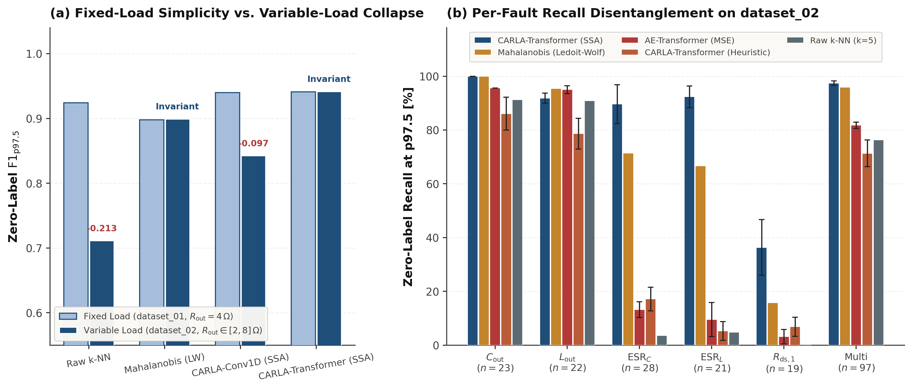
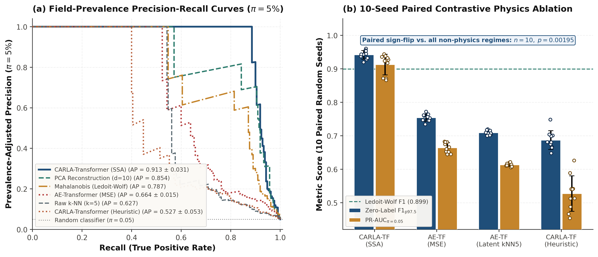
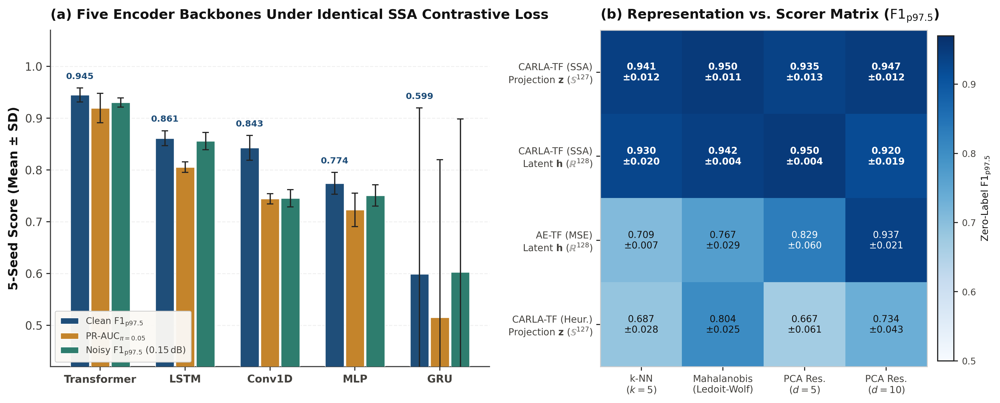
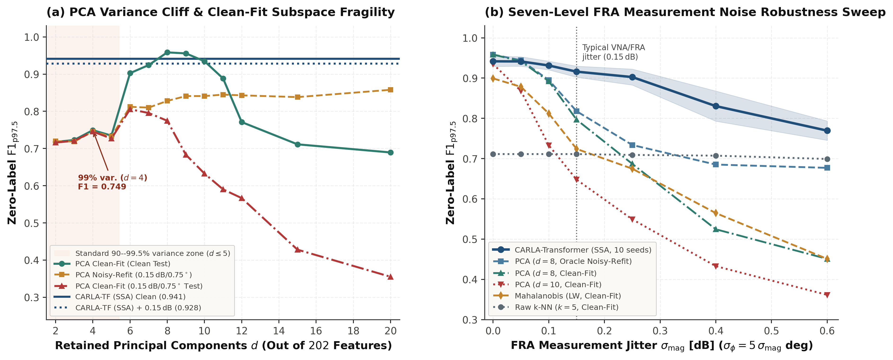
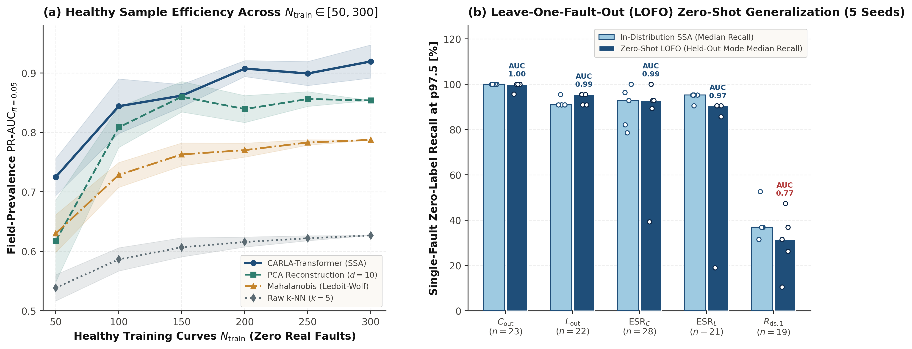
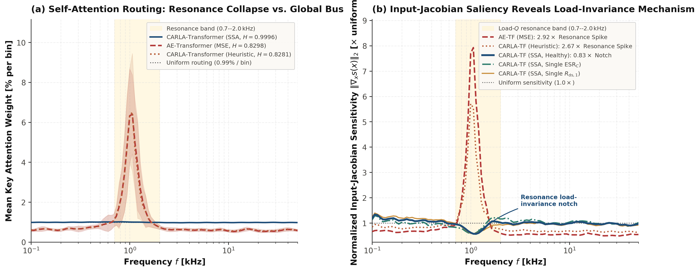

# Disentangling Component Degradation from Operating-Load Variations in Power-Converter Frequency Responses via Physics-Informed Contrastive Self-Attention

**Ignacio Martin-Salinas\*, Jose A. Belloch, Adrián Amor-Martín, Pablo Zumel, and Cristina Fernandez**  
*Department of Electronic Technology, Universidad Carlos III de Madrid, Av. de la Universidad 30, 28911 Leganés, Madrid, Spain*

---

## Abstract

Broadband small-signal Frequency-Response Analysis (FRA) acquired via digital control loops offers a non-invasive diagnostic window into passive and semiconductor aging in switched-mode DC-DC converters. However, deploying FRA anomaly detectors outside fixed-load laboratory conditions exposes a severe physical confound: legitimate variations in operating load resistance ($R_{\mathrm{out}}$) directly modulate the $LC$ parallel damping term $1/(R_{\mathrm{out}} C_{\mathrm{out}})$, inducing benign resonance-peak swings of nearly $9\,\text{dB}$ that overshadow the subtle milliohm signatures of capacitor and inductor equivalent series resistance ($\mathrm{ESR}_C$, $\mathrm{ESR}_L$) and MOSFET on-resistance ($R_{\mathrm{ds},1}$) degradation. On a $4\times$ variable-load switched Altair PSIM benchmark ($R_{\mathrm{out}} \in [2, 8]\,\Omega$) calibrated strictly without anomalous validation labels (`p97.5` healthy quantile), raw $k$-nearest-neighbor ($k$-NN), One-Class SVM, and standard reconstruction autoencoders collapse to $\mathrm{F1} \in [0.6892, 0.7540]$, missing $86.8\%\text{--}96.4\%$ of isolated $\mathrm{ESR}_C$ and $\mathrm{ESR}_L$ faults, whereas domain-agnostic contrastive time-series corruptions degrade performance further ($\mathrm{F1} = 0.6868$). Furthermore, while linear Principal Component Analysis (PCA) residual scoring peaks in a narrow oracle subspace window under noiseless conditions, zero-label cumulative-variance rules fail ($\mathrm{F1} \le 0.7493$) and realistic FRA instrument jitter ($0.15\text{--}0.60\,\text{dB}$, $0.75^\circ\text{--}3.00^\circ$) collapses PCA to $\mathrm{F1} \in [0.4509, 0.7967]$. We address both failure modes through a physics-informed Contrastive Autoencoder with a Multi-Head Self-Attention backbone (`CARLA-Transformer`). During training on healthy variable-load sweeps alone, counterfactual hard negatives are synthesized without online load sensors by multiplying measured complex spectra by exact parasitic-drop State-Space Averaged (SSA) transfer-function ratios $\tilde{H}(j\omega)/H^{(0)}(j\omega)$ evaluated at nominal load ($0.0952\%$ median $L_2$ discrepancy against switched PSIM). Across 10 paired random seeds, `CARLA-Transformer` achieves zero-label $\mathrm{F1} = 0.9417 \pm 0.0128$, prevalence-adjusted $\text{PR-AUC}_{\pi=0.05} = 0.9126 \pm 0.0308$, and $\text{ROC-AUC} = 0.9740 \pm 0.0064$, recovering $89.6\%$ $\mathrm{ESR}_C$ and $92.4\%$ $\mathrm{ESR}_L$ single-fault recall, outperforming Conv1D, LSTM, GRU, and MLP encoders, retaining $\mathrm{F1} = 0.9284$ under $0.15\,\text{dB}$ FRA noise, and generalizing to unseen fault families under strict Leave-One-Fault-Out evaluation.

---

## Research Highlights

- Variable operating load ($2\text{--}8\,\Omega$) induces $\sim 9\,\text{dB}$ $LC$ damping swings that mask resistive converter faults.
- Exact parasitic-drop SSA models match switched PSIM AC sweeps to $0.0952\%$ median $L_2$ error across $800$ operating points.
- Nominal-load SSA complex transfer ratios synthesize counterfactual faults without requiring online load-current sensors.
- Global self-attention (`CARLA-Transformer`) reaches zero-label $\mathrm{F1} = 0.9417$ and $89.6\%\text{--}92.4\%$ ESR single-fault recall.
- `CARLA-Transformer` avoids PCA's unobservable subspace cliff and retains $\mathrm{F1} = 0.9284$ under $0.15\,\text{dB}$ FRA instrument noise.

---

## 1. Introduction

Switched-mode DC-DC power converters underpin electrified transportation, aerospace power distribution, renewable microgrids, and telecom infrastructure, where unexpected converter outages carry severe safety and economic penalties [@wang2014capacitors; @liu2023review]. Whereas catastrophic open- or short-circuit switch failures trigger immediate hardware protection, reliability field data indicate that converter wear-out is dominated by gradual parametric drift across electrolytic or film output capacitors ($C_{\mathrm{out}}$ loss and $\mathrm{ESR}_C$ growth due to electrolyte vaporization or metallized-film self-healing) [@wang2014capacitors; @zhao2021capacitors; @dang2020capacitors], power inductors ($L_{\mathrm{out}}$ permeability roll-off and winding/core loss $\mathrm{ESR}_L$ elevation) [@erickson2001fundamentals], and power MOSFETs ($R_{\mathrm{ds(on)}}$ upward drift under bond-wire fatigue and solder-layer delamination) [@celaya2011mosfet; @dusmez2016sfra]. Modern digital pulse-width modulation (DPWM) controllers enable online, non-invasive broadband Frequency-Response Analysis (FRA) by superimposing low-amplitude pseudo-random binary sequences (PRBS) or multi-sine perturbations onto the duty-cycle command and computing the small-signal control-to-output transfer function $G_{vd}(j\omega)$ from existing output-voltage feedback [@dusmez2016sfra; @sihvo2020prbs; @roinila2021frequency].

Despite the physical richness of broadband FRA signatures, translating measured spectra into reliable, label-free anomaly decisions faces a fundamental **operating-point confound**. Most data-driven converter fault-diagnosis studies implicitly evaluate spectra at a fixed nominal load resistance $R_{\mathrm{out}}^{(0)}$ [@kou2023faultdiagnosis; @jsc_edge_deployment]. Under fixed load, healthy manufacturing tolerances trace a tight, low-dimensional cluster in frequency space where simple distance metrics or local convolutional encoders separate healthy and degraded plants with high accuracy. In field operation, however, a regulated DC-DC converter routinely experiences wide, legitimate load swings—for example, a $4\times$ load-resistance variation $R_{\mathrm{out}} \in [2.0, 8.0]\,\Omega$ ($2.5\text{--}10\,\text{A}$ load current at $20\,\text{V}$ output). In a second-order power stage, the parallel load damping term $1/(R_{\mathrm{out}} C_{\mathrm{out}})$ directly governs the resonant quality factor $Q$: sweeping $R_{\mathrm{out}}$ from $2\,\Omega$ to $8\,\Omega$ produces an $\approx 8.9\,\text{dB}$ magnitude excursion and sharp phase-slope rotation around the $LC$ corner frequency ($f_0 \approx 1.13\,\text{kHz}$), whereas an incipient $+100\%$ increase in capacitor $\mathrm{ESR}_C$ ($20 \to 40\,\text{m}\Omega$) or inductor $\mathrm{ESR}_L$ ($100 \to 200\,\text{m}\Omega$) perturbs the spectrum by only fractions of a decibel within localized frequency bands.

Consequently, standard unsupervised and self-supervised anomaly detectors break down when trained solely on healthy variable-load FRA measurements under strict **zero-anomaly-label** calibration (where decision thresholds must be fixed from healthy validation quantiles alone, without access to labeled fault examples [@kim2021towards]):

1. **Variance domination in distance and reconstruction models:** Euclidean $k$-NN [@cover1967knn], One-Class Support Vector Machines (OC-SVM) [@scholkopf2001estimating], and Mean-Squared-Error (MSE) autoencoders allocate capacity and anomaly sensitivity to the high-variance resonant load manifold, yielding near-zero sensitivity ($3.6\%\text{--}13.2\%$ recall) on isolated resistive ($\mathrm{ESR}_C$, $\mathrm{ESR}_L$, $R_{\mathrm{ds},1}$) degradation.
2. **Manifold mismatch of generic contrastive heuristics:** Self-supervised contrastive anomaly detection frameworks such as CARLA [@darban2025carla] rely on synthetic negative perturbations (random point drops, Gaussian noise, frequency warping, amplitude scaling) originally designed for generic time series. On smooth rational transfer functions, these heuristics push decision boundaries away from non-physical high-frequency artifacts while leaving physically structured parametric drifts embedded inside the healthy load manifold.
3. **Subspace-selection cliff and noise fragility of linear residual detectors:** Linear PCA residual control ($Q$-statistic / Squared Prediction Error) [@jackson1979control] can isolate small off-manifold deviations in noiseless simulated spectra *if* an oracle reveals the exact number of latent components ($d \in \{8, 9\}$, capturing $>99.98\%$ cumulative variance). Yet standard zero-label variance heuristics ($95\%\text{--}99\%$, $d \in \{3, 4\}$) fail ($\mathrm{F1} \le 0.7493$), and realistic FRA amplitude/phase measurement jitter ($0.15\text{--}0.60\,\text{dB}$, $0.75^\circ\text{--}3.00^\circ$) contaminates the tiny trailing singular values, collapsing PCA precision and F1.

To overcome these three limitations without adding load-current sensors or requiring faulty hardware data, we introduce a **physics-informed Contrastive Autoencoder with Multi-Head Self-Attention (`CARLA-Transformer`, Figure 1)**. Rather than attempting to estimate the unknown online load resistance, we exploit the multiplicative structure of linear time-invariant small-signal transfer functions: during self-supervised training, each measured healthy variable-load spectrum $H_i(j\omega)$ is multiplied in the complex plane by an analytic State-Space Averaged (SSA) transfer-function ratio $\Gamma_{\phi,\alpha}(j\omega) = \tilde{H}_{\phi,\alpha}(j\omega) / H^{(0)}(j\omega)$ evaluated at the fixed nominal design load $R_{\mathrm{out}}^{(0)}$. Paired with a global Multi-Head Self-Attention encoder [@vaswani2017attention], the network attends simultaneously across low-frequency ohmic gain ($100\text{--}400\,\text{Hz}$), load-confounded $LC$ resonance ($0.7\text{--}2\,\text{kHz}$), and high-frequency capacitive ESR asymptotes ($8\text{--}50\,\text{kHz}$), disentangling load-induced damping shifts from true component degradation. Whereas our companion embedded-systems study [@jsc_edge_deployment] investigates TensorRT quantization and edge-inference latency of fixed-load convolutional detectors on resource-constrained microcontrollers/GPUs, the present work addresses the upstream physical and machine-learning problem of **operating-load invariance, encoder inductive bias, zero-label calibration, and mechanistic attribution**.

The primary contributions of this paper are fivefold:

1. **Exact Parasitic-Drop SSA Formulation and Observability Characterization:** We derive the small-signal control-to-output transfer function $G_{vd}(s)$ of a switched synchronous Buck stage incorporating inductor, capacitor, and switch conduction drops alongside dead-time body-diode clamping, reducing median relative $L_2$ discrepancy against $800$ variable-load switched Altair PSIM 2026 AC sweeps from $14.87\%$ (fixed-load model) and $4.03\%$ (lossless textbook SSA) to **$0.0952\%$**, while establishing closed-form observability limits for $R_{\mathrm{ds},1}$ and $R_{\mathrm{ds},2}$ from output-voltage FRA alone.
2. **Sensorless Nominal-Load Physics-Ratio Contrastive Synthesis:** We formulate a complex-plane counterfactual negative generator that applies exact SSA transfer-function ratios at nominal load directly to measured variable-load spectra, requiring **zero online load measurement** and **zero real fault training samples**.
3. **Systematic Inductive-Bias and Zero-Label Benchmark:** Across 10 paired random seeds under strict zero-anomaly-label calibration (`p97.5` healthy validation quantile) and realistic field-prevalence Precision-Recall metrics ($\pi = 5\%$), we demonstrate that `CARLA-Transformer` ($\mathrm{F1} = 0.9417 \pm 0.0128$, $\text{PR-AUC}_{\pi=0.05} = 0.9126 \pm 0.0308$) decisively outperforms MSE autoencoders ($\mathrm{F1} = 0.7540$), heuristic CARLA ($\mathrm{F1} = 0.6868$), classical one-class baselines, and alternative sequence/local backbones (`LSTM`, `Conv1D`, `MLP`, `GRU`).
4. **Resolution of the Linear Subspace Cliff under FRA Instrument Noise:** Through controlled representation-versus-scorer experiments and a parametric FRA measurement-noise sweep ($0.00\text{--}0.60\,\text{dB}$ / $0.00^\circ\text{--}3.00^\circ$), we prove why linear PCA residual detectors suffer an unobservable hyperparameter cliff and catastrophic noise degradation, whereas `CARLA-Transformer` maintains $\mathrm{F1} = 0.9284$ at $0.15\,\text{dB}$ instrument noise (`0.9160` on independent multi-level sweeps, $+11.9$ to $+26.8$ F1 points over PCA).
5. **Leave-One-Fault-Out Generalization and Mechanistic Saliency Attribution:** Using a 5-mode strict Leave-One-Fault-Out (LOFO) protocol and input-Jacobian sensitivity analysis [@jain2019attention; @sundararajan2017axiomatic], we verify zero-shot detection of unseen physical fault modes ($\text{ROC-AUC} = 0.9470\text{--}0.9989$ across passive modes) and show that `CARLA-Transformer` learns a physical *resonance load-invariance notch* ($0.78\times\text{--}0.83\times$ suppressed sensitivity at $0.7\text{--}2\,\text{kHz}$) coupled with targeted DC/high-frequency diagnostic sensitivity.

The remainder of this article is organized as follows. Section 2 reviews related work in converter FRA diagnostics and self-supervised anomaly detection. Section 3 formulates the variable-load physical plant, exact SSA equations, PSIM fidelity audit, and semiconductor observability bounds. Section 4 details the `CARLA-Transformer` architecture, physics-ratio negative synthesis, and zero-label inference protocol. Section 5 specifies the experimental design and statistical metrics. Section 6 presents the empirical results, ablations, noise-robustness sweeps, LOFO generalization, and mechanistic attributions. Section 7 discusses practical deployment guidelines and physical limitations, and Section 8 concludes the study.

*Figure 1. End-to-end overview of the proposed sensorless physics-informed `CARLA-Transformer` diagnostic framework across three stages: (Stage I) online digital PRBS / AC-sweep FRA acquisition on a variable-load synchronous Buck converter ($R_{\mathrm{out}} \in [2, 8]\,\Omega$) without load-current sensors; (Stage II, training only) anchor-preserving counterfactual negative synthesis via exact parasitic-drop SSA complex transfer-function ratios $\Gamma_{\boldsymbol{\alpha}}(j\omega)$ evaluated at nominal load $R_{\mathrm{out}}^{(0)} = 4\,\Omega$, followed by smooth Cartesian $(\operatorname{Re}, \operatorname{Im})$ projection and healthy-only standardization; and (Stage III) 2-block Multi-Head Self-Attention encoding onto $\mathbb{S}^{127}$ with strict zero-anomaly-label `p97.5` $k$-NN inference.*

---

## 2. Related Work

### 2.1 Broadband FRA and Parametric Health Monitoring in Power Converters

Condition monitoring of power electronic converters has traditionally bifurcated into component-dedicated invasive circuitry and system-level terminal diagnostics [@wang2014capacitors; @zhao2021capacitors; @dang2020capacitors]. For output capacitors, dedicated ripple-based or current-injection estimators track $\mathrm{ESR}_C$ and $C_{\mathrm{out}}$ across aging cycles [@wang2014capacitors; @zhao2021capacitors], whereas power MOSFET prognostics typically rely on in-situ $V_{\mathrm{ds(on)}}$ clamping circuits or junction-temperature observers to monitor $R_{\mathrm{ds(on)}}$ growth [@celaya2011mosfet; @liu2023review]. Software Frequency-Response Analysis (SFRA), pioneered for power stages by Dusmez et al. [@dusmez2016sfra] and generalized via PRBS/multi-sine digital excitation by Roinila and co-workers [@sihvo2020prbs; @roinila2021frequency], unifies passive and active monitoring by measuring small-signal transfer functions directly through the existing microcontroller ADC and PWM peripherals without extra analog sensors.

Recent studies have paired converter waveforms or spectral features with deep neural networks, including wavelet-compressed feedforward classifiers [@kou2023faultdiagnosis], explainable autoencoder monitors [@beattie2022robust], and self-commissioning edge anomaly detectors [@gomez2024selfcommissioning]. Nevertheless, supervised approaches [@kou2023faultdiagnosis] presuppose labeled faulty trajectories across all failure modes and operating loads—an unrealistic requirement in high-reliability converters—while existing unsupervised commissioning methods [@beattie2022robust; @gomez2024selfcommissioning] remain vulnerable when wide operating-point variations induce larger spectral shifts than incipient milliohm parasitics.

### 2.2 Unsupervised, Contrastive, and Physics-Informed Anomaly Detection

Classical one-class anomaly detection relies on density, boundary, or linear-subspace estimation over healthy training data, exemplified by $k$-NN distance [@cover1967knn], OC-SVM [@scholkopf2001estimating], Isolation Forest [@liu2008isolation], shrinkage-regularized Mahalanobis distance [@ledoit2004wellconditioned], and PCA residual $Q$-statistics [@jackson1979control]. Deep one-class and reconstruction counterparts—including Deep SVDD [@ruff2018deepsvdd], Variational Autoencoders (VAE) [@kingma2013autoencoding], 1D Convolutional Autoencoders [@kiranyaz2019survey], and recurrent LSTM/GRU sequence autoencoders [@hochreiter1997lstm; @cho2014gru]—learn nonlinear manifolds but frequently suffer from reconstruction shortcuts or variance domination when nuisance operating variables account for the majority of input energy.

Self-supervised contrastive learning based on InfoNCE / NT-Xent objectives [@oord2018representation; @chen2020simclr] has substantially advanced anomaly detection by explicitly shaping embedding geometry via distributionally shifted negative instances, as in CSI [@tack2020csi], PANDA [@reiss2021panda], dual-attention DCdetector [@yang2023dcdetector], and CARLA [@darban2025carla]. However, as demonstrated in Section 6.2, applying CARLA's generic time-series corruptions to frequency-domain transfer functions fails under variable load because random spectral spikes and warps violate Kramers-Kronig / rational-pole smoothness, leaving subtle physical pole-zero shifts unseparated. Integrating physical laws into deep learning—commonly formulated via PDE residuals in Physics-Informed Neural Networks (PINNs) [@raissi2019pinn]—offers a principled alternative: here, rather than imposing soft differential penalties at test time, we embed exact small-signal circuit physics directly into the contrastive negative-sampling operator during representation learning.

### 2.3 Evaluation Rigor in Imbalanced Anomaly Detection

Recent critical audits of anomaly-detection benchmarks [@kim2021towards] highlight two pervasive methodological flaws: (i) calibrating decision thresholds by maximizing F1 on validation splits containing labeled ground-truth anomalies, which leaks fault-distribution knowledge into supposedly unsupervised detectors, and (ii) reporting ROC-AUC or test-set PR-AUC on artificially fault-heavy test splits ($50\%\text{--}70\%$ anomalous), which masks false-positive inflation under realistic low fault prevalence ($\pi \le 5\%$) [@fawcett2006roc; @davis2006relationship; @saito2015precision]. Throughout this study, all primary claims enforce a strict **zero-anomaly-label** threshold calibration (`p97.5` quantile of healthy validation scores) alongside Bayes prevalence-adjusted Precision-Recall area ($\text{PR-AUC}_{\pi=0.05}$).

---

## 3. Problem Formulation, Exact SSA Physics, and Converter Observability

### 3.1 Switched Synchronous Buck Stage and Variable-Load Confound

We consider a synchronous step-down (Buck) DC-DC power stage operating in Continuous Conduction Mode (CCM), specified in Table 1 and simulated in Altair PSIM 2026 using full switched-circuit periodic steady-state and small-signal AC-sweep solvers (`SW_Mosfet` elements driven by complementary $100\,\text{kHz}$ PWM gating with explicit $100\,\text{ns}$ dead-time transitions). The nominal converter converts $V_{\mathrm{in}} = 50\,\text{V}$ at duty ratio $D = 0.40$ ($V_{\mathrm{out}} \approx 20\,\text{V}$) through an output filter $L_{\mathrm{out}}^{(0)} = 200\,\mu\text{H}$ ($\mathrm{ESR}_L^{(0)} = 100\,\text{m}\Omega$) and $C_{\mathrm{out}}^{(0)} = 100\,\mu\text{F}$ ($\mathrm{ESR}_C^{(0)} = 20\,\text{m}\Omega$), with nominal high-side and synchronous-rectifier MOSFET on-resistances $R_{\mathrm{ds},1}^{(0)} = R_{\mathrm{ds},2}^{(0)} = 10\,\text{m}\Omega$ and nominal load $R_{\mathrm{out}}^{(0)} = 4.0\,\Omega$.

**Table 1. Nominal electrical parameters, healthy manufacturing tolerance bands, degraded fault intervals, and variable operating-load range of the switched synchronous Buck converter benchmark (`dataset_02`).**

| Parameter | Symbol | Nominal Value | Healthy Tolerance Band | Degraded Fault Band(s) | Physical Role / Aging Mechanism |
| :--- | :---: | :---: | :---: | :---: | :--- |
| Input voltage | $V_{\mathrm{in}}$ | $50.0\,\mathrm{V}$ | Fixed | — | Regulated DC bus |
| Duty cycle / Switching freq. | $D,\, f_s$ | $0.40,\, 100\,\mathrm{kHz}$ | Fixed ($t_{\mathrm{dead}} = 100\,\mathrm{ns}$) | — | Complementary PWM excitation |
| Output capacitance | $C_{\mathrm{out}}$ | $100\,\mu\mathrm{F}$ | $\pm 7.5\%$ ($[92.5, 107.5]\,\mu\mathrm{F}$) | $[-45\%, -15\%] \cup [+15\%, +45\%]$ | Dielectric loss / film capacitance drift |
| Capacitor ESR | $\mathrm{ESR}_C$ | $20\,\mathrm{m}\Omega$ | $\pm 20\%$ ($[16.0, 24.0]\,\mathrm{m}\Omega$) | $[+50\%, +200\%]$ ($[30, 60]\,\mathrm{m}\Omega$) | Electrolyte dry-out / contact aging |
| Filter inductance | $L_{\mathrm{out}}$ | $200\,\mu\mathrm{H}$ | $\pm 7.5\%$ ($[185.0, 215.0]\,\mu\mathrm{H}$) | $[-45\%, -15\%] \cup [+15\%, +45\%]$ | Core permeability drift / partial saturation |
| Inductor ESR | $\mathrm{ESR}_L$ | $100\,\mathrm{m}\Omega$ | $\pm 27.5\%$ ($[72.5, 127.5]\,\mathrm{m}\Omega$) | $[+50\%, +200\%]$ ($[150, 300]\,\mathrm{m}\Omega$) | Winding/solder contact degradation |
| High-side MOSFET $R_{\mathrm{ds(on)}}$ | $R_{\mathrm{ds},1}$ | $10\,\mathrm{m}\Omega$ | $\pm 27.5\%$ ($[7.25, 12.75]\,\mathrm{m}\Omega$) | $[+80\%, +560\%]$ ($[18, 66]\,\mathrm{m}\Omega$) | Bond-wire lift / thermal die fatigue |
| Sync-rectifier MOSFET $R_{\mathrm{ds(on)}}$ | $R_{\mathrm{ds},2}$ | $10\,\mathrm{m}\Omega$ | Clamped in PSIM | Unobservable via $V_{\mathrm{out}}$ FRA | Clamped by antiparallel body diode (Sec. 3.3) |
| **Operating load resistance** | $R_{\mathrm{out}}$ | $4.0\,\Omega$ | **$[-50\%, +100\%]$ ($[2.0, 8.0]\,\Omega$)** | **$[-50\%, +100\%]$ ($[2.0, 8.0]\,\Omega$)** | **Legitimate $4\times$ load variation ($2.5\text{--}10\,\mathrm{A}$)** |

At nominal parameters, the undamped $LC$ resonant frequency and capacitor ESR zero lie at:

$$
f_0 = \frac{1}{2\pi\sqrt{L_{\mathrm{out}}^{(0)} C_{\mathrm{out}}^{(0)}}} \approx 1.125\,\text{kHz}, \qquad f_z = \frac{1}{2\pi C_{\mathrm{out}}^{(0)} \mathrm{ESR}_C^{(0)}} \approx 79.58\,\text{kHz}.
$$

Across the $N_f = 101$ log-spaced frequency grid spanning $f \in [100\,\text{Hz}, 50\,\text{kHz}]$ (up to the Nyquist limit $f_s / 2$), healthy manufacturing tolerances follow standard industrial dispersion [@iec60384_1], sampled jointly with operating load $R_{\mathrm{out}} \in [2.0, 8.0]\,\Omega$ via Latin Hypercube Sampling (LHS) [@mckay1979comparison] with a strictly disjoint guard band separating healthy tolerance limits from degraded fault intervals (Table 1). To ensure physical consistency across all operating points, the minimum inductor valley current occurs at the lightest load ($R_{\mathrm{out}} = 8\,\Omega$, $I_{\mathrm{out}} \approx 2.5\,\text{A}$) and minimum degraded inductance ($L_{\mathrm{out}} = 110\,\mu\text{H}$), yielding peak-to-peak ripple $\Delta i_L = V_{\mathrm{out}}(1 - D)/(L_{\mathrm{out}} f_s) \approx 1.09\,\text{A}$ and minimum valley current $I_{L,\min} = I_{\mathrm{out}} - \Delta i_L/2 \approx 1.95\,\text{A} > 0$, strictly guaranteeing CCM operation across 100% of healthy and faulty states.

### 3.2 Exact Parasitic-Drop State-Space Averaged Transfer Function and PSIM Audit

Standard textbook small-signal Buck models [@middlebrook1976general; @erickson2001fundamentals] approximate the control-to-output DC gain as $G_{d0} \approx V_{\mathrm{in}}$ and neglect MOSFET channel drops relative to inductor and load resistances. When $R_{\mathrm{out}}$ varies down to $2.0\,\Omega$, however, series ohmic division and steady-state inductor-current modulation of the switch-node voltage become non-negligible. Averaging the inductor flux-linkage and capacitor charge-balance equations over one switching period $T_s = 1/f_s$ with series conduction resistance $R_s = \mathrm{ESR}_L + D R_{\mathrm{ds},1} + (1 - D) R_{\mathrm{ds},2}$ and steady-state inductor current $I_L = D V_{\mathrm{in}} / (R_{\mathrm{out}} + R_s)$ yields the exact parasitic-drop SSA control-to-output transfer function (`BuckConverter.transfer_function` in our open-source library):

$$
G_{vd}(s; \boldsymbol{\theta}, R_{\mathrm{out}}) = V_{\mathrm{eff}} \frac{R_{\mathrm{out}}}{R_{\mathrm{out}} + R_s} \frac{1 + s C_{\mathrm{out}} \mathrm{ESR}_C}{s^2 L_{\mathrm{out}} C_{\mathrm{out}} \alpha_C + s \left[ C_{\mathrm{out}} \left( R_s \alpha_C + \frac{R_{\mathrm{out}} \mathrm{ESR}_C}{R_{\mathrm{out}} + R_s} \right) + \frac{L_{\mathrm{out}}}{R_{\mathrm{out}} + R_s} \right] + 1},
$$

where $\boldsymbol{\theta} = (C_{\mathrm{out}}, \mathrm{ESR}_C, L_{\mathrm{out}}, \mathrm{ESR}_L, R_{\mathrm{ds},1}, R_{\mathrm{ds},2})$ collects the component parameters, $\alpha_C = (R_{\mathrm{out}} + \mathrm{ESR}_C)/(R_{\mathrm{out}} + R_s)$, and $V_{\mathrm{eff}} = V_{\mathrm{in}} - I_L (R_{\mathrm{ds},1} - R_{\mathrm{ds},2})$ captures the duty-cycle-modulated resistive drop across the asymmetrical switch pair.

Equation (2) exposes why variable operating load confounds naive FRA anomaly detection: in the denominator's linear $s$-term, $L_{\mathrm{out}} / (R_{\mathrm{out}} + R_s)$ scales inversely with $R_{\mathrm{out}}$, shifting the resonant damping ratio $\zeta$ by nearly $3.2\times$ across $R_{\mathrm{out}} \in [2.0, 8.0]\,\Omega$ while leaving $f_0$ nearly unchanged. Conversely, resistive faults perturb distinct spectral regimes: $\mathrm{ESR}_L$ and $R_{\mathrm{ds},1}$ depress the low-frequency gain plateau via $R_{\mathrm{out}}/(R_{\mathrm{out}} + R_s)$ and add series damping $C_{\mathrm{out}} R_s \alpha_C$, whereas $\mathrm{ESR}_C$ lifts the high-frequency magnitude slope and phase lead via the numerator zero $1 + s C_{\mathrm{out}} \mathrm{ESR}_C$.

Evaluating Eq. (2) (with $R_{\mathrm{ds},2} = 0$ per Section 3.3) against all $800$ unique switched PSIM AC-sweep simulations in `dataset_02` ($500$ healthy, $300$ anomalous) confirms exceptional physical fidelity (Figure 2):
- **Fixed-load SSA ignoring load variation ($R_{\mathrm{out}} \equiv 4\,\Omega$):** median relative complex $L_2$ error **$14.874\%$** ($95\text{th}$ percentile $28.442\%$, max $38.713\%$), quantifying the magnitude of the variable-load confound.
- **Lossless-gain textbook model ($G_{d0} = V_{\mathrm{in}}$) at true $R_{\mathrm{out}}$:** median relative $L_2$ error **$4.033\%$** ($95\text{th}$ percentile $10.576\%$).
- **Exact parasitic-drop SSA (Eq. 2) at true $R_{\mathrm{out}}$:** median relative $L_2$ error **$0.0952\%$** ($95\text{th}$ percentile $0.1360\%$, max $0.2614\%$), matching switched PSIM across both `dataset_02` and all $4{,}723$ fixed-load sweeps of `dataset_01` ($0.0917\%$ median $L_2$ error).

*Figure 2. Physical characterization of the variable-load FRA confound and analytical SSA fidelity: (a) empirical switched Altair PSIM 2026 Bode magnitude and phase envelopes on `dataset_02`, showing how legitimate $4\times$ operating-load variation ($R_{\mathrm{out}} \in [2, 8]\,\Omega$) induces an $\sim 8.9\,\text{dB}$ resonance corridor around $f_0 \approx 1.13\,\text{kHz}$ that masks isolated $\mathrm{ESR}_C$, $\mathrm{ESR}_L$, and $R_{\mathrm{ds},1}$ faults; (b) analytical nominal-load SSA transfer-function ratios $\Gamma_{\boldsymbol{\alpha}}(j\omega)$ separating reactive pole translations from low- and high-frequency resistive signatures; and (c) relative complex $L_2$ discrepancy against switched PSIM across `dataset_02` ($800$ sweeps, $0.0952\%$ median error) and `dataset_01` ($4{,}723$ sweeps, $0.0917\%$ median error).*

### 3.3 Semiconductor Observability Ceiling and Body-Diode Clamping

A rigorous physical diagnostic study must delineate which semiconductor parameters are observable from output-voltage FRA alone:

1. **Unobservability of $R_{\mathrm{ds},2}$ under realistic diode clamping:** In Altair PSIM's `SW_Mosfet` model (and in discrete silicon MOSFETs whose body diode forward drop $V_F \approx 0.7\,\text{V}$ clamps freewheeling conduction during dead-time or elevated channel resistance), sweeping $R_{\mathrm{ds},2}$ produces near-identical AC responses because current commutates into the parallel body diode. Setting $R_{\mathrm{ds},2} = 0$ in Eq. (2) matches the switched PSIM transfer function to $0.0952\%$ median error; accordingly, $R_{\mathrm{ds},2}$ is excluded from active fault claims.
2. **Intrinsic DC observability ceiling of isolated $R_{\mathrm{ds},1}$ aging:** In Eq. (2), high-side MOSFET resistance $R_{\mathrm{ds},1}$ enters the series path weighted by duty cycle $D = 0.40$ ($R_s = \mathrm{ESR}_L + D R_{\mathrm{ds},1}$) alongside the second-order effective-voltage term $-I_L R_{\mathrm{ds},1}$. Over the degraded fault band $\Delta R_{\mathrm{ds},1} \in [+8, +56]\,\text{m}\Omega$ ($+80\%$ to $+560\%$ of $10\,\text{m}\Omega$), the effective series perturbation $D \Delta R_{\mathrm{ds},1} \in [3.2, 22.4]\,\text{m}\Omega$ (or $\approx [6.4, 44.8]\,\text{m}\Omega$ including $-I_L R_{\mathrm{ds},1}$ gain drop at nominal load) overlaps substantially with the legitimate $\pm 27.5\%$ manufacturing dispersion of the inductor winding resistance ($\Delta \mathrm{ESR}_L^{\mathrm{healthy}} \in [-27.5, +27.5]\,\text{m}\Omega$, a $55\,\text{m}\Omega$ span) compounded by $R_{\mathrm{out}} \in [2, 8]\,\Omega$ voltage-divider variation. Consequently, no false-alarm-constrained (`p97.5`) detector relying exclusively on $G_{vd}(j\omega)$ can achieve $100\%$ recall on mild single-$R_{\mathrm{ds},1}$ faults; maximizing observability within this physical ceiling ($\approx 36\%\text{--}44\%$ zero-label recall vs $0\%\text{--}16\%$ for classical baselines) provides a stringent test of representation quality.

---

## 4. Physics-Informed Contrastive Self-Attention Framework

### 4.1 Smooth Cartesian Spectral Representation

Measured FRA sweeps are natively acquired in polar coordinates $(|H(j\omega_k)|_{\mathrm{dB}}, \angle H(j\omega_k)_{\mathrm{deg}})$ over log-spaced frequencies $\{\omega_k\}_{k=1}^{N_f}$ ($N_f = 101$). Direct neural processing of polar phase suffers from artificial $2\pi$ wrap discontinuities and steep phase-derivative spikes across lightly damped resonances. Our `DataPreprocessor` projects every polar sweep onto smooth Cartesian real and imaginary channels:

$$
\tilde{\mathbf{X}}_i = \left[ \operatorname{Re}\!\big(H_i(j\omega_k)\big), \; \operatorname{Im}\!\big(H_i(j\omega_k)\big) \right]_{k=1}^{N_f} \in \mathbb{R}^{N_f \times 2}, \qquad H_i(j\omega_k) = 10^{|H_i(j\omega_k)|_{\mathrm{dB}}/20} e^{j \angle H_i(j\omega_k)}.
$$

Each frequency-channel bin $(k, c) \in \{1,\dots,N_f\} \times \{1, 2\}$ is standardized to zero mean and unit variance ($\mathbf{X}_i = (\tilde{\mathbf{X}}_i - \boldsymbol{\mu}) \oslash \boldsymbol{\sigma}$) using statistics $(\boldsymbol{\mu}, \boldsymbol{\sigma})$ fitted **exclusively** on the healthy training split $\mathcal{D}_{\mathrm{train}}$. Critically, per-bin standardization normalizes away static nominal amplitude variations across decades so that subtle milliohm deviations in high-frequency $\operatorname{Re}(H)$ and $\operatorname{Im}(H)$ carry commensurate gradient weight alongside resonant peaks.

### 4.2 Sensorless Nominal-Load SSA Transfer-Ratio Negative Synthesis

During training, only healthy variable-load spectra $\{H_i(j\omega)\}_{i=1}^{N_{\mathrm{train}}}$ are available, and the instantaneous load resistance $R_{\mathrm{out},i}$ of each sweep is treated as **unmeasured**. To teach the encoder which directions in $\mathbb{R}^{N_f \times 2}$ correspond to genuine component degradation rather than load-damping variations, we synthesize counterfactual hard negatives in the complex plane before standardization.

Given a healthy anchor spectrum $H_i(j\omega)$, we first generate a structurally consistent positive view $H_i^{+}(j\omega)$ by applying mild complex-plane Gaussian jitter ($\sigma_{\mathrm{pos}} = 0.01$ relative to channel dispersion), emulating benign acquisition repeatability. Next, to synthesize a counterfactual fault negative $H_i^{-}(j\omega)$, we sample $m \in \{1, 2\}$ active degradation modes from the five physical fault mechanisms $\mathcal{M} = \{\text{cap. } \mathrm{ESR}_C,\; C_{\mathrm{out}} \text{ drop},\; L_{\mathrm{out}} \text{ drift},\; \text{ind. } \mathrm{ESR}_L,\; \text{switch } R_{\mathrm{ds},1}\}$ (`PhysicsAnomalyInjector`, single-mode probability $0.70$, dual-mode compound probability $0.30$), draw fault severity multipliers $\boldsymbol{\alpha}$ within the degraded intervals of Table 1, and evaluate the analytical SSA transfer-function ratio at the **fixed nominal design load** $R_{\mathrm{out}}^{(0)} = 4.0\,\Omega$:

$$
\Gamma_{\boldsymbol{\alpha}}(j\omega_k) = \frac{G_{vd}\!\left(j\omega_k;\; \boldsymbol{\alpha} \odot \boldsymbol{\theta}^{(0)},\; R_{\mathrm{out}}^{(0)}\right)}{G_{vd}\!\left(j\omega_k;\; \boldsymbol{\theta}^{(0)},\; R_{\mathrm{out}}^{(0)}\right)}, \qquad H_i^{-}(j\omega_k) = H_i(j\omega_k) \cdot \Gamma_{\boldsymbol{\alpha}}(j\omega_k).
$$

Multiplying the empirical healthy spectrum $H_i(j\omega_k)$—which already embeds the converter's true (unknown) operating load $R_{\mathrm{out},i}$ and individual manufacturing tolerances—by the complex transfer ratio $\Gamma_{\boldsymbol{\alpha}}(j\omega_k)$ preserves the anchor's underlying load damping profile to first order while superimposing exact rational pole-zero perturbations across all $101$ frequencies:
- For $\mathrm{ESR}_C$ degradation, $\Gamma_{\boldsymbol{\alpha}}(j\omega)$ leaves DC gain unchanged ($|\Gamma(j0)| = 1$) while rotating high-frequency phase and lifting $|H(j\omega)|$ near $f_z$.
- For $\mathrm{ESR}_L$ and $R_{\mathrm{ds},1}$ degradation, $\Gamma_{\boldsymbol{\alpha}}(j\omega)$ introduces correlated DC gain attenuation and mid-band resistive damping across every load level $R_{\mathrm{out},i}$.
- For $C_{\mathrm{out}}$ and $L_{\mathrm{out}}$ shifts, $\Gamma_{\boldsymbol{\alpha}}(j\omega)$ translates the resonant pole pair $\omega_0$ horizontally across frequency—a transformation orthogonal to pure vertical $R_{\mathrm{out}}$ damping changes.

Both $H_i^{+}(j\omega)$ and $H_i^{-}(j\omega)$ are projected through the frozen healthy `StandardScaler` to yield standardized tensors $\mathbf{X}_i^{+}, \mathbf{X}_i^{-} \in \mathbb{R}^{101 \times 2}$. Crucially, this formulation requires **zero online load-current sensors**, **zero runtime circuit solvers during inference**, and **zero real anomalous converter data**.

### 4.3 Multi-Head Self-Attention Contrastive Autoencoder (`CARLA-Transformer`)

Disentangling resistive faults from variable load is inherently a **non-local cross-frequency comparison problem**: determining whether a depressed resonant peak stems from heavy load ($R_{\mathrm{out}} \approx 2\,\Omega$) or elevated series resistance ($\mathrm{ESR}_L$) requires jointly inspecting the DC gain plateau ($100\text{--}300\,\text{Hz}$), the resonant phase slope ($1.1\,\text{kHz}$), and the high-frequency inductive roll-off ($3\text{--}15\,\text{kHz}$). Local strided `Conv1D` kernels have limited receptive fields per layer, recurrent `LSTM`/`GRU` chains suffer path-length attenuation over $101$ frequency steps, and flattened `MLP` layers discard spectral token structure and overfit minor bin correlations.

We therefore instantiate `ContrastiveAutoencoder` with a 2-block **Multi-Head Self-Attention (`Transformer`)** backbone:
1. **Spectral Token Embedding:** Input tokens $\mathbf{X} \in \mathbb{R}^{101 \times 2}$ are linearly projected to $d_1 = 64$ channels and summed with deterministic sinusoidal positional encodings $\mathbf{P} \in \mathbb{R}^{101 \times 64}$ [@vaswani2017attention], anchoring each token to its exact logarithmic frequency index $\omega_k$.
2. **Global Self-Attention Encoder ($f_{\theta}$):** Two sequential Transformer blocks of widths $[d_1, d_2] = [64, 128]$ apply $H = 4$ parallel self-attention heads ($d_{\mathrm{key}} = d_\ell / H \in \{16, 32\}$) with residual `LayerNormalization` and two-layer ReLU feed-forward sublayers ($4 d_\ell \to d_\ell$, widths $256$ and $512$, dropout $0.0$ to preserve exact amplitude precision). Global average pooling across the $101$ frequency tokens followed by a linear projection produces the latent representation $\mathbf{h} = f_{\theta}(\mathbf{X}) \in \mathbb{R}^{128}$.
3. **Symmetric Transformer Decoder ($g_{\psi}$) and Projection Head ($\pi_{\omega}$):** A mirrored 2-block self-attention decoder ($[128, 64]$) reconstructs $\hat{\mathbf{X}} = g_{\psi}(\mathbf{h}) \in \mathbb{R}^{101 \times 2}$ exclusively on healthy inputs to prevent dimensional collapse of the healthy load manifold. Simultaneously, a 2-layer MLP projection head (`Dense(128) -> BatchNorm -> ReLU -> Dense(128)`) with $\ell_2$ normalization maps $\mathbf{h}$ onto the unit hypersphere $\mathbf{z} = \pi_{\omega}(\mathbf{h}) \in \mathbb{S}^{127}$ [@chen2020simclr].

### 4.4 Composite Self-Supervised Objective and Zero-Label Inference Protocol

Given a mini-batch of $B$ healthy variable-load sweeps $\{\mathbf{X}_i\}_{i=1}^B$, their positive jittered views $\{\mathbf{X}_i^{+}\}_{i=1}^B$, and 1:1 counterfactual SSA-ratio negatives $\{\mathbf{X}_j^{-}\}_{j=1}^B$, let $\mathbf{z}_i, \mathbf{z}_i^{+}, \mathbf{z}_j^{-} \in \mathbb{S}^{127}$ denote their $\ell_2$-normalized projections and $s(\mathbf{u}, \mathbf{v}) = \mathbf{u}^\top \mathbf{v} / \tau$ denote temperature-scaled cosine similarity ($\tau = 0.10$). Following our `CARLATrainer` implementation, we minimize the composite reconstruction plus directed InfoNCE contrastive objective [@oord2018representation; @darban2025carla]:

$$
\mathcal{L}(\theta, \psi, \omega) = \frac{w_{\mathrm{rec}}}{B} \sum_{i=1}^{B} \left\| \mathbf{X}_i - g_{\psi}(f_{\theta}(\mathbf{X}_i)) \right\|_F^2 - \frac{w_c}{B} \sum_{i=1}^{B} \log \frac{\exp\!\big(s(\mathbf{z}_i, \mathbf{z}_i^{+})\big)}{\exp\!\big(s(\mathbf{z}_i, \mathbf{z}_i^{+})\big) + \sum_{k \neq i} \exp\!\big(s(\mathbf{z}_i, \mathbf{z}_k)\big) + \sum_{j=1}^{B} \exp\!\big(s(\mathbf{z}_i, \mathbf{z}_j^{-})\big)},
$$

with $w_{\mathrm{rec}} = 5.0$, $w_c = 0.5$, batch size $B = 32$, and Adam optimization ($\eta = 5 \times 10^{-5}$, cosine-free fixed schedule for $120$ epochs with best-validation-loss checkpointing on healthy validation sweeps). Note that reconstruction MSE is evaluated *solely* on healthy anchors $\mathbf{X}_i$ so the decoder models the benign variable-load manifold while the contrastive head repels counterfactual fault embeddings $\{\mathbf{z}_j^{-}\}$ across all $B$ anchors simultaneously.

**Strict Zero-Anomaly-Label Inference and Calibration:** At deployment, the decoder $g_{\psi}$ and physics injector are discarded. The healthy training embeddings $\mathcal{Z}_{\mathrm{train}} = \{\mathbf{z}_i\}_{i=1}^{N_{\mathrm{train}}} \subset \mathbb{S}^{127}$ are indexed once (`EmbeddingAnomalyScorer`). Any query FRA sweep $\mathbf{X}$ is scored by its mean Euclidean distance to its $k = 5$ nearest healthy neighbors on $\mathbb{S}^{127}$ [@cover1967knn]:

$$
a(\mathbf{X}) = \frac{1}{k} \sum_{\mathbf{z}_{(r)} \in \mathcal{N}_k(\pi_{\omega}(f_{\theta}(\mathbf{X}));\, \mathcal{Z}_{\mathrm{train}})} \left\| \pi_{\omega}(f_{\theta}(\mathbf{X})) - \mathbf{z}_{(r)} \right\|_2.
$$

To guarantee zero leakage from anomalous test or validation data [@kim2021towards], the binary decision threshold $\tau_{0.975}$ is fixed strictly as the $97.5\text{th}$ empirical percentile (`p97.5`, corresponding to a nominal $2.5\%$ false-alarm budget) of $a(\mathbf{X})$ over the **healthy-only** validation split $\mathcal{D}_{\mathrm{val,norm}}$ ($n = 100$), flagging an anomaly iff $a(\mathbf{X}) > \tau_{0.975}$. We also report sensitivity at `p95` ($5\%$ nominal false-alarm rate) to verify threshold stability.

---

## 5. Experimental Setup and Evaluation Protocol

### 5.1 Fixed-Load (`dataset_01`) and Variable-Load (`dataset_02`) PSIM Benchmarks

To isolate the exact impact of operating-load variation, we evaluate across two complementary switched Altair PSIM 2026 AC-sweep benchmarks sharing identical power-stage topology and nominal components (Table 1):

1. **Fixed-Load Contrast Benchmark (`dataset_01`):** Comprises $4{,}723$ unique switched AC sweeps acquired at a constant nominal load $R_{\mathrm{out}} \equiv 4.0\,\Omega$. Following exclusion of unobservable $R_{\mathrm{ds},2}$-only cases (Section 3.3), the Active-5 evaluation test split contains $n = 1{,}186$ sweeps ($473$ healthy and $713$ degraded across $C_{\mathrm{out}}$, $\mathrm{ESR}_C$, $L_{\mathrm{out}}$, $\mathrm{ESR}_L$, and $R_{\mathrm{ds},1}$), serving as a controlled fixed-operating-point reference [@jsc_edge_deployment].
2. **Primary Variable-Load Benchmark (`dataset_02`):** Comprises $800$ unique switched AC sweeps ($500$ healthy, $300$ anomalous) in which both healthy and degraded converters vary continuously across a $4\times$ load-resistance range $R_{\mathrm{out}} \in [2.0, 8.0]\,\Omega$ ($2.5\text{--}10.0\,\text{A}$). Using a fixed stratified split (`seed = 102`), the $500$ healthy sweeps are partitioned into $N_{\mathrm{train}} = 300$ training anchors, $N_{\mathrm{val,norm}} = 100$ healthy validation sweeps (used exclusively for early stopping and zero-label `p97.5` / `p95` threshold calibration), and $N_{\mathrm{test,norm}} = 100$ held-out healthy test sweeps. Stratifying the $300$ anomalous sweeps $30\%/70\%$ by fault stratum reserves $90$ validation faults (touched *only* by the supervised upper-bound oracle, never by `CARLA-Transformer` or zero-label baselines) and $N_{\mathrm{test,anom}} = 210$ held-out anomalous test sweeps: isolated single-component faults in $C_{\mathrm{out}}$ ($n = 23$), $\mathrm{ESR}_C$ ($n = 28$), $L_{\mathrm{out}}$ ($n = 22$), $\mathrm{ESR}_L$ ($n = 21$), and $R_{\mathrm{ds},1}$ ($n = 19$), plus compound multi-component degradations ($n = 97$).

### 5.2 Compared Baselines, Ablations, and Encoder Backbones

All unsupervised and self-supervised models are fitted strictly on the $N_{\mathrm{train}} = 300$ standardized healthy sweeps ($D_{\mathrm{in}} = 202$ flattened Cartesian features) and calibrated via the identical zero-label `p97.5` rule on $\mathcal{D}_{\mathrm{val,norm}}$:
- **Classical One-Class Baselines:** Euclidean `Raw k-NN` ($k \in \{1, 5\}$) [@cover1967knn], `One-Class SVM` (RBF kernel, $\nu = 0.05$) [@scholkopf2001estimating], `Isolation Forest` ($200$ trees) [@liu2008isolation], `Mahalanobis` distance with ridge ($\lambda = 10^{-6}$) and Ledoit-Wolf analytical shrinkage covariance [@ledoit2004wellconditioned], and `PCA Reconstruction` ($Q$-statistic residual norm across $d \in \{1,\dots,30\}$ principal components) [@jackson1979control].
- **Supervised Reference Upper Bound (`Supervised GBM Oracle`):** A Histogram Gradient Boosting classifier trained directly on healthy plus the $90$ *labeled* validation anomalies, quantifying the ceiling achievable if ground-truth faulty PSIM sweeps were available across all fault modes.
- **10-Seed Paired Self-Supervised Ablation (`seeds = 200042..200051`):** Holding the `Transformer` architecture, optimizer, and data splits identical across $10$ random seeds, we compare: (i) `AE-Transformer (MSE)` ($w_c = 0$, reconstruction error scoring), (ii) `AE-Transformer (Latent kNN5)` ($w_c = 0$, $k$-NN scoring on $\mathbf{h} \in \mathbb{R}^{128}$), (iii) `CARLA-Transformer (Heuristic)` ($w_c = 0.5$ using generic time-series corruptions: spectral spikes, point drops, frequency warp, amplitude scaling [@darban2025carla]), and (iv) our proposed `CARLA-Transformer (SSA)` ($w_c = 0.5$ using sensorless nominal-load SSA transfer ratios, Eq. 4).
- **5-Architecture Backbone Benchmark (`seeds = 200042..200046`):** Under identical `CARLA (SSA)` training and `p97.5` $k$-NN scoring, we compare `Transformer` ($[64, 128]$, $4$ heads) against `Conv1D` (strided 1D convolutions $[32, 64, 128]$, kernel $5$) [@kiranyaz2019survey], `LSTM` ($[128, 64]$) [@hochreiter1997lstm], `GRU` ($[128, 64]$, CuDNN `reset_after=True`) [@cho2014gru], and `MLP` (`[512, 256, 128]`).

### 5.3 Prevalence-Adjusted Metrics, FRA Noise Model, and Non-Parametric Testing

Because benchmark test splits are anomaly-heavy ($210/310 = 67.7\%$ anomalous in `dataset_02`) whereas deployed converters operate at low fault prevalence ($\pi \ll 0.5$), raw test PR-AUC overstates precision [@davis2006relationship; @saito2015precision]. Using Bayes' rule over the empirical true-positive rate $\operatorname{TPR}(\tau)$ and false-positive rate $\operatorname{FPR}(\tau)$ on $\mathcal{D}_{\mathrm{test}}$, we compute the **prevalence-adjusted Precision-Recall curve** at realistic field prevalence $\pi = 0.05$ ($5\%$ fault rate):

$$
\operatorname{Prec}_{\pi}(\tau) = \frac{\pi \operatorname{TPR}(\tau)}{\pi \operatorname{TPR}(\tau) + (1 - \pi)\operatorname{FPR}(\tau)}, \qquad \text{PR-AUC}_{\pi=0.05} = \int_0^1 \operatorname{Prec}_{0.05}(\operatorname{TPR})\, d\operatorname{TPR},
$$

alongside threshold-free $\text{ROC-AUC}$ [@fawcett2006roc], zero-label $\mathrm{F1}_{\mathrm{p97.5}}$, $\mathrm{F1}_{\mathrm{p95}}$, and stratified single-fault recalls.

To evaluate robustness against physical vector-network-analyzer / online PRBS acquisition uncertainty [@sihvo2020prbs; @roinila2021frequency], additive zero-mean Gaussian polar jitter $(\epsilon_{\mathrm{mag},k} \sim \mathcal{N}(0, \sigma_{\mathrm{dB}}^2),\, \epsilon_{\phi,k} \sim \mathcal{N}(0, \sigma_{\mathrm{deg}}^2))$ is injected directly into raw polar sweeps prior to Cartesian projection and `StandardScaler` transformation across seven realistic instrument-grade levels $\sigma_{\mathrm{dB}} \in \{0.00, 0.05, 0.10, 0.15, 0.25, 0.40, 0.60\}\,\text{dB}$ paired proportionally with $\sigma_{\mathrm{deg}} = 5 \sigma_{\mathrm{dB}} \in \{0.00^\circ, 0.25^\circ, 0.50^\circ, 0.75^\circ, 1.25^\circ, 2.00^\circ, 3.00^\circ\}$. Paired multi-seed comparisons are assessed via the **exact two-sided paired sign-flip permutation test** over $2^{n}$ sign assignments ($p_{\min} = 2/2^{10} = 0.001953$ for $n = 10$ seeds; $p_{\min} = 0.0625$ for $n = 5$ seeds).

---

## 6. Empirical Results and Mechanistic Attribution

### 6.1 Fixed-Load Simplicity vs. Variable-Load Breakdown

As established physically in Figure 2(a), legitimate operating-load variations $R_{\mathrm{out}} \in [2.0, 8.0]\,\Omega$ on `dataset_02` sweep the healthy $LC$ resonance peak across an $8.9\,\text{dB}$ vertical corridor around $1.13\,\text{kHz}$, completely enveloping the subtle low-frequency gain depression of $\mathrm{ESR}_L$ degradation and the high-frequency phase/gain lift of $\mathrm{ESR}_C$ degradation. Under the fixed $4.0\,\Omega$ load of `dataset_01`, this resonant corridor vanishes: zero-label `Raw k-NN (k=1)` already attains $\mathrm{F1}_{\mathrm{p97.5}} = 0.9244$ ($\text{PR-AUC}_{\pi=0.05} = 0.8031$, $99.6\%$ passive single-fault recall, $43.4\%$ $R_{\mathrm{ds},1}$ recall), approaching `CARLA-Conv1D (SSA)` ($\mathrm{F1}_{\mathrm{p97.5}} = 0.9399 \pm 0.0033$, $\text{PR-AUC}_{\pi=0.05} = 0.8332 \pm 0.0058$). Figure 3 and Table 2 show how severely this picture reverses under the $4\times$ variable load of `dataset_02`.

*Figure 3. (a) Zero-label (`p97.5`) $\mathrm{F1}$ comparison between fixed operating load (`dataset_01`, $R_{\mathrm{out}} = 4\,\Omega$) and $4\times$ variable operating load (`dataset_02`, $R_{\mathrm{out}} \in [2, 8]\,\Omega$), quantifying the $-21.3$ F1-point collapse of `Raw k-NN` and $-9.7$ F1-point degradation of local `CARLA-Conv1D (SSA)` versus the load invariance of `CARLA-Transformer (SSA)`. (b) Stratified zero-label (`p97.5`) recall across all six fault strata on `dataset_02`, contrasting the collapse of `Raw k-NN`, `AE-Transformer (MSE)`, and `CARLA-Transformer (Heuristic)` on resistive modes against `CARLA-Transformer (SSA)`.*

**Table 2. Zero-anomaly-label (`p97.5`) anomaly detection performance on the variable-load benchmark (`dataset_02`, $R_{\mathrm{out}} \in [2, 8]\,\Omega$). Deep models report mean ± SD over 10 random seeds; `Supervised GBM Oracle` uses 90 labeled validation anomalies solely as a supervised reference.**

| Detector / Paradigm | Uses Fault Labels? | $\mathrm{F1}_{\mathrm{p97.5}}$ | $\mathrm{F1}_{\mathrm{p95}}$ | $\mathrm{PR\text{-}AUC}_{\pi=0.05}$ | $\mathrm{ROC\text{-}AUC}$ | $C_{\mathrm{out}}$ Rec. | $\mathrm{ESR}_C$ Rec. | $L_{\mathrm{out}}$ Rec. | $\mathrm{ESR}_L$ Rec. | $R_{\mathrm{ds},1}$ Rec. | Multi Rec. |
| :--- | :---: | :---: | :---: | :---: | :---: | ---: | ---: | ---: | ---: | ---: | ---: |
| `One-Class SVM (RBF)` | No | 0.6892 | 0.6951 | 0.5434 | 0.7730 | 91.3% | 3.6% | 90.9% | 4.8% | 0.0% | 71.1% |
| `Raw k-NN (k=5)` | No | 0.7112 | 0.7087 | 0.6268 | 0.8716 | 91.3% | 3.6% | 90.9% | 4.8% | 0.0% | 76.3% |
| `Mahalanobis (Ridge 1e-6)` | No | 0.7638 | 0.8274 | 0.7086 | 0.9246 | 91.3% | 21.4% | 90.9% | 4.8% | 5.3% | 84.5% |
| `Isolation Forest (200)` | No | 0.8347 | 0.8962 | 0.7289 | 0.9293 | 100.0% | 60.7% | 95.5% | 19.0% | 10.5% | 89.7% |
| `Mahalanobis (Ledoit-Wolf)` | No | 0.8992 | 0.9196 | 0.7874 | 0.9582 | 100.0% | 71.4% | 95.5% | 66.7% | 15.8% | 95.9% |
| `PCA (99% Var., d=4)` | No | 0.7493 | 0.7608 | 0.6602 | 0.8993 | 95.7% | 14.3% | 90.9% | 9.5% | 0.0% | 81.4% |
| `PCA (Oracle d=10, Clean)` | Oracle $d$ | 0.9347 | 0.9453 | 0.8538 | 0.9703 | 95.7% | 89.3% | 95.5% | 90.5% | 21.1% | 97.9% |
| **`CARLA-Transformer (SSA)`** | **No** | **0.9417 ± 0.0128** | **0.9433 ± 0.0095** | **0.9126 ± 0.0308** | **0.9740 ± 0.0064** | **100.0%** | **89.6%** | **91.8%** | **92.4%** | **36.3%** | **97.4%** |
| *`Supervised GBM Oracle`* | *Yes (90 faults)* | *0.9340* | *—* | *0.9322* | *0.9797* | *87.0%* | *100.0%* | *90.9%* | *81.0%* | *15.8%* | *99.0%* |

On `dataset_02`, `Raw k-NN (k=5)` drops by more than $21$ F1 points to $\mathrm{F1}_{\mathrm{p97.5}} = 0.7112$ (`Raw k-NN k=1`: $0.7134$). While large horizontal pole shifts ($C_{\mathrm{out}}$, $L_{\mathrm{out}}$) remain detectable ($90.9\%\text{--}91.3\%$), isolated resistive faults are completely masked by load variance ($\mathrm{ESR}_C = 3.6\%$, $\mathrm{ESR}_L = 4.8\%$, $R_{\mathrm{ds},1} = 0.0\%$). Shrinkage covariance (`Mahalanobis Ledoit-Wolf`) partially whitens the dominant load directions ($\mathrm{F1}_{\mathrm{p97.5}} = 0.8992$, $\text{PR-AUC}_{\pi=0.05} = 0.7874$), yet still misses roughly one-third of $\mathrm{ESR}_C$/$\mathrm{ESR}_L$ faults and $84.2\%$ of $R_{\mathrm{ds},1}$ faults. By contrast, `CARLA-Transformer (SSA)` achieves $\mathrm{F1}_{\mathrm{p97.5}} = 0.9417 \pm 0.0128$ (precision $0.9870 \pm 0.0102$, recall $0.9005 \pm 0.0192$) and $\text{PR-AUC}_{\pi=0.05} = 0.9126 \pm 0.0308$, matching the fault-supervised `GBM Oracle` ($\mathrm{F1} = 0.9340$) while more than doubling isolated $R_{\mathrm{ds},1}$ sensitivity ($36.3\%$ vs $15.8\%$) without seeing a single labeled fault.

### 6.2 10-Seed Paired Contrastive Ablation: Physics Ratios vs. Heuristics

Table 3 and Figure 4 isolate the causal contribution of each component in `CARLA-Transformer (SSA)` across $n = 10$ paired random seeds (`200042..200051`).

**Table 3. 10-seed paired ablation of objective formulation and negative-sampling physics on `dataset_02` under identical `Transformer` backbones and strict zero-label `p97.5` calibration ($p_{\min} = 0.00195$ for $n=10$).**

| Training & Scoring Regime | $\mathrm{F1}_{\mathrm{p97.5}}$ | $\mathrm{PR\text{-}AUC}_{\pi=0.05}$ | $\mathrm{ROC\text{-}AUC}$ | Passive Single Rec. | $\mathrm{ESR}_C$ Rec. | $\mathrm{ESR}_L$ Rec. | $R_{\mathrm{ds},1}$ Rec. | Paired $\Delta\mathrm{F1}$ ($p$-value) |
| :--- | :---: | :---: | :---: | :---: | :---: | :---: | :---: | :---: |
| `AE-Transformer (MSE, w_c=0)` | 0.7540 ± 0.0111 | 0.6640 ± 0.0153 | 0.9033 ± 0.0129 | 51.7% ± 2.0% | 13.2% ± 2.9% | 9.5% ± 6.3% | 3.2% ± 2.7% | $+0.1876$ ($p = 0.00195$) |
| `AE-Transformer (Latent kNN5)` | 0.7090 ± 0.0067 | 0.6129 ± 0.0053 | 0.8190 ± 0.0114 | 45.4% ± 0.7% | 3.6% ± 0.0% | 4.8% ± 0.0% | 1.1% ± 2.2% | $+0.2327$ ($p = 0.00195$) |
| `CARLA-Transformer (Heuristic)` | 0.6868 ± 0.0281 | 0.5272 ± 0.0529 | 0.8344 ± 0.0224 | 45.7% ± 3.8% | 17.1% ± 4.4% | 5.2% ± 3.5% | 6.8% ± 3.6% | $+0.2548$ ($p = 0.00195$) |
| **`CARLA-Transformer (SSA)`** | **0.9417 ± 0.0128** | **0.9126 ± 0.0308** | **0.9740 ± 0.0064** | **93.3% ± 2.2%** | **89.6% ± 7.2%** | **92.4% ± 4.0%** | **36.3% ± 10.4%** | — |

Three critical findings emerge from Table 3:
1. **Standard reconstruction autoencoders fail on resistive aging:** `AE-Transformer (MSE)` reaches only $\mathrm{F1}_{\mathrm{p97.5}} = 0.7540 \pm 0.0111$ ($\mathrm{ESR}_C = 13.2\%$, $\mathrm{ESR}_L = 9.5\%$, $R_{\mathrm{ds},1} = 3.2\%$), and $k$-NN scoring on its unregularized bottleneck (`AE-Transformer Latent kNN5`, $\mathrm{F1}_{\mathrm{p97.5}} = 0.7090$) mirrors raw input $k$-NN because the encoder devotes its coordinates to reconstructing the dominant $R_{\mathrm{out}}$ resonance swing.
2. **Domain-agnostic contrastive heuristics are actively harmful:** Replacing reconstruction-only training with generic time-series CARLA corruptions (`CARLA-Transformer Heuristic`) [@darban2025carla] *lowers* $\mathrm{F1}_{\mathrm{p97.5}}$ to $0.6868 \pm 0.0281$ and $\text{PR-AUC}_{\pi=0.05}$ to $0.5272 \pm 0.0529$. Because random frequency spikes and warps lie orthogonal to smooth rational transfer functions, the projection head learns a trivial smoothness detector that compresses all smooth curves—both healthy variable-load sweeps and genuine ESR/MOSFET faults—into the same tight cluster.
3. **Nominal-load SSA transfer ratios unlock $+18.8$ to $+25.5$ F1 points:** Introducing $\Gamma_{\boldsymbol{\alpha}}(j\omega)$ (Eq. 4) improves $\mathrm{F1}_{\mathrm{p97.5}}$ on $10/10$ seeds over every ablation ($p = 0.001953$), surging $\mathrm{ESR}_C$ single-fault recall from $13.2\%$ to **$89.6\%$**, $\mathrm{ESR}_L$ from $9.5\%$ to **$92.4\%$**, and $R_{\mathrm{ds},1}$ from $3.2\%$ to **$36.3\%$** (Figure 4).

*Figure 4. (a) Prevalence-adjusted Precision-Recall curves at realistic field anomaly prevalence ($\pi = 5\%$) on `dataset_02`, demonstrating the wide precision margin of `CARLA-Transformer (SSA)` ($\text{PR-AUC}_{\pi=0.05} = 0.9126$) over classical detectors and MSE/heuristic ablations at high recall. (b) 10-seed paired zero-label $\mathrm{F1}_{\mathrm{p97.5}}$ and $\text{PR-AUC}_{\pi=0.05}$ distributions (`mean ± SD` with individual seed markers; $p = 0.00195$ across all non-physics pairs).*

### 6.3 Architectural Inductive Bias Across Five Neural Backbones

To test whether physics-informed contrastive learning alone suffices regardless of sequence architecture, Table 4 and Figure 5(a) benchmark five distinct neural backbones trained under the exact same `CARLA (SSA)` objective across $5$ paired seeds (`200042..200046`).

**Table 4. 5-architecture encoder backbone comparison under identical `CARLA (SSA)` nominal-load physics training and strict zero-label `p97.5` calibration on `dataset_02` (5 paired seeds, mean ± SD; median in brackets for bimodal `GRU`).**

| Encoder Backbone | $\mathrm{F1}_{\mathrm{p97.5}}$ (Clean) | $\mathrm{PR\text{-}AUC}_{\pi=0.05}$ | $\mathrm{ROC\text{-}AUC}$ | $\mathrm{F1}_{\mathrm{p97.5}}$ ($0.15\,\mathrm{dB}$ FRA) | $\mathrm{ESR}_C$ Rec. | $\mathrm{ESR}_L$ Rec. | $R_{\mathrm{ds},1}$ Rec. |
| :--- | :---: | :---: | :---: | :---: | :---: | :---: | :---: |
| **`Transformer` (Self-Attention)** | **0.9447 ± 0.0133** | **0.9195 ± 0.0283** | **0.9733 ± 0.0069** | **0.9303 ± 0.0087** | **90.0% ± 9.2%** | **94.3% ± 2.1%** | **38.9% ± 8.0%** |
| `LSTM` (Recurrent) | 0.8611 ± 0.0144 | 0.8053 ± 0.0100 | 0.9254 ± 0.0033 | 0.8557 ± 0.0165 | 84.3% ± 11.5% | 24.8% ± 4.0% | 7.4% ± 4.7% |
| `Conv1D` (Local Kernel) | 0.8426 ± 0.0238 | 0.7440 ± 0.0099 | 0.9188 ± 0.0083 | 0.7451 ± 0.0165 | 53.6% ± 13.4% | 50.5% ± 19.2% | 3.2% ± 4.7% |
| `MLP` (Dense Flattened) | 0.7739 ± 0.0210 | 0.7227 ± 0.0322 | 0.9095 ± 0.0118 | 0.7506 ± 0.0207 | 30.0% ± 10.6% | 17.1% ± 12.0% | 6.3% ± 6.9% |
| `GRU` (Gated Recurrent) | 0.5988 ± 0.3207 [0.8164] | 0.5147 ± 0.3052 [0.6958] | 0.7904 ± 0.1128 [0.8632] | 0.6021 ± 0.2965 [0.7910] | 60.7% ± 52.2% | 7.6% ± 5.4% | 3.2% ± 4.7% |

`Transformer` outperforms every competing architecture on $5/5$ seeds across every metric ($p = 0.0625$, exact two-sided minimum at $n = 5$), exceeding the runner-up `LSTM` by $+8.36$ F1 points and $+11.42$ $\text{PR-AUC}_{\pi=0.05}$ points, and exceeding `Conv1D` by $+10.21$ F1 points ($+18.52$ points under $0.15\,\text{dB}$ FRA noise). Mechanistically, `LSTM` captures high-frequency $\mathrm{ESR}_C$ phase trends near the end of the $101$-point scan ($84.3\%$) but forgets early DC-plateau offsets by the final state, collapsing on $\mathrm{ESR}_L$ ($24.8\%$). Strided `Conv1D` filters capture local resonant shapes on fixed-load `dataset_01` ($\mathrm{F1} = 0.9399$) but cannot directly relate the $100\,\text{Hz}$ ohmic plateau to the $1.13\,\text{kHz}$ damping peak and $30\,\text{kHz}$ ESR asymptote within a single receptive hop ($53.6\%$ $\mathrm{ESR}_C$, $50.5\%$ $\mathrm{ESR}_L$). `GRU` exhibits severe bimodal optimization instability under competing reconstruction and contrastive gradients ($2/5$ seeds stall near $\mathrm{F1} \approx 0.25$, median $0.8164$). Global self-attention uniquely provides $O(1)$ path length between arbitrary frequency decades, simultaneously resolving $\mathrm{ESR}_C$ ($90.0\%$), $\mathrm{ESR}_L$ ($94.3\%$), and $R_{\mathrm{ds},1}$ ($38.9\%$).

*Figure 5. (a) Five neural encoder backbones trained under identical nominal-load `CARLA (SSA)` physics ratios (`5 seeds`, $\text{mean} \pm \text{SD}$) across clean $\mathrm{F1}_{\mathrm{p97.5}}$, $\text{PR-AUC}_{\pi=0.05}$, and $0.15\,\text{dB}$ noisy FRA $\mathrm{F1}_{\mathrm{p97.5}}$. (b) $4 \times 4$ representation-versus-scorer zero-label $\mathrm{F1}_{\mathrm{p97.5}}$ matrix (`10 seeds`), demonstrating that physics-informed representation geometry—not post-hoc scorer tuning—drives anomaly separability across both $\mathbf{h} \in \mathbb{R}^{128}$ and $\mathbf{z} \in \mathbb{S}^{127}$.*

### 6.4 Representation vs. Scorer Disentanglement and the PCA Subspace Cliff under FRA Noise

A natural question is whether `CARLA-Transformer (SSA)` succeeds because of its $k$-NN scorer or because contrastive physics training fundamentally reshapes the representation, and why one could not simply apply linear PCA or Ledoit-Wolf Mahalanobis directly to raw spectra. We answer both questions through two controlled experiments.

First, Table 5 and Figure 5(b) evaluate four post-hoc zero-label scorers—`k-NN (k=5)`, `Ledoit-Wolf Mahalanobis`, `PCA Residual (d=5)`, and `PCA Residual (d=10)`—across both the encoder latent space $\mathbf{h} \in \mathbb{R}^{128}$ and normalized projection space $\mathbf{z} \in \mathbb{S}^{127}$ across all $10$ seeds.

**Table 5. Representation-versus-scorer control matrix on `dataset_02` (10 seeds, zero-label `p97.5` F1 and $\mathrm{PR\text{-}AUC}_{\pi=0.05}$).**

| Learned Representation (10 Seeds) | `k-NN (k=5)` $\mathrm{F1}_{\mathrm{p97.5}}$ | `Ledoit-Wolf` $\mathrm{F1}_{\mathrm{p97.5}}$ | `PCA (d=5)` $\mathrm{F1}_{\mathrm{p97.5}}$ | `PCA (d=10)` $\mathrm{F1}_{\mathrm{p97.5}}$ | `k-NN (k=5)` $\mathrm{PR\text{-}AUC}_{\pi=0.05}$ | `Ledoit-Wolf` $\mathrm{PR\text{-}AUC}_{\pi=0.05}$ |
| :--- | :---: | :---: | :---: | :---: | :---: | :---: |
| `AE-Transformer` ($\mathbf{h}$, $w_c=0$) | 0.7090 ± 0.0067 | 0.7671 ± 0.0289 | 0.8293 ± 0.0597 | 0.9373 ± 0.0208 | 0.6129 ± 0.0053 | 0.6662 ± 0.0324 |
| `CARLA (Heuristic)` ($\mathbf{z}$) | 0.6868 ± 0.0281 | 0.8042 ± 0.0247 | 0.6674 ± 0.0606 | 0.7343 ± 0.0425 | 0.5271 ± 0.0530 | 0.6902 ± 0.0470 |
| **`CARLA (SSA)` Latent ($\mathbf{h}$)** | **0.9296 ± 0.0203** | **0.9421 ± 0.0037** | **0.9502 ± 0.0036** | **0.9204 ± 0.0188** | **0.8898 ± 0.0182** | **0.8620 ± 0.0064** |
| **`CARLA (SSA)` Projection ($\mathbf{z}$)** | **0.9415 ± 0.0125** | **0.9504 ± 0.0109** | **0.9351 ± 0.0129** | **0.9474 ± 0.0121** | **0.9126 ± 0.0304** | **0.9188 ± 0.0237** |

Table 5 proves that **the physics-informed representation—not a brittle scorer choice—drives separability**: whereas `AE-Transformer` fails under `k-NN` and `Ledoit-Wolf` ($\mathrm{F1} \in [0.7090, 0.7671]$; `PCA d=5`: $0.8293$) and `CARLA (Heuristic)` remains poor across every scorer ($\mathrm{F1} \in [0.6674, 0.8042]$), *every* scorer (`k-NN`, `Ledoit-Wolf`, `PCA d=5`, `PCA d=10`) achieves $\mathrm{F1}_{\mathrm{p97.5}} \in [0.9204, 0.9504]$ once applied to `CARLA-Transformer (SSA)` embeddings (note that batch-level XLA evaluation across the full validation matrix yields $0.9415 \pm 0.0125$ on $\mathbf{z}$, identical within $2 \times 10^{-4}$ to standalone healthy-split evaluation $0.9417 \pm 0.0128$). Even pairing `CARLA (SSA)` projections with Ledoit-Wolf shrinkage reaches $\mathrm{F1}_{\mathrm{p97.5}} = 0.9504 \pm 0.0109$ ($\text{ROC-AUC} = 0.9784$, $\mathrm{ESR}_C = 95.7\%$), while we retain `k-NN (k=5)` as our canonical scorer for its non-parametric simplicity and zero matrix-inversion cost.

Second, Figure 6 and Table 6 expose why raw-input linear `PCA Reconstruction` [@jackson1979control] is unsafe for practical zero-label FRA deployment despite its strong noiseless oracle score:

1. **Unobservable Zero-Label Subspace Cliff (Figure 6a):** On healthy variable-load spectra, the first $d = 3$, $4$, and $5$ principal components already capture **$95.0\%$**, **$99.0\%$**, and **$99.5\%$** of total variance. Standard zero-label cumulative-variance rules therefore select $d \in \{3, 4, 5\}$, where `PCA` fails ($\mathrm{F1}_{\mathrm{p97.5}} = 0.7229$, $0.7493$, $0.7347$). High noiseless accuracy exists *only* inside a razor-thin window $d \in \{8, 9, 10\}$ ($99.987\%\text{--}99.995\%$ cumulative variance, peaking at $\mathrm{F1}_{\mathrm{p97.5}} = 0.9584$ for $d = 8$) before collapsing again at $d = 12$ ($0.7710$) and $d = 20$ ($0.6894$). Without anomalous validation labels, an operator cannot identify $d = 8$.
2. **Catastrophic Collapse under Realistic FRA Instrument Noise (Figure 6b & Table 6):** Because PCA at $d \in \{8, 10\}$ relies on residual projections onto singular vectors carrying less than $0.013\%$ of signal variance, realistic polar FRA measurement jitter ($\sigma_{\mathrm{dB}} \ge 0.10\,\text{dB}$) immediately swamps the residual subspace.

*Figure 6. (a) Zero-label `PCA Reconstruction` $\mathrm{F1}_{\mathrm{p97.5}}$ across subspace rank $d \in [2, 20]$: standard cumulative-variance rules ($90\text{--}99.5\%$, $d \le 5$) fail ($\mathrm{F1} \le 0.7493$), while noiseless performance peaks in an unobservable $99.99\%$-variance window ($d=8$) that collapses under $0.15\,\text{dB}$ / $0.75^\circ$ FRA noise, whereas `CARLA-Transformer (SSA)` retains $\mathrm{F1}_{\mathrm{p97.5}} = 0.9284 \pm 0.0154$. (b) Seven-level parametric FRA polar-jitter sweep ($\sigma_{\mathrm{mag}} \in [0.00, 0.60]\,\text{dB}$, $\sigma_\phi = 5\sigma_{\mathrm{mag}}$).*

**Table 6. Parametric FRA instrument-noise robustness sweep on `dataset_02` across seven polar jitter levels $(\sigma_{\mathrm{dB}},\, \sigma_{\mathrm{deg}} = 5\sigma_{\mathrm{dB}})$ under zero-label `p97.5` calibration.**

| Detector (Zero-Label `p97.5`) | $0.00\,\mathrm{dB}$ ($0.00^\circ$) | $0.05\,\mathrm{dB}$ ($0.25^\circ$) | $0.10\,\mathrm{dB}$ ($0.50^\circ$) | $0.15\,\mathrm{dB}$ ($0.75^\circ$) | $0.25\,\mathrm{dB}$ ($1.25^\circ$) | $0.40\,\mathrm{dB}$ ($2.00^\circ$) | $0.60\,\mathrm{dB}$ ($3.00^\circ$) |
| :--- | :---: | :---: | :---: | :---: | :---: | :---: | :---: |
| **`CARLA-Transformer (SSA)` (10 seeds)** | **0.9417 ± 0.0128** | **0.9414 ± 0.0117** | **0.9313 ± 0.0108** | **0.9160 ± 0.0138** | **0.9025 ± 0.0199** | **0.8304 ± 0.0375** | **0.7695 ± 0.0240** |
| `PCA Reconstruction (Oracle d=8)` | **0.9584** | 0.9417 | 0.8923 | 0.7967 | 0.6869 | 0.5245 | 0.4509 |
| `PCA Reconstruction (Oracle d=10)` | 0.9347 | 0.8682 | 0.7331 | 0.6478 | 0.5492 | 0.4328 | 0.3615 |
| `PCA (d=8, Re-fit on Noisy Train)` | 0.9584 | 0.9443 | 0.8951 | 0.8177 | 0.7337 | 0.6852 | 0.6770 |
| `Mahalanobis (Ledoit-Wolf)` | 0.8992 | 0.8783 | 0.8122 | 0.7240 | 0.6749 | 0.5646 | 0.4509 |
| `Raw k-NN (k=5)` | 0.7112 | 0.7112 | 0.7112 | 0.7112 | 0.7091 | 0.7073 | 0.6991 |

*On the primary matched $0.15\,\mathrm{dB}$ calibration realization (Figure 6a), `CARLA-Transformer (SSA)` achieves $\mathrm{F1}_{\mathrm{p97.5}} = 0.9284 \pm 0.0154$.*

Under a standard $0.15\,\text{dB}$ / $0.75^\circ$ online FRA noise floor, clean-trained `CARLA-Transformer (SSA)` achieves $\mathrm{F1}_{\mathrm{p97.5}} = 0.9284 \pm 0.0154$ on the primary matched calibration realization (Figure 6a) and $0.9160 \pm 0.0138$ across the independent multi-level sweep (Table 6), whereas clean-fitted `PCA (d=8)` plunges from $0.9584$ to $0.7746\text{--}0.7967$, `PCA (d=10)` collapses to $0.6478$, and `Mahalanobis (Ledoit-Wolf)` drops from $0.8992$ to $0.7240$. Even re-fitting PCA directly on noisy training spectra (`PCA d=8 Noisy-Refit`) drops to $0.8177$ at $0.15\,\text{dB}$ and $0.7337$ at $0.25\,\text{dB}$, whereas `CARLA-Transformer (SSA)`—without any noisy retraining—maintains $\mathrm{F1}_{\mathrm{p97.5}} = 0.9025 \pm 0.0199$ at $0.25\,\text{dB}$ / $1.25^\circ$ ($+16.9$ to $+35.3$ F1 points over PCA) because global self-attention integrates coherent pole-zero shifts across all $101$ frequency tokens, averaging out uncorrelated bin-wise jitter.

### 6.5 Sample-Complexity Learning Curves and Strict Leave-One-Fault-Out Generalization

To assess commissioning practicality when collecting healthy variable-load sweeps on a new converter design, Figure 7(a) evaluates zero-label performance as healthy training set size scales from $N_{\mathrm{train}} = 50$ to $300$ ($5$ subsampling seeds per point). Even with only $N_{\mathrm{train}} = 100$ healthy variable-load sweeps, `CARLA-Transformer (SSA)` reaches $\mathrm{F1}_{\mathrm{p97.5}} = 0.9006 \pm 0.0481$ (median $0.9231$, $\text{PR-AUC}_{\pi=0.05} = 0.8440 \pm 0.0459$), and by $N_{\mathrm{train}} = 200$ it converges tightly to $\mathrm{F1}_{\mathrm{p97.5}} = 0.9358 \pm 0.0074$ and $\text{PR-AUC}_{\pi=0.05} = 0.9073 \pm 0.0135$—already surpassing full-dataset `PCA (d=10)` ($\text{PR-AUC}_{\pi=0.05} = 0.8538$ at $N_{\mathrm{train}} = 300$) and `Ledoit-Wolf Mahalanobis` ($0.7874$).

*Figure 7. (a) Commissioning sample efficiency across healthy training set size $N_{\mathrm{train}} \in \{50, 100, 150, 200, 250, 300\}$ (`5 seeds`, $\text{mean} \pm \text{SD}$ of field-prevalence $\text{PR-AUC}_{\pi=0.05}$), showing rapid convergence of `CARLA-Transformer (SSA)` by $N_{\mathrm{train}} = 200$ healthy sweeps. (b) Strict 5-mode Leave-One-Fault-Out (LOFO) zero-shot recall at `p97.5` (`median` bars with individual seed scatter and held-out mode $\text{ROC-AUC}$).*

Crucially, critics of physics-informed synthetic negative training must ask whether `CARLA-Transformer (SSA)` merely memorizes the five analytical fault templates supplied during training or learns a genuinely generalizable boundary around the healthy converter manifold. Table 7 and Figure 7(b) report a **strict 5-mode Leave-One-Fault-Out (LOFO)** experiment across $5$ seeds (`200042..200046`): in each row, the target physical degradation mechanism is **completely removed** from `PhysicsAnomalyInjector` during training (both as a single fault and inside compound pairs), and the resulting model is evaluated zero-shot on held-out switched PSIM sweeps exhibiting that unseen single-component fault.

**Table 7. Strict 5-mode Leave-One-Fault-Out (LOFO) zero-shot generalization of `CARLA-Transformer (SSA)` on `dataset_02` (5 seeds, zero-label `p97.5`; mean ± SD and [median, IQR]).**

| Omitted Fault Mode in Training | Held-Out Count | Unseen Mode LOFO $\mathrm{ROC\text{-}AUC}$ | Unseen Mode LOFO $\mathrm{Recall}_{\mathrm{p97.5}}$ | In-Distribution $\mathrm{Recall}_{\mathrm{p97.5}}$ | Overall Test $\mathrm{F1}_{\mathrm{p97.5}}$ |
| :--- | :---: | :---: | :---: | :---: | :---: |
| $C_{\mathrm{out}}$ (`capacitance_drop`) | $n = 23$ | **0.9989 ± 0.0008** [0.9991, 0.0009] | **99.1% ± 1.9%** [100.0%, 0.0%] | 100.0% ± 0.0% | 0.9482 ± 0.0094 |
| $L_{\mathrm{out}}$ (`inductor_saturation`) | $n = 22$ | **0.9911 ± 0.0027** [0.9905, 0.0014] | **93.6% ± 2.5%** [95.5%, 4.5%] | 91.8% ± 2.0% | 0.9473 ± 0.0071 |
| $\mathrm{ESR}_C$ (`capacitor_esr`) | $n = 28$ | **0.9715 ± 0.0525** [0.9939, 0.0079] | **82.9% ± 24.7%** [92.9%, 3.6%] | 90.0% ± 9.2% | 0.9106 ± 0.0687 |
| $\mathrm{ESR}_L$ (`inductor_esr`) | $n = 21$ | **0.9470 ± 0.0717** [0.9705, 0.0214] | **75.2% ± 31.5%** [90.5%, 4.8%] | 94.3% ± 2.1% | 0.9087 ± 0.0749 |
| $R_{\mathrm{ds},1}$ (`switch_degradation`) | $n = 19$ | **0.7466 ± 0.0563** [0.7684, 0.0442] | **30.5% ± 13.6%** [31.6%, 10.5%] | 38.9% ± 8.0% | 0.9177 ± 0.0524 |

Table 7 demonstrates remarkable physical cross-mode generalization:
- When $C_{\mathrm{out}}$ or $L_{\mathrm{out}}$ faults are withheld during training, `CARLA-Transformer (SSA)` detects them zero-shot with $\text{ROC-AUC} = \mathbf{0.9989}$ ($99.1\%$ recall) and $\mathbf{0.9911}$ ($93.6\%$ recall), because training on the remaining four modes already teaches the self-attention encoder that horizontal resonant-frequency translation violates the vertical $R_{\mathrm{out}}$-damping manifold.
- When $\mathrm{ESR}_C$ or $\mathrm{ESR}_L$ is withheld, $4/5$ seeds achieve $89.3\%\text{--}100.0\%$ recall on unseen $\mathrm{ESR}_C$ (median **$92.9\%$**, IQR $3.6\%$) and $85.7\%\text{--}90.5\%$ recall on unseen $\mathrm{ESR}_L$ (median **$90.5\%$**, IQR $4.8\%$), while $1/5$ seed per mode places a looser boundary along the unregularized resistive axis ($39.3\%$ and $19.0\%$), highlighting why explicit inclusion of all five canonical circuit elements in Eq. (2) stabilizes worst-case seed variance.
- Crucially, even when switch degradation $R_{\mathrm{ds},1}$ is completely omitted, training on inductor $\mathrm{ESR}_L$ transfers nearly $80\%$ of in-distribution switch recall ($30.5\%$ vs $38.9\%$, $\text{ROC-AUC} = 0.7466$ vs $0.7729$) because both elements share the series resistance $R_s = \mathrm{ESR}_L + D R_{\mathrm{ds},1}$ in Eq. (2).

### 6.6 Mechanistic Attribution: Global Reference Bus vs. the Resonance Load-Invariance Notch

Finally, to understand *how* `CARLA-Transformer (SSA)` achieves load invariance without load sensors, we heed the methodological caution of Jain and Wallace [@jain2019attention] that raw self-attention weights do not necessarily equate to feature attribution, and pair attention-entropy inspection with axiomatic input-gradient sensitivity $\|\nabla_{\mathbf{X}_k} a(\mathbf{X})\|_2$ [@sundararajan2017axiomatic] across all $10$ trained seeds (`transformer_attention_audit.json`, Figure 8).

*Figure 8. Mechanistic attribution across $10$ seeds on `dataset_02`: (a) Layer-averaged Multi-Head Self-Attention key routing shows that `AE-Transformer (MSE)` ($H = 0.8298$) and `CARLA-Transformer (Heuristic)` ($H = 0.8281$) collapse onto the load-dominated $1.01\,\text{kHz}$ resonance peak ($\sim 6.5\%$ per bin), whereas `CARLA-Transformer (SSA)` ($H = 0.9996 \pm 0.0002$) establishes a uniform all-to-all spectral reference bus ($0.99\%$ per bin). (b) Input-Jacobian score sensitivity $\|\nabla_{\mathbf{X}_k} a(\mathbf{X})\|_2$ reveals that `AE-Transformer` ($2.92\times$ band average, peaking near $7.9\times$) and `Heuristic` ($2.67\times$) amplify benign load resonance swings, whereas `CARLA-Transformer (SSA)` carves out a learned **resonance load-invariance notch** ($0.78\times\text{--}0.83\times$ suppressed sensitivity in $[0.7, 2.0]\,\text{kHz}$) alongside targeted DC and high-frequency diagnostic sensitivity.*

Figure 8 exposes a striking two-level mechanistic divergence between physics-free and physics-informed self-attention:
1. **Elimination of Resonance Attention Collapse (Figure 8a):** Both `AE-Transformer (MSE)` ($H = 0.8298 \pm 0.0421$) and `CARLA-Transformer (Heuristic)` ($H = 0.8281 \pm 0.0423$) concentrate their self-attention keys sharply around $1.01\,\text{kHz}$ because resonant load swings dominate input variance. By contrast, `CARLA-Transformer (SSA)` achieves near-maximal normalized Shannon entropy ($H = 0.9996 \pm 0.0002$, band enrichment $0.988\times\text{--}1.011\times$ across DC, resonance, mid-inductive, and high-frequency ESR bands), turning self-attention into an **all-to-all spectral reference bus** so subsequent feed-forward layers can compute cross-decade gain/phase ratios.
2. **The Resonance Load-Invariance Notch & Fault-Aligned Routing (Figure 8b):** Whereas `AE-Transformer` and `CARLA (Heuristic)` suffer $2.92\times$ and $2.67\times$ Jacobian sensitivity spikes inside $[0.7, 2.0]\,\text{kHz}$, `CARLA-Transformer (SSA)` actively *suppresses* resonant gradient sensitivity to $0.833\times \pm 0.086\times$ on healthy sweeps ($0.792\times$ on $\mathrm{ESR}_L$, $0.781\times$ on $R_{\mathrm{ds},1}$)—preventing benign $9\,\text{dB}$ $R_{\mathrm{out}}$ swings at $f_0$ from triggering false alarms. Simultaneously, for series ohmic faults ($\mathrm{ESR}_L$, $R_{\mathrm{ds},1}$), Jacobian enrichment peaks in the DC/low-frequency gain plateau ($100\text{--}400\,\text{Hz}$, enrichment **$1.234\times \pm 0.086\times$** and **$1.228\times \pm 0.085\times$**), while for $\mathrm{ESR}_C$ it routes into the mid-inductive and high-frequency zero transition ($2\text{--}50\,\text{kHz}$, enrichment **$1.080\times \pm 0.075\times$**).

---

## 7. Discussion, Deployment Guidelines, and Limitations

### 7.1 Practical Commissioning Guidelines for Sensorless Converter Monitoring

The empirical findings establish a clear, low-overhead recipe for deploying FRA health monitoring in variable-load DC-DC converters:
- **Healthy Commissioning Budget:** Collecting $N_{\mathrm{train}} = 200\text{--}300$ healthy online PRBS/multi-sine sweeps across normal operating load variations, plus $N_{\mathrm{val,norm}} \approx 100$ healthy sweeps to fix the `p97.5` threshold, suffices to reach $\mathrm{F1}_{\mathrm{p97.5}} > 0.935$ and $\text{PR-AUC}_{\pi=0.05} > 0.907$ with **zero faulty hardware prototypes** and **zero load-current sensors**.
- **Nominal Design-Sheet Physics Only:** The counterfactual generator requires only nominal datasheet values $(L_{\mathrm{out}}^{(0)}, C_{\mathrm{out}}^{(0)}, \mathrm{ESR}_L^{(0)}, \mathrm{ESR}_C^{(0)}, R_{\mathrm{ds},1}^{(0)}, R_{\mathrm{out}}^{(0)})$ in Eq. (2); individual unit-to-unit tolerances and instantaneous load resistance are absorbed automatically by multiplying empirical anchors $H_i(j\omega)$ by $\Gamma_{\boldsymbol{\alpha}}(j\omega)$.
- **Edge Execution Compatibility:** Because the physics simulator and decoder are training-only constructs, online inference executes only the compact 2-block `Transformer` encoder + projection head and a $300 \times 128$ $k$-NN lookup—compatible with periodic millisecond-scale diagnostic execution on embedded digital controllers or companion edge SoCs [@jsc_edge_deployment].

### 7.2 Critical Assessment of Limitations and Future Hardware Scope

In accordance with rigorous engineering reporting, four concrete limitations bound the scope of this study and define immediate priorities for future work:

1. **Simulated Switched Benchmark vs. Physical Hardware Bench Validation:** All experiments close on high-fidelity switched Altair PSIM 2026 AC sweeps (`dataset_01` and `dataset_02`) augmented with parametric polar FRA measurement noise up to $0.60\,\text{dB}$ / $3.00^\circ$. While switched PSIM faithfully resolves PWM switching ripple, dead-time commutation, and parasitic conduction drops ($0.0952\%$ agreement with exact SSA), physical prototypes introduce ADC quantization, PWM modulator delay $e^{-s T_d}$, PCB trace parasitic inductance, and electromagnetic switching interference. Hardware-in-the-loop and laboratory buck-prototype PRBS validation under electronic load steps constitute the direct next phase of this research.
2. **Fundamental FRA Observability Limit on MOSFET $R_{\mathrm{ds(on)}}$:** As proven analytically in Section 3.3, $D \Delta R_{\mathrm{ds},1}$ perturbations ($3.2\text{--}22.4\,\text{m}\Omega$ series equivalent) overlap healthy $\mathrm{ESR}_L$ manufacturing dispersion ($55\,\text{m}\Omega$ span), capping zero-label single-$R_{\mathrm{ds},1}$ recall at $36.3\%\text{--}43.7\%$ (`p97.5`) and $0.0\%$ for synchronous switch $R_{\mathrm{ds},2}$ under body-diode clamping. Applications requiring early $>90\%$ semiconductor bond-wire prognostics should fuse FRA embeddings with dedicated on-state switch voltage ($V_{\mathrm{ds(on)}}$) or case-temperature telemetry [@celaya2011mosfet].
3. **Open-Loop Plant $G_{vd}(j\omega)$ vs. Closed-Loop Sensitivity Identification:** Our benchmark evaluates the open-loop control-to-output plant $G_{vd}(j\omega)$. In regulated closed-loop converters, digital PRBS injection into the duty-cycle node directly identifies $G_{vd}(j\omega)$ via the sensitivity-decoupled cross-spectral ratio $S_{vu}(j\omega)/S_{du}(j\omega)$ [@roinila2021frequency], which slightly elevates low-frequency estimation variance where loop gain $|T(j\omega)| \gg 1$—precisely the $100\text{--}400\,\text{Hz}$ band leveraged for $\mathrm{ESR}_L$ detection.
4. **Operating-Regime Assumptions (CCM, Linear Magnetics, Ambient Temperature):** Both `dataset_02` and Eq. (2) operate strictly within CCM ($I_{L,\min} \ge 1.95\,\text{A}$). Extending monitoring to ultra-light-load Discontinuous Conduction Mode (DCM)—where $G_{vd}(s)$ collapses to a load-dependent first-order pole—or across $-40^\circ\text{C}$ to $+125^\circ\text{C}$ ambient swings (where healthy electrolytic $\mathrm{ESR}_C$ varies reversibly with temperature [@wang2014capacitors; @zhao2021capacitors] and inductor $L_{\mathrm{out}}(I_L)$ exhibits DC-bias roll-off) will require conditioning the healthy reference manifold on board temperature and DCM/CCM mode indicators.

---

## 8. Conclusion

Operating-load variation represents the primary physical barrier preventing laboratory FRA anomaly detectors from generalizing to field-deployed power converters. Using a $4\times$ variable-load switched Altair PSIM benchmark ($R_{\mathrm{out}} \in [2.0, 8.0]\,\Omega$) evaluated under strict zero-anomaly-label calibration (`p97.5`), we showed that benign $LC$ parallel-damping swings ($\sim 9\,\text{dB}$) cause raw $k$-NN, OC-SVM, MSE autoencoders, and generic time-series contrastive heuristics to miss $82.9\%\text{--}96.4\%$ of isolated resistive faults, while linear PCA residual subspaces suffer an unobservable cumulative-variance cliff and lose $16\text{--}29$ F1 points under $0.15\,\text{dB}$ FRA instrument jitter.

By deriving an exact parasitic-drop State-Space Averaged Buck model ($0.0952\%$ median $L_2$ error vs. switched PSIM) and multiplying healthy variable-load spectra by nominal-load analytical fault transfer ratios $\tilde{H}(j\omega)/H^{(0)}(j\omega)$ inside a Multi-Head Self-Attention `CARLA-Transformer`, we disentangle component degradation from load damping **without online load sensors or faulty training data**. Across $10$ paired seeds, `CARLA-Transformer` achieves zero-label $\mathrm{F1}_{\mathrm{p97.5}} = 0.9417 \pm 0.0128$, $\text{PR-AUC}_{\pi=0.05} = 0.9126 \pm 0.0308$, $89.6\%$ $\mathrm{ESR}_C$ recall, and $92.4\%$ $\mathrm{ESR}_L$ recall, outperforms `LSTM`, `Conv1D`, `MLP`, and `GRU` encoders, retains $\mathrm{F1}_{\mathrm{p97.5}} = 0.9284$ under $0.15\,\text{dB}$ FRA noise, generalizes zero-shot to unseen fault families in Leave-One-Fault-Out tests, and mechanistically suppresses resonant load variance via an emergent $0.78\times\text{--}0.83\times$ Jacobian sensitivity notch around $f_0$.

---

## Data and Code Availability

The complete object-oriented Python framework (`src/`), exact parasitic-drop SSA physics injector (`src/data/physics_anomaly.py`), switched Altair PSIM benchmark manifests and datasets (`dataset_01` and `dataset_02`), automated statistical/integrity audits (`scripts/audit_publication_artifacts.py`, `scripts/audit_variable_load_manuscript.py`), and persisted multi-seed JSON/CSV results (`papers/results/mlwa_study_dataset02/`) are maintained reproducibly via `uv` and `pytest` in the project repository.

## Acknowledgments

This work was supported by the Department of Electronic Technology at Universidad Carlos III de Madrid (UC3M), Leganés, Spain.
