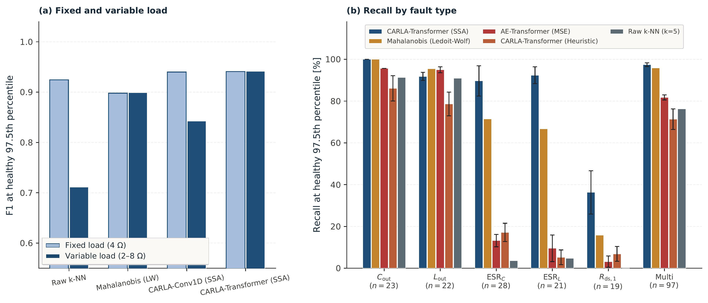
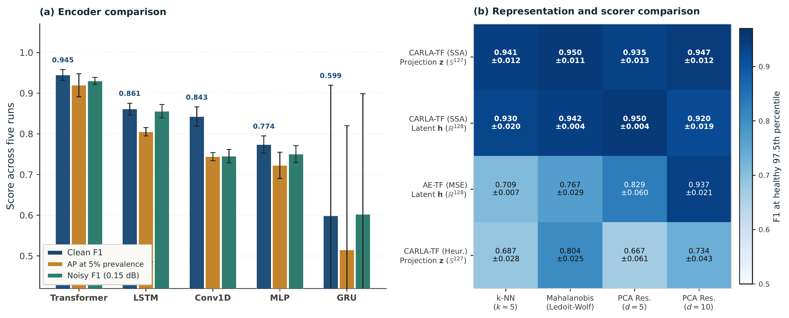
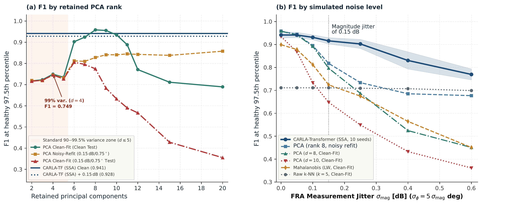
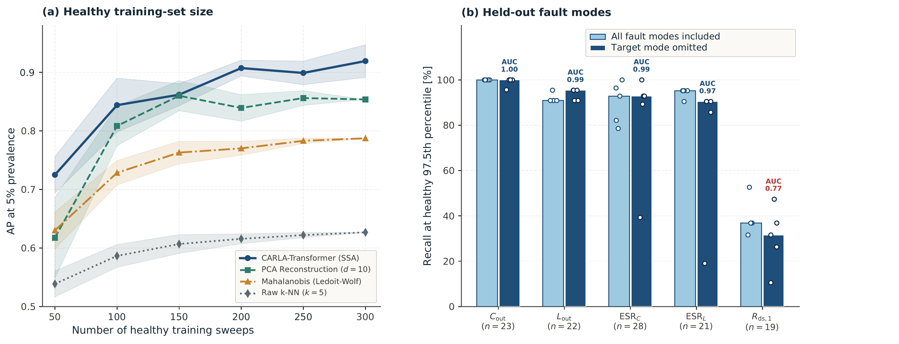
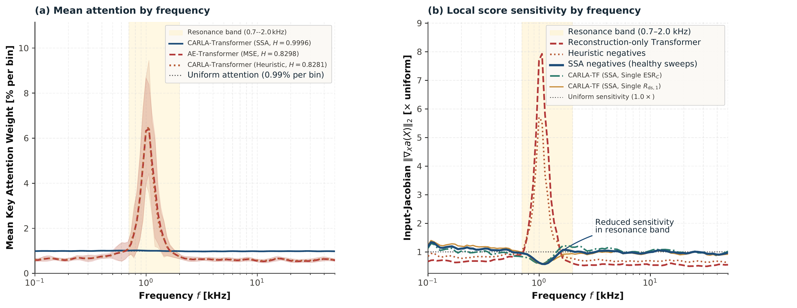

# Detecting Component Degradation Under Variable Load From Buck Converter Frequency Responses

**Ignacio Martin-Salinas\*, Jose A. Belloch, Adrián Amor-Martín, Pablo Zumel, and Cristina Fernandez**  
*Department of Electronic Technology, Universidad Carlos III de Madrid, Av. de la Universidad 30, 28911 Leganés, Madrid, Spain*

## Abstract

Operating-load changes alter the small-signal frequency response of a dc–dc buck converter and can obscure spectral changes caused by component degradation. In a switched simulation benchmark with load resistance varying from $2$ to $8\,\Omega$, the healthy resonance magnitude varies by approximately $9\,\mathrm{dB}$. We train a contrastive autoencoder with a self-attention encoder on healthy spectra and synthetic fault examples. The synthetic examples are generated by multiplying healthy complex spectra by fault-to-healthy transfer-function ratios from a state-space averaged model evaluated at nominal load. The method uses neither per-sweep load measurements nor labeled fault sweeps for training or threshold calibration. Across ten training seeds on a shared test split, the method achieves an F1 score of $0.9417 \pm 0.0128$ at a threshold set from healthy validation data and average precision of $0.9126 \pm 0.0308$ after adjustment to an assumed anomaly prevalence of $5\%$ (mean $\pm$ standard deviation). Recall is $89.6\%$ for isolated capacitor equivalent series resistance increases and $92.4\%$ for isolated inductor resistance increases, compared with $3.6\%$ and $4.8\%$ for raw nearest-neighbor scoring. In the noise sweep, mean F1 is $0.9160$ with simulated magnitude and phase jitter of $0.15\,\mathrm{dB}$ and $0.75^\circ$, respectively. Recall for isolated high-side switch degradation is $36.3\%$. The results establish performance on the simulated benchmark and motivate validation with hardware measurements.

## 1. Introduction

Component parameter drift can change the frequency response of a power converter before a loss of regulation is apparent. Relevant changes include capacitance loss and increased capacitor equivalent series resistance (ESR) [@wang2014capacitors; @zhao2021capacitors], as well as increases in metal–oxide–semiconductor field-effect transistor (MOSFET) on-resistance [@celaya2010mosfet; @dusmez2016sfra]. Frequency-response analysis (FRA) estimates the small-signal response to a perturbation. Digitally generated perturbations, such as pseudorandom binary sequences, can support plant identification through the converter's control and measurement channels [@dusmez2016sfra; @roinila2021frequency].

Load variation complicates interpretation of these responses. Increasing the load resistance of a buck converter reduces damping of the output filter. In the variable-load benchmark considered here, the resonance magnitude varies by approximately $9\,\mathrm{dB}$ over the healthy operating range. The resulting healthy responses overlap with responses caused by isolated increases in capacitor or inductor ESR. A detector that treats any large spectral displacement as a fault can therefore overlook these degradations while remaining sensitive to changes in load.

We propose a physics-informed contrastive autoencoder, CARLA-Transformer (SSA), for detecting component degradation from the complex control-to-output response. The training procedure multiplies each healthy spectrum by a fault-to-healthy ratio derived from a state-space averaged (SSA) model at nominal load. This provides synthetic negatives while retaining the healthy spectrum as the starting point. The self-attention encoder can combine information across frequencies, and a nearest-neighbor score is calibrated on healthy validation sweeps. Fig. 1 summarizes the method.

The study makes three contributions. First, it derives a conduction-loss model and quantifies its agreement with switched simulation at the simulated component values and loads. Second, it evaluates nominal-load ratio augmentation against reconstruction-only and heuristic-augmentation controls on a shared variable-load split. Third, it examines the effects of encoder and scorer choice, simulated measurement noise, omission of fault families from training, and frequency-dependent score sensitivity.

**Figure 1.** Frequency-response monitoring under variable load. (a) Synchronous buck stage and frequency-response measurement channels. (b) An unmodified healthy sweep provides the anchor, a small perturbation forms the positive view, and multiplication by the nominal-load transfer-function ratio produces the synthetic fault view. (c) The anomaly score is the mean distance to the five nearest healthy training embeddings. The decision threshold is the 97.5th percentile of healthy validation scores.

## 2. Related Work

Component-level condition monitoring includes capacitor parameter estimation [@wang2014capacitors; @zhao2021capacitors] and MOSFET on-resistance monitoring [@celaya2010mosfet]. Düşmez *et al.* demonstrated software FRA for tracking MOSFET degradation in a boost converter [@dusmez2016sfra]. Frequency-domain identification with pseudorandom excitation has also been studied for dc power distribution systems [@roinila2021frequency]. For buck converters, Zhao *et al.* estimated output capacitor ESR and capacitance from large-signal load-transient trajectories [@zhao2021bucktransient]. The present study addresses detection of departures from healthy broadband responses across multiple component parameters and operating loads.

One-class approaches score departures from healthy data using distances, fitted decision boundaries, or subspace residuals. Examples include nearest-neighbor distance, the one-class support vector machine (SVM), isolation forest, shrinkage Mahalanobis distance, and the principal component analysis (PCA) residual statistic [@cover1967knn; @scholkopf2001estimating; @liu2008isolation; @ledoit2004wellconditioned; @jackson1979control]. Reconstruction-based detectors similarly model healthy variation, but the reconstruction objective does not explicitly favor components of the spectrum that distinguish degradation from changing load.

Contrastive methods use the choice of positive and negative pairs to shape the representation [@oord2018representation; @chen2020simclr]. CARLA generates synthetic anomalies as one part of a framework for time-series anomaly detection [@darban2025carla]. We use the idea of synthetic negatives in a frequency-domain autoencoder, with a parametric circuit model determining their structure. The heuristic comparator in this study applies generic spectral corruptions within the same autoencoder. Its results characterize that comparator on FRA spectra.

## 3. Converter Model and Load Dependence

### 3.1. Operating Conditions

The synchronous buck converter operates at a nominal duty ratio $D=0.40$, input voltage $V_{\mathrm{in}}=50\,\mathrm{V}$, and switching frequency $f_s=100\,\mathrm{kHz}$. Table 1 gives the nominal parameters, healthy tolerances, and simulated fault intervals. The fixed-load benchmark uses $R_{\mathrm{out}}=4\,\Omega$. The variable-load benchmark spans $2$–$8\,\Omega$, equivalent to approximately $2.5$–$10\,\mathrm{A}$ at the ideal output voltage of $20\,\mathrm{V}$.

**Table 1. Electrical parameters and fault intervals of the synchronous buck benchmark.**

| Parameter | Symbol | Nominal | Healthy range | Fault range |
| --- | --- | --- | --- | --- |
| Input voltage | $V_{\mathrm{in}}$ | $50.0\,\mathrm{V}$ | Fixed | — |
| Duty ratio | $D$ | $0.40$ | Fixed | — |
| Switching frequency | $f_s$ | $100\,\mathrm{kHz}$ | Fixed | — |
| Dead time | $t_{\mathrm{dead}}$ | $100\,\mathrm{ns}$ | Fixed | — |
| Output capacitance | $C_{\mathrm{out}}$ | $100\,\mu\mathrm{F}$ | $92.5$–$107.5\,\mu\mathrm{F}$ | $[55, 85]\cup[115, 145]\,\mu\mathrm{F}$ |
| Capacitor ESR | $\mathrm{ESR}_C$ | $20\,\mathrm{m}\Omega$ | $16$–$24\,\mathrm{m}\Omega$ | $30$–$60\,\mathrm{m}\Omega$ |
| Filter inductance | $L_{\mathrm{out}}$ | $200\,\mu\mathrm{H}$ | $185$–$215\,\mu\mathrm{H}$ | $[110, 170]\cup[230, 290]\,\mu\mathrm{H}$ |
| Inductor ESR | $\mathrm{ESR}_L$ | $100\,\mathrm{m}\Omega$ | $72.5$–$127.5\,\mathrm{m}\Omega$ | $150$–$300\,\mathrm{m}\Omega$ |
| High-side on-resistance | $R_{\mathrm{ds},1}$ | $10\,\mathrm{m}\Omega$ | $7.25$–$12.75\,\mathrm{m}\Omega$ | $18$–$66\,\mathrm{m}\Omega$ |
| Low-side on-resistance | $R_{\mathrm{ds},2}$ | $10\,\mathrm{m}\Omega$ | See text | Excluded |
| Operating load | $R_{\mathrm{out}}$ | $4.0\,\Omega$ | $2.0$–$8.0\,\Omega$ | $2.0$–$8.0\,\Omega$ |

The operating-load range applies to both healthy and faulty sweeps in the variable-load benchmark.

In the ideal buck model, the coefficient of $s$ in the monic denominator includes $1/(R_{\mathrm{out}} C_{\mathrm{out}})$, so changing $R_{\mathrm{out}}$ primarily changes resonance damping. The nominal undamped $LC$ frequency and capacitor ESR zero are
$$
\begin{aligned}
f_0 &= \frac{1}{2\pi\sqrt{L_{\mathrm{out}}^{(0)}C_{\mathrm{out}}^{(0)}}}
       \approx 1.125\,\mathrm{kHz}, \\
f_z &= \frac{1}{2\pi C_{\mathrm{out}}^{(0)}\mathrm{ESR}_C^{(0)}}
       \approx 79.6\,\mathrm{kHz}.
\end{aligned}
$$
Superscript $(0)$ denotes nominal values. Reducing the capacitance or inductance raises the undamped frequency, while increasing capacitor ESR moves its zero toward the measured band.

Each sweep contains $N_f=101$ logarithmically spaced points from $100\,\mathrm{Hz}$ to $50\,\mathrm{kHz}$. The upper endpoint is half the switching frequency. Healthy component tolerances and variable load were sampled using Latin hypercube sampling [@mckay1979comparison]. The fault intervals are separated from the healthy intervals by design. At the lightest load and minimum specified inductance of $110\,\mu\mathrm{H}$, the ideal peak-to-peak inductor ripple is about $1.09\,\mathrm{A}$, giving an estimated valley current of $1.95\,\mathrm{A}$. This estimate supports the continuous-conduction-mode assumption over the specified range.

### 3.2. Averaged Control-to-Output Response

We use continuous-conduction state-space averaging [@middlebrook1976general; @erickson2001fundamentals]. For compactness, write $R=R_{\mathrm{out}}$, $L=L_{\mathrm{out}}$, $C=C_{\mathrm{out}}$, and $r_C=\mathrm{ESR}_C$. The averaged series resistance and the steady-state inductor current are
$$
\begin{aligned}
R_s &= \mathrm{ESR}_L + D R_{\mathrm{ds},1} + (1-D)R_{\mathrm{ds},2},\\
I_L &= DV_{\mathrm{in}}/(R+R_s),
\end{aligned}
$$
where $R_{\mathrm{ds},1}$ and $R_{\mathrm{ds},2}$ are the high- and low-side on-resistances. Linearizing the term $dV_{\mathrm{in}}-R_s(d)i_L$ about $(D,I_L)$ gives the duty-to-switch-node gain $V_{\mathrm{eff}}=V_{\mathrm{in}}-I_L(R_{\mathrm{ds},1}-R_{\mathrm{ds},2})$. The parallel combination of $R$ and the lossy capacitor has impedance $Z_p(s)=R(1+sCr_C)/(1+sC(R+r_C))$. Substituting it into the voltage divider $V_{\mathrm{eff}} Z_p(s)/(sL+R_s+Z_p(s))$ gives
$$
\tag{5}
G_{vd}(s;\boldsymbol{\theta},R)
=\frac{V_{\mathrm{eff}} R(1+sCr_C)}
{a_0+a_1s+a_2s^2},
$$
with
$$
\begin{aligned}
a_0 &= R+R_s,\\
a_1 &= L+C[R_s(R+r_C)+Rr_C],\\
a_2 &= LC(R+r_C).
\end{aligned}
$$
The vector $\boldsymbol{\theta}$ collects the component parameters. The simulator includes switching dead time. Equation (5) averages the two conducting subintervals and has no separate dead-time term.

Fig. 2(a) shows the healthy response envelope and representative degraded responses. Increasing $\mathrm{ESR}_L$ or $R_{\mathrm{ds},1}$ decreases the low-frequency gain and changes damping. Increasing $\mathrm{ESR}_C$ also changes the zero and therefore affects the upper portion of the measured band. Fig. 2(b) illustrates these differences using the nominal-load ratios used for augmentation.

For each sweep, model discrepancy is the Euclidean norm of the complex response difference divided by the norm of the switched response, expressed as a percentage. Across the 800 variable-load sweeps, the median discrepancy was $14.874\%$ when the model assumed a fixed $4\,\Omega$ load and $4.033\%$ for the textbook approximation using the true simulated load and $G_{vd}(0)=V_{\mathrm{in}}$. The conduction-loss model evaluated at the simulated loads gave a median discrepancy of $0.0952\%$ (95th percentile $0.1360\%$, maximum $0.2614\%$). Its median discrepancy over 4,723 fixed-load sweeps was $0.0917\%$ [Fig. 2(c)]. These comparisons concern the plant response with known simulation inputs. The nominal-load augmentation in Section 4.2 uses no such per-sweep information.

**Figure 2.** Load dependence and averaged-model agreement. (a) Healthy response envelope and two single-fault responses from switched variable-load simulations ($\mathrm{ESR}_L$ increased by $120\%$ and $R_{\mathrm{ds},1}$ by $362\%$). The shaded frequency band covers the filter resonance. (b) Illustrative fault-to-healthy ratios from the averaged model at $4\,\Omega$. (c) Median relative complex response error against switched simulations. Black markers indicate 95th percentiles.

### 3.3. Sensitivity to Switch On-Resistance

The switched model used in this study produced nearly identical spectra when the low-side on-resistance was varied. We therefore set the effective $R_{\mathrm{ds},2}$ to zero in the analytical comparisons and exclude low-side degradation from the detection benchmark. This convention applies to the simulated switch configuration. In physical hardware, low-side channel and body-diode conduction depend on gate timing, channel resistance, and current.

At $D=0.40$, the high-side fault interval corresponds to a $3.2$–$22.4\,\mathrm{m}\Omega$ increase in $R_s$. This range overlaps the healthy variation in inductor ESR ($\pm27.5\,\mathrm{m}\Omega$ about nominal). The high-side switch also affects $V_{\mathrm{eff}}$, but both parameters can produce similar changes in low-frequency gain and damping in the presence of variable load. This overlap makes isolated high-side faults difficult to detect in the benchmark. It does not yield a numerical upper bound on recall.

## 4. Physics-Informed Contrastive Autoencoder

### 4.1. Complex Spectral Representation

Let $M_{ik}$ and $\phi_{ik}$ denote the magnitude in decibels and the phase in degrees for sweep $i$ at angular frequency $\omega_k=2\pi f_k$. We convert the polar measurements to complex form and then retain their Cartesian components
$$
\begin{aligned}
H_i(j\omega_k) &= 10^{M_{ik}/20}\exp(j\pi\phi_{ik}/180), \\
\widetilde{\mathbf X}_{ik}
 &= \big[\operatorname{Re}H_i(j\omega_k),\,
          \operatorname{Im}H_i(j\omega_k)\big].
\end{aligned}
$$
This representation avoids a discontinuity at the phase wrap. Each real and imaginary feature is standardized separately at each frequency using the mean and standard deviation of the healthy training sweeps. The same statistics are used for augmented, validation, and test spectra.

### 4.2. Nominal-Load Transfer-Ratio Augmentation

Positive views use small Gaussian perturbations at a scale of $0.01$ relative to feature dispersion. To generate a negative view, the augmentation samples one fault mode with probability $0.70$ or two modes with probability $0.30$ from the five component parameters with prescribed degradation intervals in Table 1. The severity vector $\boldsymbol{\alpha}$ scales the selected nominal component values within their fault intervals and leaves the other values unchanged. With $R^{(0)}=4\,\Omega$ and elementwise multiplication denoted by $\odot$, the construction is
$$
\begin{aligned}
\Gamma_{\boldsymbol{\alpha}}(j\omega_k) &=
\frac{G_{vd}(j\omega_k;\boldsymbol{\alpha}\odot\boldsymbol{\theta}^{(0)},R^{(0)})}
     {G_{vd}(j\omega_k;\boldsymbol{\theta}^{(0)},R^{(0)})},
\\
H_i^-(j\omega_k) &= H_i(j\omega_k)\Gamma_{\boldsymbol{\alpha}}(j\omega_k).
\end{aligned}
$$
We apply the transfer-ratio transformation in the complex plane before standardization. The healthy anchor contributes the spectrum at its own operating point, and the ratio introduces coupled magnitude and phase changes. For instance, an increase in $r_C$ moves the ESR zero while preserving the dc gain of the averaged model, and changes in $L$ or $C$ shift the poles. Because a fault's spectral effect can depend on load and component values, a ratio evaluated at nominal conditions is an approximation to the fault transformation at an arbitrary operating point.

### 4.3. Encoder, Decoder, and Projection

The encoder treats the 101 frequency bins as an ordered sequence of two-channel tokens (Fig. 3). A linear input projection with sinusoidal positional encoding is followed by two self-attention blocks with widths 64 and 128 and four heads per block [@vaswani2017attention]. The attention and feed-forward sublayers use residual connections and layer normalization. The feed-forward widths are 256 and 512, with rectified linear activations and no dropout. Global average pooling followed by a linear layer produces the 128-dimensional representation $\mathbf h=f(\mathbf X)$.

The decoder $g$ reconstructs the healthy input from $\mathbf h$ using two self-attention blocks of widths 128 and 64. A separate projection head $p$ uses two 128-unit dense layers with batch normalization and a rectified linear activation between them, followed by $\ell_2$ normalization [@chen2020simclr]. Its output is the unit-length vector $\mathbf z=p(\mathbf h)$ used for contrastive training and test scoring.

**Figure 3.** Contrastive autoencoder architecture. (a) A shared self-attention encoder maps the 101 two-channel frequency tokens of each view to a 128-dimensional latent vector. (b) The decoder reconstructs healthy anchors during training. (c) The projection head maps all training views to unit-length embeddings. The embeddings support contrastive training and nearest-neighbor scoring at inference.

### 4.4. Training Objective and Decision Rule

For each batch of $B$ healthy anchors, the encoder produces projections $\mathbf z_i$, $\mathbf z_i^+$, and $\mathbf z_i^-$ for the anchors and their positive and synthetic negative views, respectively. Define $u(\mathbf z,\mathbf v)=\exp(\mathbf z^\top\mathbf v/T)$ with temperature $T=0.10$. The directed contrastive loss compares the positive against the negative set $\mathcal B_i$, which includes synthetic fault projections [@oord2018representation]:
$$
\begin{aligned}
Z_i &= u(\mathbf z_i,\mathbf z_i^+)+\sum_{\mathbf v\in\mathcal B_i}u(\mathbf z_i,\mathbf v),\\
\mathcal L_{\mathrm c}
 &= -\frac{1}{B}\sum_{i=1}^B\log\frac{u(\mathbf z_i,\mathbf z_i^+)}{Z_i}.
\end{aligned}
$$
The training objective is $5\mathcal L_{\mathrm{rec}}+0.5\mathcal L_{\mathrm c}$, where $\mathcal L_{\mathrm{rec}}$ is the mean squared reconstruction error over the elements of healthy anchor spectra. We use Adam with batch size 32 and a fixed learning rate of $5\times10^{-5}$ for up to 120 epochs, selecting the checkpoint with the lowest loss on healthy validation sweeps and their augmented views.

At inference, the encoder and projection head produce the query embedding $\mathbf z$. Let $\mathcal N_5(\mathbf z)$ denote its five nearest neighbors among the healthy training embeddings. The anomaly score is
$$
a(\mathbf X)=\frac{1}{5}\sum_{\mathbf v\in\mathcal N_5(\mathbf z)}
\|\mathbf z-\mathbf v\|_2.
$$
A query is flagged if its score exceeds the empirical 97.5th percentile of the scores on the healthy validation split. The 95th percentile is used for a secondary comparison. We denote the corresponding test F1 scores by $\mathrm{F1}_{0.975}$ and $\mathrm{F1}_{0.95}$. These percentiles target nominal validation exceedance rates of $2.5\%$ and $5\%$, respectively. Test false-alarm rates depend on the calibration sample and the operating distribution.

## 5. Experimental Design

### 5.1. Simulation Benchmarks

Both benchmarks use switched Altair PSIM ac sweeps of the converter described in Table 1. The fixed-load benchmark contains 4,723 sweeps. Its test subset contains 473 healthy and 713 faulty sweeps after excluding cases with only low-side switch degradation.

The variable-load benchmark contains 500 healthy and 300 faulty sweeps. A fixed stratified split (seed 102) assigns 300 healthy sweeps to training, 100 to validation, and 100 to testing. Of the faulty sweeps, 90 are reserved for the supervised reference and 210 are held out for testing. The latter comprise 23 capacitance, 28 capacitor ESR, 22 inductance, 21 inductor ESR, 19 high-side switch, and 97 compound faults. The one-class and self-supervised detectors use healthy validation data for checkpoint selection, where applicable, and threshold calibration. The 90 labeled fault sweeps are used only by the supervised reference.

### 5.2. Baselines and Controls

Classical baselines operate on 202 standardized Cartesian features. They include Euclidean $k$-nearest neighbors ($k=1,5$), a radial-basis one-class SVM ($\nu=0.05$), an isolation forest (200 trees), Mahalanobis distance with ridge regularization ($10^{-6}$) or Ledoit–Wolf covariance shrinkage, and PCA reconstruction residuals. PCA ranks selected using performance on labeled test faults are reported as retrospective references. A histogram gradient-boosting classifier trained with the 90 labeled fault sweeps provides a supervised comparison.

The ten-seed Transformer ablation compares reconstruction-only training with either reconstruction-error or latent nearest-neighbor scoring, contrastive training with heuristic negatives, and contrastive training with SSA-ratio negatives. The heuristic negatives include spectral spikes, point drops, frequency warping, and amplitude scaling. The contrastive comparisons share the same architecture and nearest-neighbor scoring on the normalized projections. In the figures, AE and MSE denote the autoencoder and mean squared error, respectively. A separate five-seed study compares self-attention, one-dimensional convolutions (widths 32, 64, and 128 with kernel length 5), long short-term memory (LSTM) [@hochreiter1997lstm], gated recurrent units (GRU) [@cho2014gru], and a multilayer perceptron (MLP). The recurrent variants use widths 128 and 64, and the MLP uses widths 512, 256, and 128. These comparisons use the same SSA augmentation and scoring procedure.

### 5.3. Metrics, Simulated Noise, and Paired Comparisons

F1 and per-fault recall are evaluated at the stated validation thresholds. F1 is computed at the test benchmark's class balance, which is $210/310$ faulty for the variable-load split. To compare ranking performance at a lower assumed anomaly prevalence $\pi=0.05$, we adjust precision using test true- and false-positive rates (TPR and FPR) [@davis2006relationship; @saito2015precision]:
$$
\operatorname{Prec}_{\pi} =
\frac{\pi\operatorname{TPR}}
{\pi\operatorname{TPR}+(1-\pi)\operatorname{FPR}}.
$$
We report prevalence-adjusted average precision ($\mathrm{AP}_{0.05}$), which summarizes the adjusted precision–recall curve by weighting precision by the increments in recall. This calculation assumes the class-conditional score distributions are retained at the target prevalence. We also report the area under the receiver operating characteristic curve (ROC AUC).

For the noise study, we add zero-mean Gaussian jitter to the magnitude in decibels and phase in degrees before Cartesian conversion. The magnitude standard deviations are $0$, $0.05$, $0.10$, $0.15$, $0.25$, $0.40$, and $0.60\,\mathrm{dB}$, paired with phase standard deviations from $0^\circ$ to $3.00^\circ$ at $5^\circ$ per decibel. At each level, the threshold uses healthy validation spectra with the corresponding noise condition. Models retain their clean-data fits except for the explicitly refitted PCA comparator.

Results across seeds are summarized by the mean and standard deviation (SD). These SDs describe variability over runs on the shared split. For the Transformer ablation, we use an exact two-sided paired sign-flip test on F1 differences, with a minimum attainable $p$-value of $2/2^{10}=0.001953$. The five-seed encoder comparison is descriptive, as the minimum attainable two-sided $p$-value is $0.0625$.

## 6. Results

### 6.1. Fixed- and Variable-Load Benchmarks

At fixed load, raw nearest-neighbor scoring ($k=1$) achieves $\mathrm{F1}_{0.975}=0.9244$ and $\mathrm{AP}_{0.05}=0.8031$. The convolutional encoder trained with SSA-ratio augmentation achieves $0.9399\pm0.0033$ and $0.8332\pm0.0058$, respectively. On the variable-load benchmark, raw nearest-neighbor F1 is $0.7134$ with $k=1$ and $0.7112$ with $k=5$. Fig. 4(a) summarizes the results on the two benchmarks. The benchmarks also differ in sample size and composition, so the cross-benchmark comparison does not isolate a causal effect of load on F1.

**Figure 4.** Detection under fixed and variable load. (a) F1 at the healthy validation 97.5th percentile on the two benchmarks. (b) Recall on the variable-load test split at the same calibration percentile, by fault type. Error bars for neural models indicate standard deviations across seeds. Sample counts appear below the fault labels.

On the variable-load test split, raw $k$-NN detects approximately $91\%$ of isolated capacitance and inductance faults but only $3.6\%$ of capacitor ESR faults and $4.8\%$ of inductor ESR faults [Table 2 and Fig. 4(b)]. Ledoit–Wolf Mahalanobis scoring improves F1 to $0.8992$ but detects $71.4\%$ and $66.7\%$ of those two fault types, respectively. The Transformer trained with SSA-ratio augmentation achieves $\mathrm{F1}_{0.975}=0.9417\pm0.0128$, $\mathrm{AP}_{0.05}=0.9126\pm0.0308$, and ROC AUC of $0.9740\pm0.0064$. Its precision and recall at the benchmark class balance are $0.9870\pm0.0102$ and $0.9005\pm0.0192$. The supervised reference has a similar F1 of $0.9340$ and higher average precision of $0.9322$. High-side switch recall remains modest at $36.3\%$ for the SSA-ratio model.

**Table 2. Detection performance on the variable-load benchmark.**

**(a) Aggregate detection metrics**

| Detector | Use of fault labels | $\mathrm{F1}_{0.975}$ | $\mathrm{F1}_{0.95}$ | $\mathrm{AP}_{0.05}$ | ROC AUC |
| --- | --- | --- | --- | --- | --- |
| One-class SVM | None | 0.6892 | 0.6951 | 0.5434 | 0.7730 |
| Raw $k$-NN ($k=5$) | None | 0.7112 | 0.7087 | 0.6268 | 0.8716 |
| Mahalanobis (ridge) | None | 0.7638 | 0.8274 | 0.7086 | 0.9246 |
| Isolation forest | None | 0.8347 | 0.8962 | 0.7289 | 0.9293 |
| Mahalanobis (Ledoit–Wolf) | None | 0.8992 | 0.9196 | 0.7874 | 0.9582 |
| PCA (99\% variance, rank 4) | None | 0.7493 | 0.7608 | 0.6602 | 0.8993 |
| PCA (retrospective rank 10) | Rank selection | 0.9347 | 0.9453 | 0.8538 | 0.9703 |
| Transformer, SSA negatives | None | 0.9417 ± 0.0128 | 0.9433 ± 0.0095 | 0.9126 ± 0.0308 | 0.9740 ± 0.0064 |
| Supervised gradient boosting | Training (90 faults) | 0.9340 | — | 0.9322 | 0.9797 |

**(b) Recall by fault type at the 97.5th percentile (\%)**

| Detector | $C_{\mathrm{out}}$ | $\mathrm{ESR}_C$ | $L_{\mathrm{out}}$ | $\mathrm{ESR}_L$ | $R_{\mathrm{ds},1}$ | Compound |
| --- | --- | --- | --- | --- | --- | --- |
| One-class SVM | 91.3 | 3.6 | 90.9 | 4.8 | 0.0 | 71.1 |
| Raw $k$-NN ($k=5$) | 91.3 | 3.6 | 90.9 | 4.8 | 0.0 | 76.3 |
| Mahalanobis (ridge) | 91.3 | 21.4 | 90.9 | 4.8 | 5.3 | 84.5 |
| Isolation forest | 100.0 | 60.7 | 95.5 | 19.0 | 10.5 | 89.7 |
| Mahalanobis (Ledoit–Wolf) | 100.0 | 71.4 | 95.5 | 66.7 | 15.8 | 95.9 |
| PCA (99\% variance, rank 4) | 95.7 | 14.3 | 90.9 | 9.5 | 0.0 | 81.4 |
| PCA (retrospective rank 10) | 95.7 | 89.3 | 95.5 | 90.5 | 21.1 | 97.9 |
| Transformer, SSA negatives | 100.0 | 89.6 | 91.8 | 92.4 | 36.3 | 97.4 |
| Supervised gradient boosting | 87.0 | 100.0 | 90.9 | 81.0 | 15.8 | 99.0 |

Transformer values are means over ten runs. Panel (a) reports mean $\pm$ SD. The supervised F1 and recalls use its own decision rule.

### 6.2. Effect of the Training Objective and Negative Samples

Table 3 and Fig. 5 compare Transformer training regimes across ten paired seeds. Reconstruction-error scoring gives a mean F1 of $0.7540$ and mean capacitor and inductor ESR recalls of $13.2\%$ and $9.5\%$. Applying $k$-NN to the reconstruction-only latent representation reduces F1 to $0.7090$. Contrastive training with heuristic negatives gives F1 of $0.6868$ and adjusted average precision of $0.5272$.

The SSA-ratio model improves F1 by $0.188$ to $0.255$ over the three ablations and has higher F1 in every paired run ($p=0.00195$ for each comparison, unadjusted). Mean recall reaches $89.6\%$ for capacitor ESR and $92.4\%$ for inductor ESR. The contrastive comparison holds the architecture and scorer fixed and varies the negative examples. The comparison with reconstruction-error scoring also changes the scorer.

**Figure 5.** Ranking performance and training ablation on the variable-load benchmark. (a) Precision–recall curves adjusted to an assumed anomaly prevalence of $5\%$. AP is average precision. (b) F1 at the healthy validation 97.5th percentile and prevalence-adjusted AP for the ten paired training runs. Bars show means, error bars show SDs, and dots give individual runs.

**Table 3. Paired Transformer ablation on the variable-load benchmark over ten seeds.**

| Training and scoring | $\mathrm{F1}_{0.975}$ | $\mathrm{AP}_{0.05}$ | ROC AUC |
| --- | --- | --- | --- |
| Reconstruction error | 0.7540 ± 0.0111 | 0.6640 ± 0.0153 | 0.9033 ± 0.0129 |
| Reconstruction latent $k$-NN | 0.7090 ± 0.0067 | 0.6129 ± 0.0053 | 0.8190 ± 0.0114 |
| Heuristic negatives | 0.6868 ± 0.0281 | 0.5272 ± 0.0529 | 0.8344 ± 0.0224 |
| SSA negatives | 0.9417 ± 0.0128 | 0.9126 ± 0.0308 | 0.9740 ± 0.0064 |

**Recall at the 97.5th percentile (\%)**

| Training and scoring | Passive | $\mathrm{ESR}_C$ | $\mathrm{ESR}_L$ | $R_{\mathrm{ds},1}$ | $\Delta$F1 |
| --- | --- | --- | --- | --- | --- |
| Reconstruction error | 51.7 ± 2.0 | 13.2 ± 2.9 | 9.5 ± 6.3 | 3.2 ± 2.7 | $+0.1876$ |
| Reconstruction latent $k$-NN | 45.4 ± 0.7 | 3.6 ± 0.0 | 4.8 ± 0.0 | 1.1 ± 2.2 | $+0.2327$ |
| Heuristic negatives | 45.7 ± 3.8 | 17.1 ± 4.4 | 5.2 ± 3.5 | 6.8 ± 3.6 | $+0.2548$ |
| SSA negatives | 93.3 ± 2.2 | 89.6 ± 7.2 | 92.4 ± 4.0 | 36.3 ± 10.4 | — |

Values are mean $\pm$ SD. Passive recall pools the four passive single-fault strata. $\Delta$F1 is the mean paired improvement with SSA negatives. Each paired comparison gives $p=0.00195$ (unadjusted).

### 6.3. Encoder Comparison

With the same SSA-ratio augmentation, the Transformer has the highest mean F1 and AP among the five encoder configurations tested [Table 4 and Fig. 6(a)]. Its clean mean F1 is $0.9447$, compared with $0.8611$ for the LSTM and $0.8426$ for the convolutional encoder. The LSTM detects capacitor ESR faults more often than inductor ESR faults ($84.3\%$ versus $24.8\%$), while the Transformer reaches $90.0\%$ and $94.3\%$, respectively. The GRU has the largest seed-to-seed variation (F1 SD $0.3207$). These comparisons apply to the evaluated configurations and do not identify which architectural property accounts for the differences.

**Figure 6.** Encoder and scorer comparisons on the variable-load benchmark. (a) Five encoder configurations with identical SSA-ratio augmentation, summarized over five seeds. Noisy F1 uses simulated jitter of $0.15\,\mathrm{dB}$ and $0.75^\circ$. Error bars indicate SDs. (b) F1 for four scorers applied to four representations, reported as mean $\pm$ SD over ten seeds.

**Table 4. Encoder comparisons with the same SSA-ratio augmentation on the variable-load benchmark.**

| Encoder | Clean $\mathrm{F1}_{0.975}$ | Noisy $\mathrm{F1}_{0.975}$ | $\mathrm{AP}_{0.05}$ | ROC AUC |
| --- | --- | --- | --- | --- |
| Transformer | 0.9447 ± 0.0133 | 0.9303 ± 0.0087 | 0.9195 ± 0.0283 | 0.9733 ± 0.0069 |
| LSTM | 0.8611 ± 0.0144 | 0.8557 ± 0.0165 | 0.8053 ± 0.0100 | 0.9254 ± 0.0033 |
| 1-D convolution | 0.8426 ± 0.0238 | 0.7451 ± 0.0165 | 0.7440 ± 0.0099 | 0.9188 ± 0.0083 |
| MLP | 0.7739 ± 0.0210 | 0.7506 ± 0.0207 | 0.7227 ± 0.0322 | 0.9095 ± 0.0118 |
| GRU | 0.5988 ± 0.3207 [0.8164] | 0.6021 ± 0.2965 [0.7910] | 0.5147 ± 0.3052 [0.6958] | 0.7904 ± 0.1128 [0.8632] |

**Clean recall at the 97.5th percentile (\%)**

| Encoder | $\mathrm{ESR}_C$ | $\mathrm{ESR}_L$ | $R_{\mathrm{ds},1}$ |
| --- | --- | --- | --- |
| Transformer | 90.0 ± 9.2 | 94.3 ± 2.1 | 38.9 ± 8.0 |
| LSTM | 84.3 ± 11.5 | 24.8 ± 4.0 | 7.4 ± 4.7 |
| 1-D convolution | 53.6 ± 13.4 | 50.5 ± 19.2 | 3.2 ± 4.7 |
| MLP | 30.0 ± 10.6 | 17.1 ± 12.0 | 6.3 ± 6.9 |
| GRU | 60.7 ± 52.2 | 7.6 ± 5.4 | 3.2 ± 4.7 |

Values are mean $\pm$ SD over five seeds. Brackets give the GRU medians. The noisy condition uses $0.15\,\mathrm{dB}$ magnitude and $0.75^\circ$ phase jitter.

### 6.4. Scoring, PCA Rank, and Noise Sensitivity

Table 5 and Fig. 6(b) compare four scorers on the encoder representation $\mathbf h$ or normalized projection $\mathbf z$. For the SSA-ratio model, mean F1 ranges from $0.9204$ to $0.9504$ across these combinations. The heuristic-negative representation gives mean F1 between $0.6674$ and $0.8042$. The reconstruction-only representation reaches $0.9373$ with rank-10 PCA scoring, despite scoring $0.7090$ with $k$-NN. The benefit of SSA-ratio augmentation is therefore most consistent across scorers, and a favorable scorer can also improve a reconstruction-only representation.

**Table 5. Effects of representation and anomaly scoring on the variable-load benchmark.**

**$\mathrm{F1}_{0.975}$**

| Representation | $k$-NN | Ledoit–Wolf | PCA (rank 5) | PCA (rank 10) |
| --- | --- | --- | --- | --- |
| Reconstruction ($\mathbf h$) | 0.7090 ± 0.0067 | 0.7671 ± 0.0289 | 0.8293 ± 0.0597 | 0.9373 ± 0.0208 |
| Heuristic negatives ($\mathbf z$) | 0.6868 ± 0.0281 | 0.8042 ± 0.0247 | 0.6674 ± 0.0606 | 0.7343 ± 0.0425 |
| SSA negatives ($\mathbf h$) | 0.9296 ± 0.0203 | 0.9421 ± 0.0037 | 0.9502 ± 0.0036 | 0.9204 ± 0.0188 |
| SSA negatives ($\mathbf z$) | 0.9415 ± 0.0125 | 0.9504 ± 0.0109 | 0.9351 ± 0.0129 | 0.9474 ± 0.0121 |

**$\mathrm{AP}_{0.05}$**

| Representation | $k$-NN | Ledoit–Wolf |
| --- | --- | --- |
| Reconstruction ($\mathbf h$) | 0.6129 ± 0.0053 | 0.6662 ± 0.0324 |
| Heuristic negatives ($\mathbf z$) | 0.5271 ± 0.0530 | 0.6902 ± 0.0470 |
| SSA negatives ($\mathbf h$) | 0.8898 ± 0.0182 | 0.8620 ± 0.0064 |
| SSA negatives ($\mathbf z$) | 0.9126 ± 0.0304 | 0.9188 ± 0.0237 |

Values are mean $\pm$ SD over ten seeds. $\mathbf h$ denotes the encoder representation, and $\mathbf z$ denotes the normalized projection.

PCA applied directly to the standardized spectra is sensitive to rank [Fig. 7(a)]. The healthy-data rules that retain at least $95\%$, $99\%$, and $99.5\%$ of variance select ranks 3, 4, and 5, with F1 scores of $0.7229$, $0.7493$, and $0.7347$. A retrospective rank sweep using labeled test performance reaches $0.9584$ at rank 8 under clean conditions. All three healthy-data variance rules select lower ranks.

**Figure 7.** PCA rank and simulated measurement noise. (a) F1 as a function of retained PCA rank under clean conditions and at magnitude and phase jitter of $0.15\,\mathrm{dB}$ and $0.75^\circ$. The horizontal lines show the corresponding SSA-ratio Transformer scores. (b) F1 across seven paired jitter levels. The shaded band is one SD across ten Transformer seeds. The PCA reference ranks were selected retrospectively.

**Table 6. Detection F1 at the healthy validation 97.5th percentile across seven simulated jitter levels.**

| dB | Degrees | SSA Transformer | PCA 8 | PCA 10 | PCA 8 (refit) | Ledoit–Wolf | Raw $k$-NN |
| --- | --- | --- | --- | --- | --- | --- | --- |
| 0.00 | 0.00 | 0.9417 ± 0.0128 | 0.9584 | 0.9347 | 0.9584 | 0.8992 | 0.7112 |
| 0.05 | 0.25 | 0.9414 ± 0.0117 | 0.9417 | 0.8682 | 0.9443 | 0.8783 | 0.7112 |
| 0.10 | 0.50 | 0.9313 ± 0.0108 | 0.8923 | 0.7331 | 0.8951 | 0.8122 | 0.7112 |
| 0.15 | 0.75 | 0.9160 ± 0.0138 | 0.7967 | 0.6478 | 0.8177 | 0.7240 | 0.7112 |
| 0.25 | 1.25 | 0.9025 ± 0.0199 | 0.6869 | 0.5492 | 0.7337 | 0.6749 | 0.7091 |
| 0.40 | 2.00 | 0.8304 ± 0.0375 | 0.5245 | 0.4328 | 0.6852 | 0.5646 | 0.7073 |
| 0.60 | 3.00 | 0.7695 ± 0.0240 | 0.4509 | 0.3615 | 0.6770 | 0.4509 | 0.6991 |

Jitter levels are standard deviations. The Transformer column gives mean $\pm$ SD over ten seeds. PCA ranks were selected retrospectively. Only the refit comparator is fitted on noisy training spectra.

At $0.15\,\mathrm{dB}$ and $0.75^\circ$, the clean-trained SSA-ratio Transformer attains $\mathrm{F1}_{0.975}=0.9284\pm0.0154$ in the rank-sweep comparison and $0.9160\pm0.0138$ in the separate seven-level sweep [Fig. 7(b) and Table 6]. In the latter sweep, rank-8 PCA scores $0.7967$ with a clean fit and $0.8177$ when refitted on noisy healthy spectra. At $0.25\,\mathrm{dB}$ and $1.25^\circ$, the respective F1 scores are $0.9025$ for the Transformer and $0.7337$ for refitted PCA. At the highest tested jitter ($0.60\,\mathrm{dB}$ and $3.00^\circ$), Transformer F1 declines to $0.7695$. These results quantify sensitivity to the simulated noise model.

### 6.5. Training-Set Size and Held-Out Fault Modes

Fig. 8(a) compares training sets of 50 to 300 healthy sweeps on the same benchmark. With 100 sweeps, the mean Transformer F1 is $0.9006\pm0.0481$ and mean adjusted AP is $0.8440\pm0.0459$ over five subsampling runs. At 200 sweeps the scores are $0.9358\pm0.0074$ and $0.9073\pm0.0135$, respectively. These are within-benchmark sample-size estimates.

**Figure 8.** Training-set size and held-out fault modes. (a) Prevalence-adjusted AP as a function of the number of healthy training sweeps. Bands indicate one SD across five runs where available. (b) Median thresholded recall with all fault modes included in augmentation and with the indicated mode omitted. Dots show individual held-out-mode runs, and annotations give median held-out ROC AUC.

In each leave-one-fault-out experiment, the target mode is omitted from both single-mode and compound training augmentations. The detector is then evaluated on isolated simulated faults of that mode. Table 7 and Fig. 8(b) summarize five runs per mode. Mean recall remains above $93\%$ for withheld capacitance and inductance faults, with mean ROC AUC of $0.9989$ and $0.9911$, respectively. Withholding capacitor or inductor ESR gives median recall above $90\%$, but mean recall is lower ($82.9\%$ and $75.2\%$), with substantial variability over seeds. High-side switch recall is $30.5\%$ when omitted and $38.9\%$ when included in augmentation. The transfer results are specific to held-out parameter changes in the same simulated topology.

**Table 7. Leave-one-fault-out evaluation of the SSA-ratio Transformer over five seeds.**

| Omitted mode | $n$ | Held-out ROC AUC | Held-out recall (\%) | Included recall (\%) | Overall $\mathrm{F1}_{0.975}$ |
| --- | --- | --- | --- | --- | --- |
| $C_{\mathrm{out}}$ | 23 | 0.9989 ± 0.0008 [0.9991, 0.0009] | 99.1 ± 1.9 [100.0, 0.0] | 100.0 ± 0.0 | 0.9482 ± 0.0094 |
| $L_{\mathrm{out}}$ | 22 | 0.9911 ± 0.0027 [0.9905, 0.0014] | 93.6 ± 2.5 [95.5, 4.5] | 91.8 ± 2.0 | 0.9473 ± 0.0071 |
| $\mathrm{ESR}_C$ | 28 | 0.9715 ± 0.0525 [0.9939, 0.0079] | 82.9 ± 24.7 [92.9, 3.6] | 90.0 ± 9.2 | 0.9106 ± 0.0687 |
| $\mathrm{ESR}_L$ | 21 | 0.9470 ± 0.0717 [0.9705, 0.0214] | 75.2 ± 31.5 [90.5, 4.8] | 94.3 ± 2.1 | 0.9087 ± 0.0749 |
| $R_{\mathrm{ds},1}$ | 19 | 0.7466 ± 0.0563 [0.7684, 0.0442] | 30.5 ± 13.6 [31.6, 10.5] | 38.9 ± 8.0 | 0.9177 ± 0.0524 |

Values are mean $\pm$ SD, with [median, interquartile range] where indicated. Recall is measured at the healthy validation 97.5th percentile. Included recall is the reference obtained with all five modes in augmentation.

### 6.6. Frequency Dependence of Attention and Score Sensitivity

We compare mean attention assigned to each key frequency and the norm of the anomaly-score gradient with respect to the two standardized channels at that frequency. The gradient measures local sensitivity of the score to changes in standardized input coordinates. Attention weights are reported as a complementary description of the model [@jain2019attention].

**Figure 9.** Attention and score sensitivity on the variable-load benchmark. (a) Mean attention weight per key frequency. The uniform reference is $100/101\%$ per bin, and $H$ is normalized Shannon entropy. (b) Norm of the score gradient per frequency, shown relative to uniform sensitivity. The shaded regions mark the $0.7$–$2.0\,\mathrm{kHz}$ resonance band.

The reconstruction-only and heuristic-negative Transformers concentrate mean attention near $1.01\,\mathrm{kHz}$, with normalized entropies of $0.8298\pm0.0421$ and $0.8281\pm0.0423$, respectively. Mean attention is nearly uniform for the SSA-ratio Transformer ($0.9996\pm0.0002$) [Fig. 9(a)]. In the resonance band, the corresponding normalized gradient sensitivities are $2.92$ and $2.67$ for the two controls, compared with $0.833\pm0.086$ for the SSA-ratio model on healthy sweeps [Fig. 9(b)]. The SSA-ratio model shows relatively higher low-frequency sensitivity for inductor ESR and high-side switch faults, consistent with the gain changes in Section 3.2. These observations characterize local model sensitivity. Establishing invariance to load would require perturbations along measured or simulated load trajectories.

## 7. Discussion

The study evaluates detection of prescribed parameter deviations in a synchronous buck converter with resistive loads in continuous conduction. The nominal-load ratio makes training possible without per-sweep load measurements, but its approximation error for a specific fault at an unknown load is not measured by the plant-response fidelity comparison. The healthy and degraded sampling intervals are separated, and performance at the boundary between normal drift and early-stage degradation remains untested.

The reported uncertainty captures variation over training seeds on one split. Performance across hardware units, independently generated splits, and field load distributions remains to be measured.

All evaluated spectra are simulated open-loop plant responses. The injected magnitude and phase jitter probes one source of acquisition uncertainty. In regulated hardware, plant identification depends on the excitation and feedback paths, particularly at low frequencies, and can be affected by timing delays, quantization, interference, and temperature-dependent parasitics [@roinila2021frequency]. The findings also leave open the effects of nonlinear or discontinuous-conduction operating regimes. A hardware study would be needed to establish acquisition repeatability, diagnostic performance, and embedded latency under those conditions.

## 8. Conclusion

An autoencoder with physics-informed contrastive augmentation improved detection of isolated capacitor and inductor ESR increases in simulated buck converter responses under variable load. The augmentation uses nominal-load transfer-function ratios and requires no load measurement for an individual sweep. Mean F1 on the variable-load test split was $0.9417$ with healthy-only threshold calibration and $0.9160$ at $0.15\,\mathrm{dB}$ and $0.75^\circ$ in the simulated noise sweep. Isolated high-side switch degradation remained difficult to detect. The practical value of these results depends on whether they transfer to hardware-acquired spectra under normal operating variation.

## Data and Code Availability

The manuscript and accompanying tables report aggregate benchmark results. The authors plan to publish the simulation data and experiment code in a versioned GitHub release, with large data files managed through Git Large File Storage (Git LFS).

## Acknowledgment

This work was supported by the Department of Electronic Technology at Universidad Carlos III de Madrid, Leganés, Spain.
