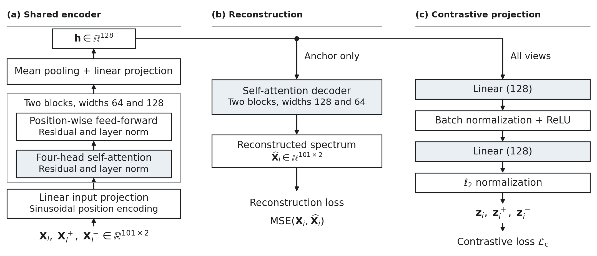

# Detecting Component Degradation Under Variable Load From Buck Converter Frequency Responses

**Ignacio Martin-Salinas\*, Jose A. Belloch, Adrián Amor-Martín, Pablo Zumel, and Cristina Fernandez**  
*Department of Electronic Technology, Universidad Carlos III de Madrid, Av. de la Universidad 30, 28911 Leganés, Madrid, Spain*

## Abstract

Operating-load changes alter the small-signal frequency response of a dc–dc buck converter and can obscure spectral changes caused by component degradation. In a switched simulation benchmark with load resistance varying from $2$ to $8\,\Omega$, the central 95\% of healthy peak magnitudes spans approximately $8.5\,\mathrm{dB}$. We train a contrastive autoencoder with a self-attention encoder on healthy spectra and synthetic fault examples. The synthetic examples are generated by multiplying healthy complex spectra by fault-to-healthy transfer-function ratios from a state-space averaged model evaluated at nominal load. The method uses neither per-sweep load measurements nor labeled fault sweeps for training or threshold calibration. Across ten training seeds on a shared test split, the method achieves an F1 score of $0.9417 \pm 0.0128$ at a threshold set from healthy validation data and average precision of $0.9126 \pm 0.0308$ after adjustment to an assumed anomaly prevalence of $5\%$ (mean $\pm$ standard deviation). Recall is $89.6\%$ for isolated capacitor equivalent series resistance increases and $92.4\%$ for isolated inductor resistance increases, compared with $3.6\%$ and $4.8\%$ for raw nearest-neighbor scoring. In the noise sweep, mean F1 is $0.9160$ with simulated magnitude and phase jitter of $0.15\,\mathrm{dB}$ and $0.75^\circ$, respectively. Recall for isolated high-side switch degradation is $36.3\%$. The results establish performance on the simulated benchmark and motivate validation with hardware measurements.

## 1. Introduction

Component parameter drift can change the frequency response of a power converter before a loss of regulation is apparent. Relevant changes include capacitance loss and increased capacitor equivalent series resistance (ESR) [@wang2014capacitors; @zhao2021capacitors], as well as increases in metal–oxide–semiconductor field-effect transistor (MOSFET) on-resistance [@celaya2010mosfet; @dusmez2016sfra]. Frequency-response analysis (FRA) estimates the small-signal response to a perturbation. Digitally generated perturbations, such as pseudorandom binary sequences, can support plant identification through the converter's control and measurement channels [@dusmez2016sfra; @roinila2021frequency].

Load variation complicates interpretation of these responses. Increasing the load resistance of a buck converter reduces damping of the output filter. In the variable-load benchmark considered here, the 2.5th to 97.5th percentile range of healthy peak magnitudes is approximately $8.5\,\mathrm{dB}$. The resulting healthy responses overlap with responses caused by isolated increases in capacitor or inductor ESR. A detector that treats any large spectral displacement as a fault can therefore overlook these degradations while remaining sensitive to changes in load.

We propose a physics-informed contrastive autoencoder, CARLA-Transformer (SSA), for detecting component degradation from the complex control-to-output response. The training procedure multiplies each healthy spectrum by a fault-to-healthy ratio derived from a state-space averaged (SSA) model at nominal load. This provides synthetic negatives while retaining the healthy spectrum as the starting point. The self-attention encoder can combine information across frequencies, and a nearest-neighbor score is calibrated on healthy validation sweeps. Fig. 1 summarizes the method.

The study makes three contributions. First, it derives a conduction-loss model and quantifies its agreement with switched simulation at the simulated component values and loads. Second, it evaluates nominal-load ratio augmentation against reconstruction-only and heuristic-augmentation controls on a shared variable-load split. Third, it measures how simulated measurement jitter affects detection and compares that behavior with PCA.

**Figure 1.** Frequency-response monitoring under variable load. (a) Synchronous buck stage and frequency-response measurement channels. (b) An unmodified healthy sweep provides the anchor, Gaussian jitter and amplitude scaling form the positive view, and multiplication by the nominal-load transfer-function ratio produces the synthetic fault view. (c) The anomaly score is the mean distance to the five nearest healthy training embeddings. The decision threshold is the 97.5th percentile of healthy validation scores.

## 2. Related Work

Component-level condition monitoring includes capacitor parameter estimation [@wang2014capacitors; @zhao2021capacitors] and MOSFET on-resistance monitoring [@celaya2010mosfet]. Düşmez *et al.* demonstrated software FRA for tracking MOSFET degradation in a boost converter [@dusmez2016sfra]. Frequency-domain identification with pseudorandom excitation has also been studied for dc power distribution systems [@roinila2021frequency]. For buck converters, Zhao *et al.* estimated output capacitor ESR and capacitance from large-signal load-transient trajectories [@zhao2021bucktransient]. The present study addresses detection of departures from healthy broadband responses across multiple component parameters and operating loads.

One-class approaches score departures from healthy data using distances, fitted decision boundaries, or subspace residuals. Examples include nearest-neighbor distance, the one-class support vector machine (SVM), isolation forest, shrinkage Mahalanobis distance, and the principal component analysis (PCA) residual statistic [@cover1967knn; @scholkopf2001estimating; @liu2008isolation; @ledoit2004wellconditioned; @jackson1979control]. Reconstruction-based detectors similarly model healthy variation, but the reconstruction objective does not explicitly favor components of the spectrum that distinguish degradation from changing load.

Contrastive methods use the choice of positive and negative pairs to shape the representation [@oord2018representation; @chen2020simclr]. CARLA generates synthetic anomalies as one part of a framework for time-series anomaly detection [@darban2025carla]. We use the idea of synthetic negatives in a frequency-domain autoencoder, with a parametric circuit model determining their structure. The heuristic comparator in this study applies generic spectral corruptions within the same autoencoder. Its results characterize that comparator on FRA spectra.

## 3. Converter Model and Load Dependence

### 3.1. Operating Conditions

The synchronous buck converter operates at a nominal duty ratio $D=0.40$, input voltage $V_{\mathrm{in}}=50\,\mathrm{V}$, and switching frequency $f_s=100\,\mathrm{kHz}$. Table 1 gives the nominal parameters and prescribed simulation intervals for the variable-load benchmark. The fixed-load benchmark uses $R_{\mathrm{out}}=4\,\Omega$. The variable-load benchmark spans $2$–$8\,\Omega$, equivalent to approximately $2.5$–$10\,\mathrm{A}$ at the ideal output voltage of $20\,\mathrm{V}$.

**Table 1. Variable-load simulation parameters.**

| Parameter (unit) | Nominal | Healthy | Fault |
| --- | ---: | ---: | ---: |
| $C_{\mathrm{out}}$ ($\mu\mathrm{F}$) | 100 | 80–120 | 30–70 |
| $\mathrm{ESR}_C$ ($\mathrm{m}\Omega$) | 20 | 10–40 | 60–160 |
| $L_{\mathrm{out}}$ ($\mu\mathrm{H}$) | 200 | 160–240 | 80–140 |
| $\mathrm{ESR}_L$ ($\mathrm{m}\Omega$) | 100 | 85–140 | 200–600 |
| $R_{\mathrm{ds},1}$ ($\mathrm{m}\Omega$) | 10 | 10–22 | 30–150 |
| $R_{\mathrm{out}}$ ($\Omega$) | 4 | 2–8 | 2–8 |

Fault intervals apply to degraded components. Load varies in both classes.

In the ideal buck model, the coefficient of $s$ in the monic denominator includes $1/(R_{\mathrm{out}} C_{\mathrm{out}})$, so changing $R_{\mathrm{out}}$ primarily changes resonance damping. The nominal undamped $LC$ frequency and capacitor ESR zero are
$$
\begin{aligned}
f_0 &= \frac{1}{2\pi\sqrt{L_{\mathrm{out}}^{(0)}C_{\mathrm{out}}^{(0)}}}
       \approx 1.125\,\mathrm{kHz}, \\
f_z &= \frac{1}{2\pi C_{\mathrm{out}}^{(0)}\mathrm{ESR}_C^{(0)}}
       \approx 79.6\,\mathrm{kHz}.
\end{aligned}
$$
Superscript $(0)$ denotes nominal values. Reducing the capacitance or inductance raises the undamped frequency, while increasing capacitor ESR moves its zero toward the measured band.

The simulated dead time is $100\,\mathrm{ns}$ and the nominal low-side on-resistance is $10\,\mathrm{m}\Omega$. Each sweep contains $N_f=101$ logarithmically spaced points from $100\,\mathrm{Hz}$ to $50\,\mathrm{kHz}$. The upper endpoint is half the switching frequency. Healthy component tolerances and variable load were sampled using Latin hypercube sampling [@mckay1979comparison]. The fault intervals are separated from the healthy intervals by design. At the lightest load and minimum specified inductance of $80\,\mu\mathrm{H}$, the ideal peak-to-peak inductor ripple is about $1.50\,\mathrm{A}$, giving an estimated valley current of $1.75\,\mathrm{A}$. This estimate supports the continuous-conduction-mode assumption over the specified range.

### 3.2. Averaged Control-to-Output Response

We use continuous-conduction state-space averaging [@middlebrook1976general; @erickson2001fundamentals]. For compactness, write $R=R_{\mathrm{out}}$, $L=L_{\mathrm{out}}$, $C=C_{\mathrm{out}}$, and $r_C=\mathrm{ESR}_C$. The averaged series resistance and the steady-state inductor current are
$$
\begin{aligned}
R_s &= \mathrm{ESR}_L + D R_{\mathrm{ds},1} + (1-D)R_{\mathrm{ds},2},\\
I_L &= DV_{\mathrm{in}}/(R+R_s),
\end{aligned}
$$
where $R_{\mathrm{ds},1}$ and $R_{\mathrm{ds},2}$ are the high- and low-side on-resistances. Linearizing the term $dV_{\mathrm{in}}-R_s(d)i_L$ about $(D,I_L)$ gives the duty-to-switch-node gain $V_{\mathrm{eff}}=V_{\mathrm{in}}-I_L(R_{\mathrm{ds},1}-R_{\mathrm{ds},2})$. The parallel combination of $R$ and the lossy capacitor has impedance $Z_p(s)=R(1+sCr_C)/(1+sC(R+r_C))$. Substituting it into the voltage divider $V_{\mathrm{eff}} Z_p(s)/(sL+R_s+Z_p(s))$ gives
$$
\tag{5}
G_{vd}(s;\boldsymbol{\theta},R)
=\frac{V_{\mathrm{eff}} R(1+sCr_C)}
{a_0+a_1s+a_2s^2},
$$
with
$$
\begin{aligned}
a_0 &= R+R_s,\\
a_1 &= L+C[R_s(R+r_C)+Rr_C],\\
a_2 &= LC(R+r_C).
\end{aligned}
$$
The vector $\boldsymbol{\theta}$ collects the component parameters. The simulator includes switching dead time. Equation (5) averages the two conducting subintervals and has no separate dead-time term.

Fig. 2(a) shows the healthy response envelope and representative degraded responses. Increasing $\mathrm{ESR}_L$ or $R_{\mathrm{ds},1}$ decreases the low-frequency gain and changes damping. Increasing $\mathrm{ESR}_C$ also changes the zero and therefore affects the upper portion of the measured band. Fig. 2(b) illustrates these differences using the nominal-load ratios used for augmentation.

For each sweep, model discrepancy is the Euclidean norm of the complex response difference divided by the norm of the switched response, expressed as a percentage. Across the 800 variable-load sweeps, the median discrepancy was $14.874\%$ when the model assumed a fixed $4\,\Omega$ load and $4.033\%$ for the textbook approximation using the true simulated load and $G_{vd}(0)=V_{\mathrm{in}}$. The conduction-loss model evaluated at the simulated loads gave a median discrepancy of $0.0952\%$ (95th percentile $0.1360\%$, maximum $0.2614\%$). Its median discrepancy over 4,723 fixed-load sweeps was $0.0917\%$ [Fig. 2(c)]. These comparisons concern the plant response with known simulation inputs. The nominal-load augmentation in Section 4.2 uses no such per-sweep information.

**Figure 2.** Load dependence and averaged-model agreement. (a) Healthy response envelope and two single-fault responses from switched variable-load simulations ($\mathrm{ESR}_L$ increased by $120\%$ and $R_{\mathrm{ds},1}$ by $362\%$). The shaded frequency band covers the filter resonance. (b) Illustrative fault-to-healthy ratios from the averaged model at $4\,\Omega$. (c) Median relative complex response error against switched simulations. Black markers indicate 95th percentiles.

### 3.3. Sensitivity to Switch On-Resistance

The switched model used in this study produced nearly identical spectra when the low-side on-resistance was varied. We therefore set the effective $R_{\mathrm{ds},2}$ to zero in the analytical comparisons and exclude low-side degradation from the detection benchmark. This convention applies to the simulated switch configuration. In physical hardware, low-side channel and body-diode conduction depend on gate timing, channel resistance, and current.

At $D=0.40$, the high-side fault interval corresponds to an $8$–$56\,\mathrm{m}\Omega$ increase in $R_s$. This range partly overlaps the healthy variation in inductor ESR (changes of $-15$ to $+40\,\mathrm{m}\Omega$ relative to nominal). The high-side switch also affects $V_{\mathrm{eff}}$, but both parameters can produce similar changes in low-frequency gain and damping in the presence of variable load. This overlap makes isolated high-side faults difficult to detect in the benchmark. It does not yield a numerical upper bound on recall.

## 4. Physics-Informed Contrastive Autoencoder

### 4.1. Complex Spectral Representation

Let $M_{ik}$ and $\phi_{ik}$ denote the magnitude in decibels and the phase in degrees for sweep $i$ at angular frequency $\omega_k=2\pi f_k$. We convert the polar measurements to complex form and then retain their Cartesian components
$$
\begin{aligned}
H_i(j\omega_k) &= 10^{M_{ik}/20}\exp(j\pi\phi_{ik}/180), \\
\widetilde{\mathbf X}_{ik}
 &= \big[\operatorname{Re}H_i(j\omega_k),\,
          \operatorname{Im}H_i(j\omega_k)\big].
\end{aligned}
$$
This representation avoids a discontinuity at the phase wrap. Each real and imaginary feature is standardized separately at each frequency using the mean and standard deviation of the healthy training sweeps. The same statistics are used for augmented, validation, and test spectra.

### 4.2. Nominal-Load Transfer-Ratio Augmentation

For a positive view, we perturb the standardized anchor with zero-mean Gaussian noise of standard deviation $0.01$ times the standard deviation of the anchor across bins and channels. We then multiply the perturbed view by a factor drawn uniformly from $[0.98,1.02]$. For each negative view, we sample one of the five fault modes uniformly and draw its component multiplier uniformly within the fault interval in Table 1. The severity vector $\boldsymbol{\alpha}$ applies this multiplier to the selected nominal component and leaves the others at nominal values. With $R^{(0)}=4\,\Omega$ and elementwise multiplication denoted by $\odot$, the construction is
$$
\begin{aligned}
\Gamma_{\boldsymbol{\alpha}}(j\omega_k) &=
\frac{G_{vd}(j\omega_k;\boldsymbol{\alpha}\odot\boldsymbol{\theta}^{(0)},R^{(0)})}
     {G_{vd}(j\omega_k;\boldsymbol{\theta}^{(0)},R^{(0)})},
\\
H_i^-(j\omega_k) &= H_i(j\omega_k)\Gamma_{\boldsymbol{\alpha}}(j\omega_k).
\end{aligned}
$$
We apply the transfer-ratio transformation in the complex plane before standardization. The healthy anchor contributes the spectrum at its own operating point, and the ratio introduces coupled magnitude and phase changes. For instance, an increase in $r_C$ moves the ESR zero while preserving the dc gain of the averaged model, and changes in $L$ or $C$ shift the poles. Because a fault's spectral effect can depend on load and component values, a ratio evaluated at nominal conditions is an approximation to the fault transformation at an arbitrary operating point.

### 4.3. Encoder, Decoder, and Projection

The encoder treats the 101 frequency bins as an ordered sequence of two-channel tokens (Fig. 3). A linear input projection with sinusoidal positional encoding is followed by two self-attention blocks with widths 64 and 128 and four heads per block [@vaswani2017attention]. The attention and feed-forward sublayers use residual connections and layer normalization. The feed-forward widths are 256 and 512, with rectified linear activations and no dropout. Global average pooling followed by a linear layer produces the 128-dimensional representation $\mathbf h=f(\mathbf X)$.

The decoder $g$ reconstructs the healthy input from $\mathbf h$ using two self-attention blocks of widths 128 and 64. A separate projection head $p$ uses two 128-unit dense layers with batch normalization and a rectified linear activation between them, followed by $\ell_2$ normalization [@chen2020simclr]. Its output is the unit-length vector $\mathbf z=p(\mathbf h)$ used for contrastive training and test scoring.

**Figure 3.** Contrastive autoencoder architecture. (a) A shared self-attention encoder maps the 101 two-channel frequency tokens of each view to a 128-dimensional latent vector. (b) The decoder reconstructs healthy anchors during training. (c) The projection head maps all training views to unit-length embeddings. The embeddings support contrastive training and nearest-neighbor scoring at inference.

### 4.4. Training Objective and Decision Rule

For each batch of $B$ healthy anchors, the encoder produces projections $\mathbf z_i$, $\mathbf z_i^+$, and $\mathbf z_i^-$ for the anchors and their positive and synthetic negative views, respectively. Define $u(\mathbf z,\mathbf v)=\exp(\mathbf z^\top\mathbf v/T)$ with temperature $T=0.10$. The contrastive term compares each anchor with its paired positive and one synthetic negative [@oord2018representation].
$$
\begin{aligned}
Z_i &= u(\mathbf z_i,\mathbf z_i^+)+u(\mathbf z_i,\mathbf z_i^-),\\
\mathcal L_{\mathrm c}
 &= -\frac{1}{B}\sum_{i=1}^B\log\frac{u(\mathbf z_i,\mathbf z_i^+)}{Z_i}.
\end{aligned}
$$
The training objective is $5\mathcal L_{\mathrm{rec}}+0.5\mathcal L_{\mathrm c}$, where $\mathcal L_{\mathrm{rec}}$ is the mean squared reconstruction error over the elements of healthy anchor spectra. We use Adam with batch size 64 and a learning rate of $5\times10^{-5}$ for up to 150 epochs. We select the checkpoint by loss on healthy validation sweeps and their augmented views, with an early-stopping patience of 25 epochs.

At inference, the encoder and projection head produce the query embedding $\mathbf z$. Let $\mathcal N_5(\mathbf z)$ denote its five nearest neighbors among the healthy training embeddings. The anomaly score is
$$
a(\mathbf X)=\frac{1}{5}\sum_{\mathbf v\in\mathcal N_5(\mathbf z)}
\|\mathbf z-\mathbf v\|_2.
$$
A query is flagged if its score exceeds the empirical 97.5th percentile of the scores on the healthy validation split. We denote the corresponding test F1 by $\mathrm{F1}_{0.975}$. The threshold targets a nominal validation exceedance rate of $2.5\%$. Test false-alarm rates depend on the calibration sample and the operating distribution.

## 5. Experimental Design

### 5.1. Simulation Benchmarks

Both benchmarks use switched Altair PSIM ac sweeps of the converter described in Table 1. The archived fixed-load benchmark reports 4,723 sweeps. Its test subset contains 520 healthy and 666 faulty sweeps after excluding cases with only low-side switch degradation.

The variable-load benchmark contains 500 healthy and 300 faulty sweeps, including 161 single-component and 139 compound faults. A fixed stratified split (seed 102) assigns 300 healthy sweeps to training, 100 to validation, and 100 to testing. Of the faulty sweeps, 90 are reserved for the supervised reference and 210 are held out for testing. The latter comprise 23 capacitance, 28 capacitor ESR, 22 inductance, 21 inductor ESR, 19 high-side switch, and 97 compound faults. The one-class and self-supervised detectors use healthy validation data for checkpoint selection, where applicable, and threshold calibration. The 90 labeled fault sweeps are used only by the supervised reference.

### 5.2. Baselines and Controls

Classical baselines operate on 202 standardized Cartesian features. They include Euclidean $k$-nearest neighbors ($k=1,5$), a radial-basis one-class SVM ($\nu=0.05$), an isolation forest (200 trees), Mahalanobis distance with ridge regularization ($10^{-6}$) or Ledoit–Wolf covariance shrinkage, and PCA reconstruction residuals. PCA ranks selected using performance on labeled test faults are reported as retrospective references. A histogram gradient-boosting classifier uses 400 healthy sweeps from training and fit-validation, plus the 90 labeled fit-validation faults. Its probability threshold is 0.5.

The ten-seed Transformer ablation compares reconstruction-only training with either reconstruction-error or latent nearest-neighbor scoring, contrastive training with heuristic negatives, and contrastive training with SSA-ratio negatives. The heuristic sampler includes spectral spikes, dropouts, resonance shifts, and empirical component-specific perturbations applied to the standardized channels. The contrastive comparisons share the same architecture and nearest-neighbor scoring on the normalized projections. In the figures, AE and MSE denote the autoencoder and mean squared error, respectively.

### 5.3. Metrics, Simulated Noise, and Paired Comparisons

F1 and per-fault recall are evaluated at the stated validation thresholds. F1 is computed at the test benchmark's class balance, which is $210/310$ faulty for the variable-load split. To compare ranking performance at a lower assumed anomaly prevalence $\pi=0.05$, we adjust precision using test true- and false-positive rates (TPR and FPR) [@davis2006relationship; @saito2015precision]:
$$
\operatorname{Prec}_{\pi} =
\frac{\pi\operatorname{TPR}}
{\pi\operatorname{TPR}+(1-\pi)\operatorname{FPR}}.
$$
We report prevalence-adjusted average precision ($\mathrm{AP}_{0.05}$), which summarizes the adjusted precision–recall curve by weighting precision by the increments in recall. This calculation assumes the class-conditional score distributions are retained at the target prevalence. We also report the area under the receiver operating characteristic curve (ROC AUC).

For the noise study, we add zero-mean Gaussian jitter to the magnitude in decibels and phase in degrees before Cartesian conversion. Noise draws are independent across sweeps and frequency bins and use separate draws for training, validation and test spectra. The magnitude standard deviations are $0$, $0.05$, $0.10$, $0.15$, $0.25$, $0.40$, and $0.60\,\mathrm{dB}$, paired with phase standard deviations from $0^\circ$ to $3.00^\circ$ at $5^\circ$ per decibel. At each level, the threshold uses healthy validation spectra with the corresponding noise condition. The Transformer weights remain fixed. Its reference bank is rebuilt from healthy training sweeps perturbed at the corresponding level. The comparison detectors retain their clean-data fits except for PCA when explicitly refitted on noisy training spectra.

Results across seeds are summarized by the mean and standard deviation (SD). These SDs describe variability over runs on the shared split. The Transformer ablations pair initial weights by seed. We use an exact two-sided paired sign-flip test on F1 differences, with a minimum attainable $p$-value of $2/2^{10}=0.001953$.

## 6. Results

### 6.1. Detection Under Variable Load

At fixed load, raw nearest-neighbor scoring ($k=1$) achieves $\mathrm{F1}_{0.975}=0.9244$. The same scorer gives $0.7134$ on the variable-load benchmark. The cohorts differ in size and composition, so the score difference does not isolate the effect of load.

Table 2 compares the detectors on the variable-load split. The SSA-ratio model achieves $\mathrm{F1}_{0.975}=0.9417\pm0.0128$, $\mathrm{AP}_{0.05}=0.9126\pm0.0308$, and ROC AUC of $0.9740\pm0.0064$. Across ten seeds it flags 0 to 6 of the 100 healthy test sweeps. The supervised reference achieves similar F1 ($0.9340$) and higher adjusted AP ($0.9322$).

Raw 5-NN recalls $3.6\%$ of isolated capacitor ESR faults and $4.8\%$ of isolated inductor ESR faults. Ledoit–Wolf Mahalanobis scoring reaches $71.4\%$ and $66.7\%$, respectively. The corresponding recalls for SSA negatives are $(89.6\pm7.2)\%$ and $(92.4\pm4.0)\%$. The SSA-ratio model detects $100.0\%$ of isolated capacitance faults, $91.8\%$ of isolated inductance faults, and $97.4\%$ of compound faults on average. For isolated high-side switch degradation, mean recall is $(36.3\pm10.4)\%$.

**Table 2. Detection performance under variable load.**

| Detector | $\mathrm{F1}_{0.975}$ | $\mathrm{AP}_{0.05}$ |
| --- | ---: | ---: |
| One-class SVM | 0.6892 | 0.5434 |
| Raw $k$-NN ($k=5$) | 0.7112 | 0.6268 |
| Mahalanobis (ridge) | 0.7638 | 0.7086 |
| Isolation forest | 0.8347 | 0.7289 |
| Mahalanobis (Ledoit–Wolf) | 0.8992 | 0.7874 |
| PCA (99% variance, rank 4) | 0.7493 | 0.6602 |
| Transformer, SSA negatives | $0.9417\pm0.0128$ | $0.9126\pm0.0308$ |
| Supervised gradient boosting | 0.9340 | 0.9322 |

Transformer results are mean $\pm$ SD over ten seeds. Only the supervised reference uses fault labels for training. Its F1 uses a threshold of 0.5.

### 6.2. Effect of the Training Objective and Negative Samples

Fig. 4 compares training regimes across ten paired seeds. Reconstruction scoring gives mean F1 of $0.7540$ and detects $13.2\%$ of isolated capacitor ESR faults and $9.5\%$ of isolated inductor ESR faults. Nearest-neighbor scoring on the reconstruction-only latent representation gives mean F1 of $0.7090$. Contrastive training with heuristic negatives gives mean F1 of $0.6868$.

**Figure 4.** Ranking performance and training ablation on the variable-load benchmark. (a) Precision–recall curves adjusted to an assumed anomaly prevalence of $5\%$. AP is average precision. For a neural comparator, the curve is the run at the upper median of its ten AP values. The legend summarizes all seeds. The PCA curve uses a retrospectively selected rank of 10. (b) F1 at the healthy validation 97.5th percentile and prevalence-adjusted AP for the ten paired training runs. Bars show means, error bars show SDs, and dots give individual runs.

The SSA-ratio model improves mean F1 by $0.188$ to $0.255$ across the three comparisons and has higher F1 in all ten paired runs ($p=0.00195$ per comparison, unadjusted). The comparison with heuristic negatives holds the encoder and scorer fixed, isolating the effect of the negative sampler for this configuration. The reconstruction comparisons also change the training objective or scorer.

### 6.3. Sensitivity to Simulated Measurement Noise

The PCA rank sweep [Fig. 5(a)] shows why the selection rule matters. Retaining $95\%$, $99\%$, or $99.5\%$ of healthy variance gives ranks 3, 4, and 5 and respective F1 scores of $0.7229$, $0.7493$, and $0.7347$. Selecting rank using labeled test performance reaches $0.9584$ at rank 8 under clean conditions. This retrospective score describes sensitivity to the rank choice.

**Figure 5.** PCA rank and simulated measurement noise. (a) F1 as a function of retained PCA rank under clean conditions and at magnitude and phase jitter of $0.15\,\mathrm{dB}$ and $0.75^\circ$. The horizontal lines show the corresponding SSA-ratio Transformer scores. (b) F1 across seven paired jitter levels. The shaded band is one SD across ten Transformer seeds. The PCA reference ranks were selected retrospectively.

In the seven-level sweep [Fig. 5(b)], at $0.15\,\mathrm{dB}$ and $0.75^\circ$ jitter the clean-trained Transformer gives F1 of $0.9160\pm0.0138$. At this level rank-8 PCA gives $0.7967$ with a clean fit and $0.8177$ when refitted on noisy healthy spectra. The matched level in the rank sweep uses separate noise draws and yields Transformer F1 of $0.9284\pm0.0154$. At the highest tested jitter ($0.60\,\mathrm{dB}$ and $3.00^\circ$), Transformer mean F1 drops to $0.7695$. These comparisons characterize sensitivity under the specified jitter model.

## 7. Discussion

The study evaluates detection of prescribed parameter deviations in a synchronous buck converter with resistive loads in continuous conduction. The nominal-load ratio makes training possible without per-sweep load measurements, but its approximation error for a specific fault at an unknown load is not measured by the plant-response fidelity comparison. The prescribed healthy and degraded intervals for each parameter are separated. Performance for parameter values between these intervals remains to be measured.

The reported uncertainty captures variation over training seeds on one split. Performance across hardware units, independently generated splits, and field load distributions remains to be measured.

All evaluated spectra are simulated open-loop plant responses. The injected magnitude and phase jitter probes one source of acquisition uncertainty. In regulated hardware, plant identification depends on the excitation and feedback paths, particularly at low frequencies, and can be affected by timing delays, quantization, interference, and temperature-dependent parasitics [@roinila2021frequency]. The findings also leave open the effects of nonlinear or discontinuous-conduction operating regimes. A hardware study would be needed to establish acquisition repeatability, diagnostic performance, and embedded latency under those conditions.

## 8. Conclusion

An autoencoder with physics-informed contrastive augmentation improved detection of isolated capacitor and inductor ESR increases in simulated buck converter responses under variable load. The augmentation uses nominal-load transfer-function ratios and requires no load measurement for an individual sweep. Mean F1 on the variable-load test split was $0.9417$ with healthy-only threshold calibration and $0.9160$ at $0.15\,\mathrm{dB}$ and $0.75^\circ$ in the simulated noise sweep. Isolated high-side switch degradation remained difficult to detect. The practical value of these results depends on whether they transfer to hardware-acquired spectra under normal operating variation.

## Data and Code Availability

The experiment code and summary results are archived in the [code repository](https://github.com/igmsalinas/fault-converters-code/tree/9e13ccdd263346e2eadd15102fe096393a64d38a). The variable-load sweeps, manifest, split, and saved run artifacts are archived in the [data repository](https://github.com/igmsalinas/fault-converters-data/tree/4950ecf604fab8b63395201b2d4a28af88fae8e8). Access requires repository permissions. Large artifacts use Git LFS. The fixed-load results are available as saved outputs, and the raw fixed-load cohort remains to be archived.

## Acknowledgment

This work was supported by the Department of Electronic Technology at Universidad Carlos III de Madrid, Leganés, Spain.
