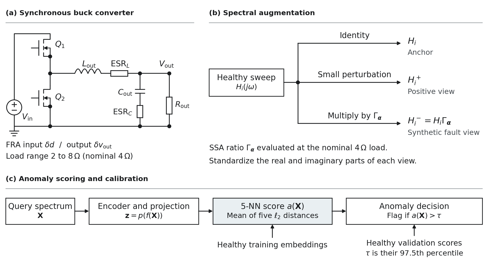
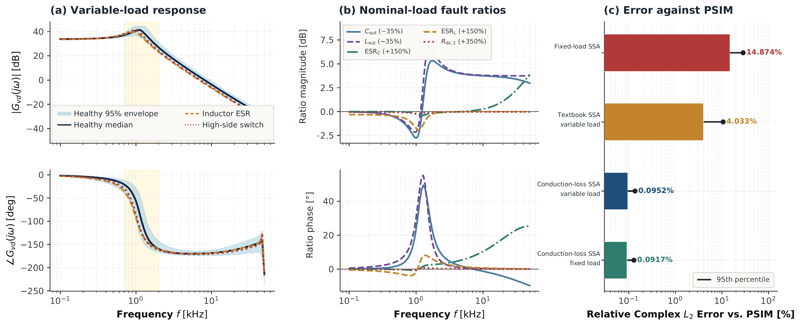
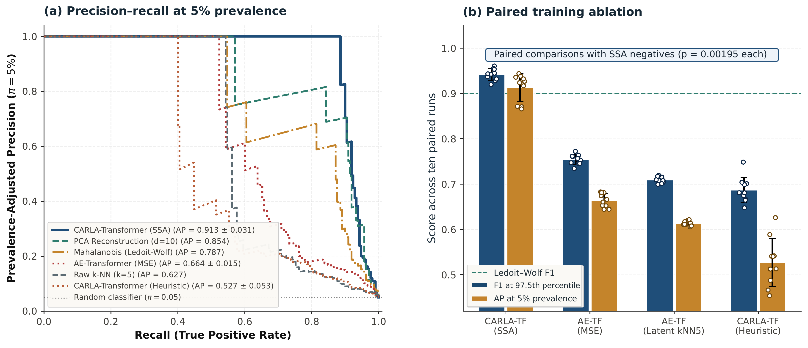

# Detecting Component Degradation Under Variable Load From Buck Converter Frequency Responses

**Ignacio Martin-Salinas\*, Jose A. Belloch, Adrián Amor-Martín, Pablo Zumel, and Cristina Fernandez**  
*Department of Electronic Technology, Universidad Carlos III de Madrid, Av. de la Universidad 30, 28911 Leganés, Madrid, Spain*

## Abstract

Load variation changes the small-signal frequency response of a buck converter and can mask the effects of component degradation. In a switched-simulation benchmark with load resistances from $2$ to $8\,\Omega$, the central 95\% of healthy peak magnitudes spans $8.5\,\mathrm{dB}$. We train a contrastive autoencoder on healthy spectra and synthetic fault views obtained by applying transfer-function ratios from a state-space-averaged model at nominal load. Training and validation anchors are healthy sweeps, and the detector takes a frequency response as its only input. Across ten training seeds evaluated on one held-out split, the mean F1 score is $0.9417\pm0.0128$ and average precision adjusted to an assumed fault prevalence of $5\%$ is $0.9126\pm0.0308$ (mean $\pm$ standard deviation). Mean recall is $89.6\%$ for isolated increases in capacitor equivalent series resistance (ESR) and $92.4\%$ for isolated increases in inductor ESR, compared with $3.6\%$ and $4.8\%$ for five-nearest-neighbor scoring on the input spectra. Mean F1 is $0.9160$ with simulated magnitude and phase jitter of standard deviations $0.15\,\mathrm{dB}$ and $0.75^\circ$, respectively. Mean recall for isolated increases in high-side switch on-resistance is $36.3\%$. These results characterize detection on a simulated benchmark and motivate validation with measured responses.

## 1. Introduction

The frequency response of a power converter can change as its components degrade. Examples include capacitance loss, an increase in capacitor equivalent series resistance (ESR), and an increase in the on-resistance of a metal--oxide--semiconductor field-effect transistor (MOSFET) [@wang2014capacitors; @zhao2021capacitors; @celaya2010mosfet; @dusmez2016sfra]. Frequency-response analysis (FRA) estimates the small-signal response to an applied perturbation. Digitally generated perturbations, including pseudorandom binary sequences, can support plant identification through the converter's control and measurement channels [@shirazi2009autotuning; @roinila2021frequency].

In a buck converter, increasing the load resistance reduces damping of the output filter. Across the healthy sweeps in our benchmark, the 2.5th and 97.5th percentiles of the peak magnitude differ by about $8.5\,\mathrm{dB}$. Responses to isolated component faults can overlap the healthy envelope over part of the measured band. This overlap makes the size of a spectral change an unreliable indicator of degradation.

We use a physics-informed contrastive autoencoder to detect component degradation from the complex control-to-output response (Fig. 1). During training, fault-to-healthy transfer-function ratios derived by state-space averaging (SSA) at nominal load generate synthetic negatives from healthy spectra. We refer to this detector as the SSA-ratio Transformer. It scores each query by its distance to nearby healthy training embeddings and sets the decision threshold using healthy validation sweeps.

We first quantify the agreement between the averaged model and switched simulations at known operating points. We then test the contribution of the nominal-load fault ratios on a shared variable-load split using reconstruction-only and heuristic-augmentation controls. Finally, we assess how simulated measurement noise affects detection, including its effect on principal component analysis (PCA) baselines.

**Figure 1.** Frequency-response analysis (FRA) and detection under variable load. (a) Synchronous buck stage with duty-ratio perturbation $\delta d$ and output-voltage response $\delta v_{\mathrm{out}}$. (b) Training views are the healthy anchor, its jittered and scaled positive, and a synthetic fault view obtained from the nominal-load state-space-averaged (SSA) transfer ratio. (c) The score is the mean distance to the five nearest healthy training embeddings (5-NN). The threshold $\tau$ is the 97.5th percentile of healthy validation scores.

## 2. Related Work

Düşmez *et al.* used software FRA to track MOSFET degradation in a boost converter [@dusmez2016sfra]. For buck converters, Zhao *et al.* estimated output capacitance and ESR from load transients, and Zhang *et al.* selected an injection frequency for online capacitance monitoring [@zhao2021bucktransient; @zhang2025injection]. Cen and Stewart used adaptive observers for fault isolation and parameter estimation [@cen2017condition]. A sensitivity study of a silicon-carbide buck converter linked output-voltage features to changes in switch and filter parameters [@toussi2020sensitivity]. Ou *et al.* used a physics-informed neural network to study differences in parameter identifiability [@ou2025parameter]. Our task is to detect abnormal broadband responses under variable load at the converter level.

One-class methods score departures from healthy data. Examples include nearest-neighbor and covariance-based distances, the one-class support vector machine (SVM), isolation forest, and PCA reconstruction residuals [@cover1967knn; @scholkopf2001estimating; @liu2008isolation; @ledoit2004wellconditioned; @jackson1979control]. Autoencoders model nonlinear structure in healthy data through reconstruction [@sakurada2014autoencoders]. Under variable load, training on reconstruction alone can preserve load-related spectral features that are irrelevant to fault detection.

Contrastive learning shapes representations through the choice of positive and negative pairs [@oord2018representation; @chen2020simclr]. Anomaly detectors have used transformations of normal data for a training classification task or contrasted normal views with deliberately shifted versions [@bergman2020goad; @tack2020csi]. We adapt the synthetic-negative strategy of CARLA, a contrastive representation learning method for time-series anomaly detection [@darban2025carla]. Our heuristic control applies generic spectral corruptions in the same autoencoder used for the transfer-ratio augmentation.

## 3. Converter Model and Load Dependence

### 3.1. Operating Conditions

The synchronous buck converter operates at a nominal duty ratio $D=0.40$, with input voltage $V_{\mathrm{in}}=50\,\mathrm{V}$ and switching frequency $f_s=100\,\mathrm{kHz}$. Table 1 lists the nominal parameter values and sampling intervals. The fixed-load benchmark uses $R_{\mathrm{out}}=4\,\Omega$. The variable-load benchmark samples a resistive load from $2$ to $8\,\Omega$, corresponding to an ideal steady-state output current of $2.5$ to $10\,\mathrm{A}$ at $20\,\mathrm{V}$.

**Table 1. Variable-load simulation parameters.**

| Parameter (unit) | Nominal | Healthy | Fault |
| --- | ---: | ---: | ---: |
| $C_{\mathrm{out}}$ ($\mu\mathrm{F}$) | 100 | 80–120 | 30–70 |
| $\mathrm{ESR}_C$ ($\mathrm{m}\Omega$) | 20 | 10–40 | 60–160 |
| $L_{\mathrm{out}}$ ($\mu\mathrm{H}$) | 200 | 160–240 | 80–140 |
| $\mathrm{ESR}_L$ ($\mathrm{m}\Omega$) | 100 | 85–140 | 200–600 |
| $R_{\mathrm{ds},1}$ ($\mathrm{m}\Omega$) | 10 | 10–22 | 30–150 |
| $R_{\mathrm{out}}$ ($\Omega$) | 4 | 2–8 | 2–8 |

Fault intervals apply to degraded components. Load varies in both classes.

In the ideal buck model, the coefficient of $s$ in the monic denominator includes $1/(R_{\mathrm{out}} C_{\mathrm{out}})$, so the load resistance affects the damping of the output filter. The nominal undamped $LC$ frequency and the capacitor ESR zero are
$$
\begin{aligned}
f_0 &= \frac{1}{2\pi\sqrt{L_{\mathrm{out}}^{(0)}C_{\mathrm{out}}^{(0)}}}
       \approx 1.125\,\mathrm{kHz}, \\
f_z &= \frac{1}{2\pi C_{\mathrm{out}}^{(0)}\mathrm{ESR}_C^{(0)}}
       \approx 79.6\,\mathrm{kHz}.
\end{aligned}
$$
Superscript $(0)$ denotes nominal values. Reducing the capacitance or inductance raises the undamped frequency, while increasing capacitor ESR moves its zero toward the measured band.

The switched model uses $100\,\mathrm{ns}$ of dead time and a nominal low-side on-resistance of $10\,\mathrm{m}\Omega$. Each sweep contains $N_f=101$ logarithmically spaced frequencies from $100\,\mathrm{Hz}$ to $50\,\mathrm{kHz}$, half the switching frequency. Latin hypercube sampling covers the healthy component and load intervals [@mckay1979comparison]. For each fault mode, the degraded component's sampling interval is disjoint from its healthy interval. At $8\,\Omega$ and the minimum simulated inductance of $80\,\mu\mathrm{H}$, the ideal inductor ripple is $1.50\,\mathrm{A}$ peak to peak and the estimated valley current is $1.75\,\mathrm{A}$. This positive valley current supports the continuous-conduction assumption over the simulated range.

### 3.2. Averaged Control-to-Output Response

We derive the small-signal control-to-output transfer function $G_{vd}(s)$ from the continuous-conduction averaged model [@middlebrook1976general; @erickson2001fundamentals]. Here, $s$ is the Laplace variable, $R=R_{\mathrm{out}}$, $L=L_{\mathrm{out}}$, $C=C_{\mathrm{out}}$, and $r_C=\mathrm{ESR}_C$. The averaged series resistance and steady-state inductor current are
$$
\begin{aligned}
R_s &= \mathrm{ESR}_L + D R_{\mathrm{ds},1} + (1-D)R_{\mathrm{ds},2},\\
I_L &= DV_{\mathrm{in}}/(R+R_s),
\end{aligned}
$$
where $R_{\mathrm{ds},1}$ and $R_{\mathrm{ds},2}$ are the high- and low-side on-resistances. Linearizing the term $dV_{\mathrm{in}}-R_s(d)i_L$ about $(D,I_L)$ gives the duty-to-switch-node gain $V_{\mathrm{eff}}=V_{\mathrm{in}}-I_L(R_{\mathrm{ds},1}-R_{\mathrm{ds},2})$. The parallel combination of $R$ and the lossy capacitor has impedance $Z_p(s)=R(1+sCr_C)/(1+sC(R+r_C))$. Substituting it into the voltage divider $V_{\mathrm{eff}} Z_p(s)/(sL+R_s+Z_p(s))$ gives
$$
\tag{5}
G_{vd}(s;\boldsymbol{\theta},R)
=\frac{V_{\mathrm{eff}} R(1+sCr_C)}
{a_0+a_1s+a_2s^2},
$$
with
$$
\begin{aligned}
a_0 &= R+R_s,\\
a_1 &= L+C[R_s(R+r_C)+Rr_C],\\
a_2 &= LC(R+r_C).
\end{aligned}
$$
The vector $\boldsymbol{\theta}$ collects the component parameters. The transfer function averages the two conducting intervals. The switched simulation also includes the dead-time interval.

Fig. 2(a) shows the healthy response envelope and two isolated faults. Increases in $\mathrm{ESR}_L$ or $R_{\mathrm{ds},1}$ reduce low-frequency gain and change damping. Higher $\mathrm{ESR}_C$ shifts the zero and affects the upper part of the measured band. Fig. 2(b) shows how these changes appear in the nominal-load ratios used for augmentation.

For a given sweep, we report the Euclidean norm of the difference between the complex averaged and switched responses, divided by the Euclidean norm of the switched response. The denominator and numerator use the same frequency grid. In the 800 variable-load sweeps, the median relative error was $14.874\%$ when the conduction-loss model used $4\,\Omega$ for every sweep. It was $4.033\%$ for the approximation with $G_{vd}(0)=V_{\mathrm{in}}$ at the simulated loads. With conduction losses and the actual simulated loads, the median was $0.0952\%$, the 95th percentile was $0.1360\%$, and the maximum was $0.2614\%$. The archived fixed-load assessment reports a median of $0.0917\%$ over 4,723 sweeps [Fig. 2(c)]. This aggregate can downweight relative discrepancies in low-gain parts of the band. Section 4.2 treats the nominal-load approximation used for augmentation separately.

**Figure 2.** Load dependence and averaged-model agreement. (a) Pointwise central 95\% envelope from the 300 healthy training sweeps, with two isolated faults from the switched simulation ($\mathrm{ESR}_L$ increased by $120\%$ and $R_{\mathrm{ds},1}$ by $362\%$). The shaded frequency band covers the filter resonance. (b) Transfer ratios for selected single-parameter perturbations at $4\,\Omega$. Training intervals are given in Table 1. (c) Median relative complex response error against switched simulation. Black markers show the 95th percentile across sweeps.

### 3.3. Sensitivity to Switch On-Resistance

Varying the low-side on-resistance produced nearly identical sweeps in the switched model. On that basis, we use an effective $R_{\mathrm{ds},2}=0$ in the averaged-model comparisons and in the augmentation model. The benchmark evaluates the other five fault modes. In hardware, current through the low-side channel and body diode depends on gate timing, device resistance, and inductor current.

At $D=0.40$, a high-side fault increases $R_s$ by $8$ to $56\,\mathrm{m}\Omega$ relative to nominal. Healthy variation in inductor ESR changes $R_s$ by $-15$ to $+40\,\mathrm{m}\Omega$. High-side resistance also affects $V_{\mathrm{eff}}$. The overlap in series resistance suggests why isolated high-side faults can be difficult to distinguish from healthy variation, especially when the load also changes.

## 4. Physics-Informed Contrastive Autoencoder

### 4.1. Complex Spectral Representation

Let $M_{ik}$ and $\phi_{ik}$ denote the magnitude in decibels and the phase in degrees for sweep $i$ at angular frequency $\omega_k=2\pi f_k$. We convert the polar measurements to complex form and then retain their Cartesian components
$$
\begin{aligned}
H_i(j\omega_k) &= 10^{M_{ik}/20}\exp(j\pi\phi_{ik}/180), \\
\widetilde{\mathbf X}_{ik}
 &= \big[\operatorname{Re}H_i(j\omega_k),\,
          \operatorname{Im}H_i(j\omega_k)\big].
\end{aligned}
$$
The Cartesian representation avoids discontinuities from wrapping the phase angle. We standardize the real and imaginary channels separately, using one mean and one standard deviation per channel computed over all frequencies and healthy training sweeps. We apply the same statistics to augmented, validation, and test inputs. The standardized input is denoted by $\mathbf X_i$.

### 4.2. Nominal-Load Transfer-Ratio Augmentation

For each anchor, we draw independent zero-mean Gaussian perturbations for the standardized entries. Their standard deviation is $0.01$ times the anchor's standard deviation across frequencies and channels. We then multiply the perturbed spectrum by one factor drawn uniformly from $[0.98,1.02]$. To generate a negative, we sample one of the five fault modes uniformly and draw a component multiplier uniformly from its fault interval in Table 1, relative to that component's nominal value. The vector $\boldsymbol{\alpha}$ contains the selected multiplier and ones for all other components. With nominal load $R^{(0)}=4\,\Omega$ and elementwise multiplication $\odot$, we define
$$
\begin{aligned}
\Gamma_{\boldsymbol{\alpha}}(j\omega_k) &=
\frac{G_{vd}(j\omega_k;\boldsymbol{\alpha}\odot\boldsymbol{\theta}^{(0)},R^{(0)})}
     {G_{vd}(j\omega_k;\boldsymbol{\theta}^{(0)},R^{(0)})},
\\
H_i^-(j\omega_k) &= H_i(j\omega_k)\Gamma_{\boldsymbol{\alpha}}(j\omega_k).
\end{aligned}
$$
We multiply the anchor spectrum by the nominal-load transfer ratio before standardizing the negative view. This retains the complex spectrum of the anchor as the starting point and applies a modeled change in magnitude and phase. For example, increasing $r_C$ moves the ESR zero while preserving the dc gain in this model, and changes in $L$ or $C$ shift the poles. The ratio approximates the effect of a fault at the anchor's unknown load and component values using nominal conditions.

### 4.3. Encoder, Decoder, and Projection

The encoder processes the 101 frequency bins as a sequence of two-channel tokens (Fig. 3). It applies a linear input projection and sinusoidal positional encoding, followed by two self-attention blocks of widths 64 and 128, each with four attention heads [@vaswani2017attention]. The attention and feed-forward sublayers use residual connections and layer normalization. The feed-forward layers have hidden widths 256 and 512 and use rectified linear units (ReLUs). The model uses no dropout. Global average pooling and a linear projection yield the 128-dimensional representation $\mathbf h=f(\mathbf X)$.

The decoder $g$ expands $\mathbf h$ into a sequence, adds sinusoidal positional encoding, and applies two self-attention blocks of widths 128 and 64. A linear projection produces the two reconstructed channels at each frequency. The separate projection head $p$ has two 128-unit dense layers with batch normalization and a ReLU between them [@chen2020simclr]. After $\ell_2$ normalization, the unit-length vector $\mathbf z=p(\mathbf h)$ is used for contrastive training and anomaly scoring.

**Figure 3.** Contrastive autoencoder. (a) The shared encoder maps each sequence of 101 two-channel frequency tokens to a 128-dimensional vector. (b) The decoder reconstructs the healthy anchor and is trained using mean squared error (MSE). (c) The projection head produces unit-length embeddings for contrastive learning and anomaly scoring. ReLU denotes the rectified linear unit.

### 4.4. Training Objective and Decision Rule

For a batch of $B$ healthy anchors, the shared encoder and projection head map the anchor, positive view, and synthetic negative to $\mathbf z_i$, $\mathbf z_i^+$, and $\mathbf z_i^-$, respectively. Define $u(\mathbf z,\mathbf v)=\exp(\mathbf z^\top\mathbf v/T)$ with temperature $T=0.10$. The contrastive loss compares each anchor with its paired positive and negative [@oord2018representation].
$$
\begin{aligned}
Z_i &= u(\mathbf z_i,\mathbf z_i^+)+u(\mathbf z_i,\mathbf z_i^-),\\
\mathcal L_{\mathrm c}
 &= -\frac{1}{B}\sum_{i=1}^B\log\frac{u(\mathbf z_i,\mathbf z_i^+)}{Z_i}.
\end{aligned}
$$
The training objective is $5\mathcal L_{\mathrm{rec}}+0.5\mathcal L_{\mathrm c}$. Here, $\mathcal L_{\mathrm{rec}}$ is the mean squared error (MSE) between the standardized anchors and their reconstructions. We train with Adam [@kingma2015adam] at a learning rate of $5\times10^{-5}$ for up to 150 epochs, with batches of up to 64 anchors. We use the loss on healthy validation sweeps and their fixed synthetic views to select the checkpoint. Training stops after 25 epochs without an improvement of at least $10^{-5}$.

At inference, the encoder and projection head produce the query embedding $\mathbf z$. Let $\mathcal N_5(\mathbf z)$ be its five nearest neighbors among the healthy training embeddings. The anomaly score is the mean Euclidean distance to these embeddings
$$
a(\mathbf X)=\frac{1}{5}\sum_{\mathbf v\in\mathcal N_5(\mathbf z)}
\|\mathbf z-\mathbf v\|_2.
$$
We flag a query if $a(\mathbf X)>\tau$, where $\tau$ is the empirical 97.5th percentile of scores on the healthy validation sweeps. We denote test F1 at this operating point by $\mathrm{F1}_{0.975}$. The corresponding nominal exceedance rate is $2.5\%$ on the calibration distribution. The observed test false-positive rate is reported separately.

## 5. Experimental Design

### 5.1. Simulation Benchmarks

Both benchmarks use frequency sweeps from switched Altair PSIM simulations of the converter in Table 1. The fixed-load comparison draws on an archived benchmark of 4,723 sweeps. The archived test subset contains 520 healthy and 666 faulty sweeps after excluding sweeps with only low-side switch degradation.

The variable-load benchmark contains 500 healthy sweeps and 300 faulty sweeps, including 161 isolated and 139 compound faults. A stratified split (seed 102) assigns 300 healthy sweeps to training, 100 to validation, and 100 to testing. Of the faulty sweeps, 90 are assigned to fit-validation for the supervised reference and 210 to testing. The faulty test sweeps comprise 23 isolated capacitance, 28 capacitor ESR, 22 inductance, 21 inductor ESR, 19 high-side switch, and 97 compound faults. The one-class detectors, including the contrastive autoencoder, use healthy validation sweeps for checkpoint selection where applicable and for threshold calibration.

### 5.2. Baselines and Controls

The classical baselines use 202 features obtained by flattening each standardized spectrum. They include Euclidean $k$-nearest-neighbor ($k$-NN) scores with $k=1$ and $k=5$, a radial-basis one-class SVM ($\nu=0.05$), an isolation forest (200 trees), Mahalanobis distance with ridge regularization ($10^{-6}$) or Ledoit–Wolf covariance shrinkage, and PCA reconstruction residuals. In the plots, raw $k$-NN refers to distances between standardized inputs. PCA ranks chosen using labeled test performance serve as retrospective references. The supervised reference is a histogram gradient-boosting classifier trained on 400 healthy sweeps from the training and validation partitions and the 90 labeled fit-validation faults. Its decision threshold is a predicted fault probability of 0.5.

The Transformer architecture comes from the fixed-load benchmark. All weights are fitted on the variable-load training split. The ablations compare reconstruction-only training scored by MSE or latent $k$-NN, contrastive training with heuristic negatives, and contrastive training with SSA-ratio negatives. The heuristic sampler applies generic spectral perturbations, including spikes, dropouts, resonance shifts, and empirical component-specific changes to the standardized channels. The two contrastive configurations share the encoder architecture and the same $k$-NN scoring rule in the normalized projection space.

### 5.3. Metrics, Simulated Noise, and Paired Comparisons

We report F1, the harmonic mean of precision and recall, at the specified decision thresholds. F1 uses the observed test-set balance, with 210 faulty sweeps out of 310 for variable load. Per-fault recall is the fraction of test sweeps of that fault type that are flagged. To summarize ranking at an assumed fault prevalence $\pi=0.05$, we adjust precision using the test true-positive rate (TPR) and false-positive rate (FPR) [@davis2006relationship; @saito2015precision].
$$
\operatorname{Prec}_{\pi} =
\frac{\pi\operatorname{TPR}}
{\pi\operatorname{TPR}+(1-\pi)\operatorname{FPR}}.
$$
Prevalence-adjusted average precision ($\mathrm{AP}_{0.05}$) weights the adjusted precision by the increase in recall at each score threshold. This calculation holds the class-conditional score distributions fixed as prevalence changes. We also report the area under the receiver operating characteristic curve (ROC AUC).

We add zero-mean Gaussian jitter to magnitude in decibels and phase in degrees before Cartesian conversion. We draw the perturbations independently across channels, sweeps, and frequency bins, with separate draws for the training, validation, and test partitions. We test magnitude standard deviations of $0$, $0.05$, $0.10$, $0.15$, $0.25$, $0.40$, and $0.60\,\mathrm{dB}$, with phase standard deviations scaled at $5^\circ$ per decibel. At each level, we retain the trained Transformer weights, rebuild its nearest-neighbor reference set from perturbed healthy training spectra, and recalibrate thresholds on perturbed healthy validation spectra. The comparison detectors retain their clean-data fits, except for the PCA variants refitted on perturbed training spectra. All ten Transformer checkpoints use the same perturbations at each level.

For neural models, we report the mean and sample standard deviation (SD) across ten seeds evaluated on the same test split. In the Transformer ablation, the initial weights are matched within each seed. For each comparison, a two-sided sign-flip test on the mean paired F1 difference enumerates all $2^{10}$ sign assignments. The test assumes exchangeable difference signs under the null hypothesis and is conditional on this split.

## 6. Results

### 6.1. Detection Under Variable Load

Table 2 compares the detectors on the variable-load test split. The SSA-ratio Transformer achieves $\mathrm{F1}_{0.975}=0.9417\pm0.0128$, $\mathrm{AP}_{0.05}=0.9126\pm0.0308$, and a ROC AUC of $0.9740\pm0.0064$ (mean $\pm$ SD). Across the ten seeds it flags between 0 and 6 of the 100 healthy test sweeps. The supervised reference attains F1 of $0.9340$ and adjusted average precision of $0.9322$.

For isolated capacitor and inductor ESR faults, $k$-NN on the input spectra ($k=5$) achieves recalls of $3.6\%$ and $4.8\%$, respectively. Ledoit–Wolf Mahalanobis scoring achieves $71.4\%$ and $66.7\%$. With SSA-ratio negatives, the mean recalls increase to $(89.6\pm7.2)\%$ and $(92.4\pm4.0)\%$. The same model detects $100.0\%$ of isolated capacitance faults, $91.8\%$ of isolated inductance faults, and $97.4\%$ of compound faults on average. Mean recall for isolated high-side switch faults is $(36.3\pm10.4)\%$.

As a fixed-load reference, nearest-neighbor scoring on the input spectra ($k=1$) gives $\mathrm{F1}_{0.975}=0.9244$, compared with $0.7134$ under variable load. Because the test cohorts differ in size and composition, this comparison is descriptive.

**Table 2. Detection performance under variable load.**

| Detector | F1 | $\mathrm{AP}_{0.05}$ |
| --- | ---: | ---: |
| One-class SVM | 0.6892 | 0.5434 |
| Raw $k$-NN ($k=5$) | 0.7112 | 0.6268 |
| Mahalanobis (ridge) | 0.7638 | 0.7086 |
| Isolation forest | 0.8347 | 0.7289 |
| Mahalanobis (Ledoit–Wolf) | 0.8992 | 0.7874 |
| PCA (99% variance, rank 4) | 0.7493 | 0.6602 |
| Transformer, SSA negatives | $0.9417\pm0.0128$ | $0.9126\pm0.0308$ |
| Supervised gradient boosting | 0.9340 | 0.9322 |

Transformer results are mean $\pm$ SD over ten seeds. The one-class detectors use the 97.5th percentile of healthy validation scores. The supervised detector uses a fault-probability threshold of 0.5.

### 6.2. Effect of the Training Objective and Negative Samples

Fig. 4 compares the training configurations across ten paired seeds. Scoring by MSE after reconstruction-only training gives mean F1 of $0.7540$ and mean recalls of $13.2\%$ and $9.5\%$ for isolated capacitor and inductor ESR faults. Scoring the reconstruction-only latent space with $k$-NN gives mean F1 of $0.7090$. Contrastive training with heuristic negatives gives mean F1 of $0.6868$.

**Figure 4.** Ranking and paired ablation under variable load. (a) Precision–recall curves adjusted to 5\% fault prevalence. Each neural curve represents the run at the upper median of ten average precision (AP) values. The legend gives mean $\pm$ standard deviation (SD) for neural models. The principal component analysis (PCA) curve uses the retrospectively selected rank of 10. (b) F1 at the healthy validation 97.5th percentile and prevalence-adjusted AP. Bars and error bars give mean $\pm$ SD over ten paired seeds. Dots show individual runs. AE-TF and CARLA-TF denote the reconstruction-only and contrastive Transformers, respectively. MSE denotes mean squared error. The $p$-values refer to unadjusted paired F1 tests.

With SSA-ratio negatives, F1 increases by $0.188$ to $0.255$ on average and is higher for all ten seeds in each paired comparison (two-sided $p=0.00195$ for each comparison, unadjusted). The comparison with heuristic negatives isolates the effect of the negative sampler for the tested architecture and scorer. The reconstruction-only controls also change the training objective and the input to the anomaly score.

### 6.3. Sensitivity to Simulated Measurement Noise

In Fig. 5(a), retaining $95\%$, $99\%$, or $99.5\%$ of the variance in healthy training data gives ranks 3, 4, and 5, with F1 scores of $0.7229$, $0.7493$, and $0.7347$, respectively. Retrospective rank selection using labeled test performance yields F1 of $0.9584$ at rank 8 on clean spectra. The gap between these results illustrates the sensitivity of PCA to rank selection.

**Figure 5.** Effect of principal component analysis (PCA) rank and simulated measurement noise on F1. (a) Results by PCA rank on clean spectra and with $0.15\,\mathrm{dB}$ magnitude and $0.75^\circ$ phase jitter, with the corresponding SSA-ratio Transformer scores as horizontal lines. (b) Results at seven jitter levels. Shading shows $\pm$ one standard deviation across ten Transformer seeds. LW denotes Ledoit–Wolf covariance shrinkage. Reference PCA ranks were selected retrospectively.

In the seven-level sweep [Fig. 5(b)], the Transformer trained on clean sweeps reaches $\mathrm{F1}_{0.975}=0.9160\pm0.0138$ at $0.15\,\mathrm{dB}$ magnitude jitter and $0.75^\circ$ phase jitter. At the same level, rank-8 PCA reaches $0.7967$ when fitted on clean spectra and $0.8177$ when refitted on noisy healthy spectra. The rank sweep in panel (a) uses a separate draw at the same noise level, giving Transformer F1 of $0.9284\pm0.0154$. At the highest tested noise level ($0.60\,\mathrm{dB}$ and $3.00^\circ$), the Transformer gives mean F1 of $0.7695$.

## 7. Discussion

The results support using modeled transfer ratios to generate negative views for this simulated buck converter. The matched-seed comparison with heuristic negatives provides evidence for the sampler under variable resistive load, with the largest practical gains in recall for the isolated ESR faults. The known-load agreement between averaged and switched responses addresses plant modeling. The accuracy of an individual synthetic fault view at an unknown operating point remains to be measured.

The evaluation covers one topology, predefined healthy and fault intervals, and one held-out split. The spread across seeds quantifies variability from training on this split. Intermediate degradation levels and performance across hardware units, independently generated cohorts, and different load distributions require separate evaluation.

The noise experiment quantifies sensitivity to independent Gaussian jitter under matched calibration. Hardware FRA introduces other effects, including timing errors, quantization, correlated interference, and temperature-dependent parasitics. Identification from a regulated converter also depends on the excitation and feedback paths [@roinila2021frequency]. Experiments on hardware are needed to establish acquisition repeatability and diagnostic performance under these conditions.

## 8. Conclusion

Nominal-load transfer-ratio augmentation improved detection of isolated capacitor and inductor ESR increases in simulated buck converter responses under variable load. With a threshold calibrated on healthy validation sweeps, the SSA-ratio Transformer achieved mean F1 of $0.9417$ on the held-out split and $0.9160$ with simulated magnitude and phase jitter of $0.15\,\mathrm{dB}$ and $0.75^\circ$. Isolated high-side switch degradation remained difficult to detect. Measurements on hardware are needed to assess whether these gains transfer to practical FRA.

## Data and Code Availability

The experiment code and summary results are publicly available in [fault-converters-code](https://github.com/igmsalinas/fault-converters-code). The [fault-converters-data](https://github.com/igmsalinas/fault-converters-data) repository contains the variable-load sweeps, manifest, split, and saved runs, as well as fixed-load evaluation records. Large data artifacts use Git LFS.

## Acknowledgment

This work was supported by the Department of Electronic Technology at Universidad Carlos III de Madrid, Leganés, Spain.
